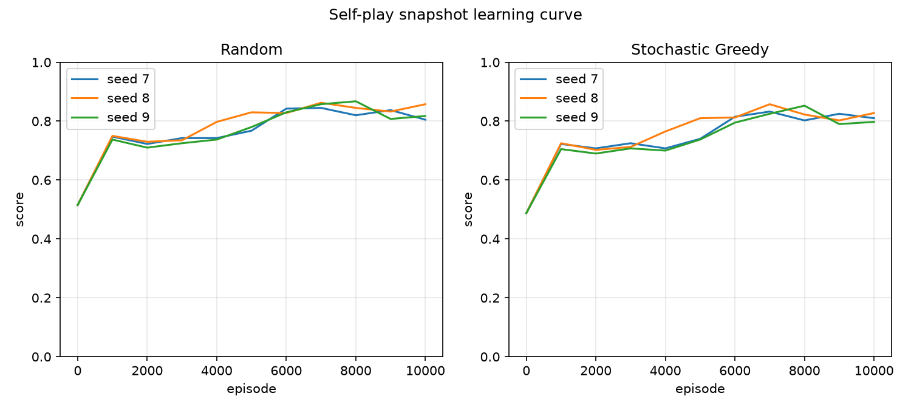

# RLCheckers

[](https://github.com/till75/RLCheckers/actions/workflows/ci.yml)

An AI learning project: applying reinforcement learning to a checkers AI, while
learning to co-author a program with opencode.

**Status:** the first milestone is complete and approved. The three-seed gate
passed. The project has the immutable 5x5 rules engine, seeded random play, the
depth-1 greedy baseline, the seeded evaluation arena, tabular Q-learning against
a fixed random opponent, self-play against periodic frozen snapshots, and the
three-seed gate. The gate trains three seeds, evaluates random and stochastic
greedy over 1,000 unique games, reports deterministic greedy and depth-2 as
unique-game diagnostics, and writes the slice report and learning-curve plot
under `docs/results/`. S7 is approved and pushed.

## First milestone result

The milestone asked for a headless, reproducible experiment showing that a
tabular agent learns to beat two fixed baselines on 5x5 English draughts. The
approved gate passed.

| Metric | Value | Threshold |
|---|---:|---:|
| Random mean | 0.830667 | 0.600000 |
| Random minimum | 0.818000 | 0.500000 |
| Stochastic greedy mean | 0.816833 | 0.550000 |
| Stochastic greedy minimum | 0.800500 | 0.500000 |

| Seed | Table size | Random W/D/L | Random score | Stochastic greedy W/D/L | Stochastic greedy score | Deterministic greedy, 10 unique | Depth-2, 10 unique |
|---:|---:|---:|---:|---:|---:|---:|---:|
| 7 | 7,181 | 818/23/159 | 0.829500 | 808/22/170 | 0.819000 | 10/0/0 | 4/0/6 |
| 8 | 7,409 | 832/25/143 | 0.844500 | 817/28/155 | 0.831000 | 10/0/0 | 4/0/6 |
| 9 | 7,388 | 800/36/164 | 0.818000 | 783/35/182 | 0.800500 | 10/0/0 | 4/0/6 |



The curve shows the expected shape: a large gain in the first 1,000 episodes,
then a slower and noisy plateau. The final agents are strong against random and
stochastic greedy, but the depth-2 diagnostic is only 4/10 for every seed. The
gate is a diagnostic, not a general-strength claim.

Full evidence: [S7 slice report](docs/results/s7-three-seed-gate-diagnostics.md)
and [first milestone report](docs/results/first-milestone.md).

## How the milestone was built

The work followed the project's learning-first workflow:

1. **Learn and decide.** Each new approach started with a design note and an
   explicit choice. Non-obvious evaluation decisions became ADRs.
2. **Specify and review.** Each slice had an observable contract, pass/fail
   criteria, and a diagnostic report path before implementation.
3. **TDD in small cycles.** Each behaviour started with a failing test, then the
   smallest implementation, then a green commit. The full suite and
   `ruff check .` stayed green.
4. **Evaluate the slice.** Every slice ended with a diagnostic report under
   `docs/results/` recording the goal, evidence, caveats, and decision.
5. **Do not push early.** Slices were pushed only after approval.

| Slice | Outcome | Status |
|---|---|---|
| S0 | Feasibility, rules, and encoding decisions | complete |
| S1 | 5x5 board and initial position | complete |
| S2 | Legal move generation, captures, promotions, perft | complete |
| S3 | Game application, terminal states, seeded random play | complete |
| S4 | Baselines, evaluation arena, metrics, artifacts | complete |
| S5 | Tabular Q-learning against a fixed random opponent | complete |
| S6 | Self-play with periodic frozen snapshots | complete |
| S7 | Three-seed gate, stochastic greedy baseline, reports | complete, approved, and pushed |

## Development

Windows and PowerShell, using the virtual environment in `.venv`:

```powershell
.\.venv\Scripts\python.exe -m pytest
.\.venv\Scripts\python.exe -m ruff check .
```

The default test run excludes slow tests. The 10,000-episode improvement checks
are explicit:

```powershell
.\.venv\Scripts\python.exe -m pytest -m slow tests/training/test_train_q.py::test_train_q_improves_against_random -q
.\.venv\Scripts\python.exe -m pytest -m slow tests/training/test_self_play.py::test_train_self_play_improves_against_random_and_greedy -q
```

## Play a random game

```powershell
.\.venv\Scripts\python.exe -m rlcheckers play-random --seed 7
```

The command prints the seed, each move as a numbered square path, the final
result, and the ply count. Replaying the same seed reproduces the game. See
[docs/specs/0003-game-application-and-random-play.md](docs/specs/0003-game-application-and-random-play.md)
for the exact output contract.

## Evaluate an agent

```powershell
.\.venv\Scripts\python.exe -m rlcheckers evaluate --config eval.toml
```

The config has exactly five keys:

```toml
seed = 7
games = 10
agent = "random"
opponent = "greedy"
output_dir = "results/smoke"
```

`games` must be a positive multiple of ten; `agent` and `opponent` are
`"random"` or `"greedy"`. The command writes `metrics.csv`, `games.csv`, and
`run.json` to `output_dir` and prints the win/draw/loss counts, the derived
score, and its 95% confidence interval. Replaying the same config reproduces the
same games and metrics. S4 writes no plots; S5's training command writes the
learning curve. See
[docs/specs/0004-evaluation-arena.md](docs/specs/0004-evaluation-arena.md) for
the exact contract.

## Train a Q-table

```powershell
.\.venv\Scripts\python.exe -m rlcheckers train-q --config train.toml
```

The random-opponent training config has exactly ten keys:

```toml
seed = 7
episodes = 10000
alpha = 0.1
gamma = 0.9
epsilon_start = 1.0
epsilon_end = 0.05
epsilon_decay_fraction = 0.8
opponent = "random"
output_dir = "results/train"
max_table_entries = 2000000
```

Episodes are a positive multiple of ten. `alpha` is in `(0, 1]`, `gamma` in
`[0, 1)`, epsilon endpoints are in `[0, 1]` with start at least end, the decay
fraction is in `(0, 1]` (zero is rejected), and `opponent` is `"random"`. The
command trains against the fixed random opponent, saves `q_table.json`,
`training.csv`, `run.json`, and `learning_curve.png`, and prints a 13-line
summary including the 1,000-game diagnostic against random.

For self-play, set `opponent = "self"` and add the required
`snapshot_interval`; the config then has exactly eleven keys:

```toml
seed = 7
episodes = 10000
alpha = 0.1
gamma = 0.9
epsilon_start = 1.0
epsilon_end = 0.05
epsilon_decay_fraction = 0.8
opponent = "self"
output_dir = "results/self-play"
max_table_entries = 2000000
snapshot_interval = 1000
```

`snapshot_interval` is a positive multiple of ten, at least 10, and strictly
less than `episodes`. A random-opponent config must not include it. Self-play
trains against a frozen copy of its own table, refreshes the opponent at each
snapshot boundary, saves the same four artifacts, and prints a 21-line summary
with the snapshot count and 1,000-game diagnostics against both random and
greedy. The point estimates are diagnostics, not the S7 gate. See
[docs/specs/0005-tabular-q-learning.md](docs/specs/0005-tabular-q-learning.md)
and
[docs/specs/0006-self-play-snapshots.md](docs/specs/0006-self-play-snapshots.md)
for the exact contracts.

## Run the three-seed gate

```powershell
.\.venv\Scripts\python.exe -m rlcheckers gate --config gate.toml
```

The gate config has exactly fourteen keys:

```toml
seeds = [7, 8, 9]
eval_seed = 7
episodes = 10000
alpha = 0.1
gamma = 0.9
epsilon_start = 1.0
epsilon_end = 0.05
epsilon_decay_fraction = 0.8
output_dir = "docs/results"
max_table_entries = 2000000
snapshot_interval = 1000
games = 1000
snapshot_games = 200
unique_games = 10
```

`seeds` must contain exactly three distinct integers. The gate trains each seed
for `episodes` self-play episodes, then evaluates the final Q-agent against
random and seeded stochastic greedy over `games` unique games, and against
deterministic greedy and depth-2 minimax over `unique_games` unique games. The
pass/fail gate uses only random and stochastic greedy: mean random score at
least 0.60, mean stochastic-greedy score at least 0.55, and no seed below 0.50
on either baseline. Deterministic greedy and depth-2 are diagnostics, not gate
criteria.

The command writes `q_table_seed_<seed>.json`, `gate.json`, `gate.csv`,
`snapshot_curve.csv`, `snapshot_curve.png`, and
`s7-three-seed-gate-diagnostics.md` to `output_dir`, and prints a 13-line
summary. It returns 0 on pass, 1 on gate fail or runtime error, and 2 on
argument error. On a gate fail the artifacts and report are still written; on a
runtime error no artifacts are written. See
[docs/specs/0007-three-seed-gate.md](docs/specs/0007-three-seed-gate.md) for the
exact contract. The recorded result is in
[docs/results/s7-three-seed-gate-diagnostics.md](docs/results/s7-three-seed-gate-diagnostics.md);
the milestone summary is
[docs/results/first-milestone.md](docs/results/first-milestone.md).

See [AGENTS.md](AGENTS.md) for the working agreement and definition of done.

## License

MIT. See [LICENSE](LICENSE).
