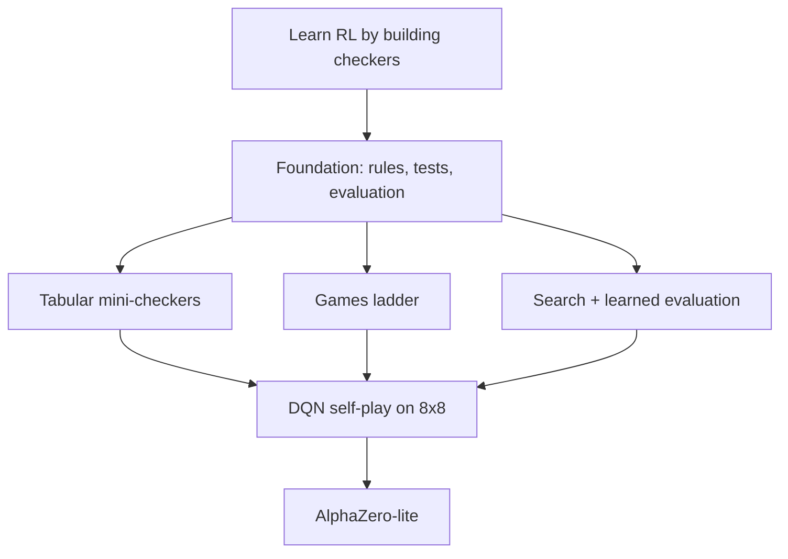

# Brainstorm — RLCheckers

**Date:** 2026-10-27
**Status:** draft for discussion. This is not a brief, plan, or decision.

## Problem frame

RLCheckers is a learning project. The goal is not merely to produce a strong
checkers program; it is to understand how reinforcement learning works by
building one, and to learn a repeatable way of co-authoring software with
opencode. Each step should be explainable: a reader should be able to see the
rules, the agent, the training loop, the evaluation, and the evidence that
learning happened.

Success has two strands:

- **RL understanding:** explain and implement the core loop — state, action,
  reward, value, policy, exploration, bootstrapping — and diagnose why an agent
  improves or fails.
- **Engineering understanding:** turn a behaviour into a spec, a failing test,
  a small implementation, a diagram, and a reviewed commit using opencode.

A useful first milestone is not "superhuman checkers"; it is an agent that
measurably improves against a fixed baseline, with a reproducible training and
evaluation loop and a learning curve you can defend.

## Known constraints

- Windows, PowerShell, Python in `.venv`.
- An RTX 4070 and all CPU cores are available. GPU use is allowed, but it must
  be justified by the experiment.
- Solo learner; no reuse of the previous checkers attempt.
- TDD, specifications, and architecture diagrams are part of the method, not
  optional extras.
- Beginner with opencode; the workflow must stay small enough to understand.
- Checkers is a solved game: perfect play leads to a draw. "Beat perfect play"
  is not a sensible target.

## Assumptions to test first

1. The main goal is learning, not maximum playing strength. If true, a small,
   inspectable agent is better than a large, opaque one.
2. A fast feedback loop — seconds to minutes — matters more than using the GPU
   on day one.
3. The previous attempt failed for a reason we can name: rules bugs, weak
   evaluation, unstable training, too-large scope, or loss of motivation. Name
   it before choosing a direction, without reopening the old code.
4. English draughts on 8x8 is the target game. Smaller boards are allowed as
   stepping stones, not as the final product.
5. A fixed evaluation protocol — opponents, seeds, number of games — is
   required before any training result is believed.
6. GPU training is appropriate for a neural agent, but much of checkers
   self-play may be CPU-bound in move generation; the GPU may be underused.

## Candidate directions

### A. Tabular RL on mini-checkers — fundamentals first

Implement a small checkers variant (5x5 or 6x6, or 8x8 endgames with few pieces)
and learn a table of state or afterstate values with Q-learning, SARSA, or value
iteration. Self-play or a fixed opponent; CPU only.

- **Makes easy:** correctness, debugging, exact tests, fast iteration, and
  visualising values. Teaches the RL loop without neural-network noise.
- **Makes hard:** scaling to 8x8 (the state space is enormous); does not teach
  deep RL or the GPU workflow; may feel like a toy.
- **Evidence:** win rate against random and against a depth-1 search; learning
  curve; inspected value tables; games per second.
- **Cheap first experiment:** rules, random self-play, and tabular Q on 5x5 for
  10 minutes. If it cannot beat random reliably, fix the loop before adding a
  network.

### B. DQN self-play on 8x8 checkers — deep RL, one step up

Encode the board as planes, use a small CNN or MLP to output Q-values for legal
moves, and train with DQN (replay buffer, target network, epsilon-greedy,
action masking) against snapshots of itself or a heuristic opponent. PyTorch
plus Gymnasium, PettingZoo, or a custom environment.

- **Makes easy:** the real 8x8 game; GPU use; teaching function approximation,
  replay, target networks, exploration, and self-play.
- **Makes hard:** stability, sample cost, non-stationary opponents, reward
  design, action masking, and debugging a network that "almost" learns. High
  risk of repeating a previous failure.
- **Evidence:** learning curve against random and heuristic opponents;
  stability across seeds; games and updates per second; GPU utilisation.
- **Cheap first experiment:** train on 5x5 or 6x6 with the same DQN code for
  20–30 minutes, then scale the board. Compare with the tabular result.

### C. AlphaZero-lite — search plus a learned policy and value

Use MCTS guided by a policy/value network, trained on self-play games (PUCT,
visit counts, replay buffer). Checkers is deterministic and perfect-information,
which suits the algorithm.

- **Makes easy:** strong play from search; an elegant integration of learning
  and planning; GPU use for the network.
- **Makes hard:** many interacting components — MCTS, Dirichlet noise,
  temperature, replay, augmentation, evaluation — and slow feedback. Hard to
  isolate bugs; largest scope.
- **Evidence:** strength against minimax and against the DQN agent; nodes per
  second; loss curves; an ablation of search.
- **Cheap first experiment:** MCTS with random rollouts on 5x5, then replace
  rollouts with a tiny value network. Do not start with 8x8.

### D. Classical search plus learned evaluation — strong baseline, hybrid

Use alpha-beta/minimax with a handcrafted evaluation, then learn or tune the
evaluation (TD learning, supervised from search, or a small value network). RL
improves the evaluator; search supplies the strength.

- **Makes easy:** a credible opponent early; interpretability; CPU-friendly
  work; an excellent TDD surface (perft, known positions).
- **Makes hard:** the project can become an engine project rather than an RL
  project; search may hide whether learning works; less exposure to
  policy-gradient and self-play methods.
- **Evidence:** depth and nodes per second; win rate against fixed-depth
  baselines; does the learned evaluator beat the handcrafted one at equal depth?
- **Cheap first experiment:** depth-4 alpha-beta with material and king safety
  against random, then swap in a learned value function at the same depth.

### E. Curriculum / games ladder — one interface, growing difficulty

Define a small `Game` interface and a shared agent/training harness. Start with
tic-tac-toe, then 5x5 checkers, then 8x8. Use tabular methods first, then a
neural agent.

- **Makes easy:** a very fast first learning signal; reusable tests and
  diagrams; teaching transfer and interface design; fits TDD.
- **Makes hard:** extra abstraction; curriculum design is its own problem; risk
  of spending the project on infrastructure and never reaching 8x8 checkers.
- **Evidence:** time to first learning curve; code reuse across games; friction
  when swapping the environment.
- **Cheap first experiment:** tic-tac-toe plus tabular Q in one day, then port
  the same loop to 5x5 checkers. If the port is painful, the interface is wrong.

## Comparison

| Direction | RL depth | Checkers realism | GPU use | Time to first signal | Main risk |
|---|---|---|---|---|---|
| A. Tabular mini-checkers | Core concepts | Low/medium | None | Minutes | Toy scope; scaling gap |
| B. DQN self-play | Deep RL | High | Medium | Hours | Instability; sample cost |
| C. AlphaZero-lite | Deep RL + search | High | High | Days | Complexity; slow debugging |
| D. Search + learned eval | Value-based/hybrid | High | Low/medium | Hours | Becomes an engine project |
| E. Games ladder | Core to deep | Low to high | Optional | Minutes | Infrastructure creep |

## Provisional recommendation — for discussion, not a decision

A staged path is likely to fit the learning goals and reduce the risk of another
failed attempt:

1. **Foundation:** Direction A or E on a small board. Build the rules, move
   generation, terminal detection, a random or heuristic baseline, and a
   tabular agent. Prove that the evaluation loop can detect improvement.
2. **Deep RL:** Direction B on 8x8, reusing the rules and evaluation harness
   but not the tabular agent. Add a small network, action masking, replay, and
   self-play snapshots.
3. **Optional stretch:** Direction C if the DQN loop is stable and there is
   appetite for search; or Direction D if a strong, interpretable baseline is
   more valuable than another learning algorithm.

Direction D is the best safety net and the best source of baselines, but it
should not become the main path if the goal is to learn RL. Direction C is the
most impressive endpoint but the worst first step.

## Hardware and frameworks

- **PyTorch** is the default for learning: readable, well documented, and good
  on Windows/CUDA. Install the CUDA build that matches the driver and verify
  with `torch.cuda.is_available()`.
- **Gymnasium** for a single-agent environment API. **PettingZoo** if the
  self-play loop is naturally multi-agent and turn-based. A custom environment
  is also reasonable for checkers; the API is a means, not a goal.
- **Stable-Baselines3** for a reliable DQN/PPO baseline and to see what a
  mature implementation looks like. Its self-play support is limited, so expect
  to write the league and opponent logic.
- **CleanRL** for single-file reference implementations when you want to read
  the whole algorithm in one place.
- **TensorBoard** for learning curves. Add Weights & Biases only if you want
  hosted experiment tracking.
- **CPU parallelism:** use process-based workers for self-play because the GIL
  limits threads; batch inference on the GPU. Avoid oversubscribing cores.
  Measure before adding Ray or any distributed setup.
- **GPU reality check:** a 4070 is more than enough for checkers networks. If
  the GPU sits idle, the bottleneck is probably move generation or Python
  overhead, not the model.

## How this fits the working method

- **Specs:** define `GameState`, `Move`, `Agent`, and `Evaluator` contracts
  before implementations. Acceptance criteria should be observable: legal moves
  for a position, terminal detection, a full game, a learning curve.
- **TDD:** rules first (perft and known positions), then environment contracts,
  then agent updates, then a short training smoke test. Keep a fast unit suite
  and a slower marked integration suite.
- **Diagrams:** one architecture diagram (environment ↔ agent ↔ trainer ↔
  evaluator), one sequence diagram for a self-play game, one state diagram for
  the training loop, and one flowchart for the evaluation pipeline.
- **opencode:** use `/brainstorm` to widen, `/grill` to pin requirements,
  `/research` for algorithm and framework questions, `/adr` for decisions,
  `/plan` for vertical slices, `/spec` per slice, `/tdd` for one behaviour,
  `/review` before commit, `/doc` for diagrams, and `/handoff` at the end.

## Learning resources

Start with one book or course, not all of them:

- Sutton & Barto, *Reinforcement Learning: An Introduction* (free):
  <http://incompleteideas.net/book/the-book-2nd.html> — read chapters 1–3, 6,
  and 9 as needed.
- David Silver's UCL RL course: <https://www.davidsilver.uk/teaching/> —
  lectures 1–6 for the core loop, later lectures for function approximation and
  policy gradients. This is the best structured video series for the theory.
- Hugging Face Deep RL Course:
  <https://huggingface.co/learn/deep-rl-course/unit0/introduction> — hands-on,
  with short videos and notebooks, and a good first DQN.
- OpenAI Spinning Up: <https://spinningup.openai.com/> — concise explanations
  and reference implementations.
- CleanRL: <https://github.com/vwxyzjn/cleanrl> — single-file algorithms to read
  and adapt.
- Stable-Baselines3 docs: <https://stable-baselines3.readthedocs.io/> —
  practical DQN/PPO and evaluation utilities.
- PettingZoo docs: <https://pettingzoo.farama.org/> — multi-agent and
  turn-based environment patterns.
- Gymnasium docs: <https://gymnasium.farama.org/> — environment API and
  wrappers.
- AlphaZero paper: <https://arxiv.org/abs/1712.01815> — read after the DQN loop
  works; focus on the self-play and MCTS ideas, not the full engineering.
- Schaeffer et al., "Checkers Is Solved":
  <https://www.cs.cornell.edu/courses/cs6700/2013sp/readings/06-b-Checkers-Solved-Science-2007.pdf>
  — context for what "strong" means and why perfect play is a draw.

Suggested order: Sutton & Barto chapters 1–3 with Silver lectures 1–3; then TD
learning in chapter 6 and Silver lectures 4–5; then the Hugging Face DQN unit
alongside CleanRL; then PettingZoo and the AlphaZero paper once self-play is
working. Avoid collecting courses; pick one and implement alongside it.

## Open questions

1. What exactly failed last time: rules, learning, performance, motivation, or
   scope? Name it; do not reopen the old code.
2. Is the target English draughts (8x8) with standard rules, and are draws
   acceptable?
3. How much time per week, and what is the first milestone you would be proud
   of: a learning curve, a playable game, or a strong agent?
4. Do you want to implement the RL algorithm yourself for learning, or use a
   library and focus on the environment and evaluation? A hybrid is possible:
   library baseline first, own implementation second.
5. How much math do you want: intuitive explanations, or derivations and
   papers?
6. Do you want the agent to be playable interactively (CLI or UI), or is
   offline training and evaluation enough?
7. Any preference on neural architecture (MLP vs CNN) or on using the GPU from
   the first slice?

## Next step

Pick one direction to grill: **A, B, D, or E** first. The provisional path is
A/E for the foundation, then B for deep RL; C remains a stretch goal. The next
command is `/grill` on the chosen direction, which will turn these assumptions
into `docs/00-brief.md`.

Choose a direction, or ask for more options.
