# Brief — RLCheckers, first milestone

**Date:** 2026-10-27
**Status:** draft for approval
**Source:** `docs/00-brainstorm.md`

## Purpose and users

RLCheckers is a personal learning project for one user: the author. The aim is
to learn reinforcement learning by building a checkers agent, and to learn a
repeatable opencode/TDD workflow. The author is comfortable with Python but new
to RL; explanations should start from the core loop and should not assume
neural-network knowledge.

The project is not a product, a public service, or a research benchmark.
Success is measured by understanding and by a trustworthy, reproducible
learning result.

## Success criteria

The first milestone is a headless, reproducible experiment showing that a
tabular agent learns to beat two fixed baselines on 5x5 English draughts.

Observable criteria:

1. **Rules:** a known-position suite and perft counts pass for the 5x5 variant;
   every game terminates under the draw rule.
2. **Training:** a seeded run produces a Q-table and a metrics CSV and plot
   showing the evaluation result rising over training.
3. **Evaluation:** for each of 3 seeds, play 1,000 games against random and
   1,000 against depth-1 greedy, with both colours and a fixed opening suite.
4. **Gate:** mean derived score (wins + 0.5 draws) across the 3 seeds is at
   least 0.60 against random and at least 0.55 against greedy. Report wins,
   draws, and losses separately, and report each seed. No seed should fall
   below 0.50 (assumption to confirm).
5. **Reproducibility:** rerunning the same config and seed reproduces the same
   metrics within the documented determinism limits.
6. **Diagnosis:** the Q-table can be inspected to explain at least one learned
   preference or one failure.
7. **Workflow:** the slice is specified, tested first, reviewed, and committed
   with a Conventional Commit; docs and diagrams ship with it.

```mermaid
%%{init: {"theme": "base", "themeVariables": {"darkMode": false, "primaryTextColor": "#000000", "secondaryTextColor": "#000000", "tertiaryTextColor": "#000000", "textColor": "#000000", "lineColor": "#334155", "edgeLabelBackground": "#ffffff", "clusterBkg": "#f8fafc", "clusterBorder": "#94a3b8"}}}%%
flowchart LR
    C["<span style='color:#000000'>TOML config + seed</span>"] --> T["<span style='color:#000000'>Self-play training</span>"]
    T --> Q["<span style='color:#000000'>Tabular Q-table</span>"]
    Q --> E["<span style='color:#000000'>Evaluate: random, then greedy</span>"]
    E --> M["<span style='color:#000000'>CSV metrics + plots</span>"]
    M --> G{"<span style='color:#000000'>Thresholds met?</span>"}
    G -->|"<span style='background-color:#ffffff'><span style='color:#000000'>No</span></span>"| T
    G -->|"<span style='background-color:#ffffff'><span style='color:#000000'>Yes</span></span>"| D["<span style='color:#000000'>First milestone done</span>"]

    classDef stage fill:#dbeafe,stroke:#1d4ed8,color:#000000
    classDef decision fill:#fef9c3,stroke:#a16207,color:#000000
    class C,T,Q,E,M,D stage
    class G decision
```

## In scope

- 5x5 English draughts variant: rules, move generation, terminal detection,
  and draw rule.
- Tabular Q-learning on state-action pairs, epsilon-greedy, self-play with
  periodic snapshots.
- Random and depth-1 greedy baselines.
- Headless training and evaluation commands.
- TOML config, seed, saved Q-table, CSV metrics, and plots.
- Unit and integration tests, perft and known positions, and a short training
  smoke test.
- An architecture diagram, a training-loop diagram, and ADRs for non-obvious
  choices.

## Explicit non-goals

- Full 8x8 game.
- Neural networks and GPU training.
- AlphaZero or MCTS.
- Interactive UI.
- Reusing the previous checkers code or material.
- Cloud or distributed training.

## Constraints

- Windows, PowerShell, `.venv\Scripts\python.exe`, Python 3.14.
- 8–12 hours per week; solo learner.
- TDD, specifications, and architecture diagrams are part of the method.
- Conventional Commits; never push without being asked.
- Local-only; no cloud, no secrets, no distribution.
- numpy is allowed. Otherwise keep dependencies minimal: pytest, ruff, and
  matplotlib.
- No previous checkers material.

## Data and failure modes

There is no external dataset. Training data is generated by self-play.

Saved artifacts per run:

- the resolved config and seed;
- the Q-table;
- a metrics CSV;
- learning-curve plots.

Failure modes and mitigations:

| Failure | Mitigation |
|---|---|
| Illegal moves, captures, or promotions | Perft counts, known-position tests, property tests for move generation |
| Games that never end | Threefold repetition or 80 plies without capture/promotion is a draw |
| Learning does not improve | Small state space, inspectable Q-table, learning curve, fixed baselines |
| Evaluation noise or overfitting | 3 seeds, both colours, fixed opening suite, 1,000 games per opponent |
| Self-play collapse or forgetting | Periodic snapshots and evaluation against fixed baselines |
| Q-table growth | 5x5 only; sparse storage initially; record table size |
| Reproducibility drift | Seed everything, record config and versions, deterministic tie-breaks |
| Scope creep | Explicit non-goals and one vertical slice per turn |

## Non-functional needs

- **Logging:** console progress plus CSV metrics. No secrets.
- **Config:** TOML file plus CLI overrides; the resolved config is saved with
  each run.
- **Packaging:** `pyproject.toml`, `src/rlcheckers/`, and `tests/`; local
  install only.
- **Dependencies:** numpy, pytest, ruff, matplotlib. They are installed in the
  first implementation slice.
- **Performance:** a single training run and a 3-seed evaluation should each
  finish within a work session, in minutes rather than hours. Profile before
  scaling.
- **Docs:** README, architecture notes, this brief, ADRs, and Mermaid diagrams.
- **Quality:** pytest and ruff; slow tests marked; deterministic tests where
  practical.

## Decisions

1. **Audience:** a personal learning project for the author.
2. **Goals:** deep RL understanding and a clean opencode/TDD workflow.
3. **First milestone:** a headless learning curve that beats fixed baselines.
4. **Board:** 5x5 English draughts variant.
5. **Agent:** tabular Q-learning on state-action pairs first; afterstates are a
   later experiment.
6. **Training:** self-play with periodic snapshots.
7. **Baselines:** random, then depth-1 greedy.
8. **Evidence:** 3 training seeds; 1,000 games per opponent; both colours; a
   fixed opening suite.
9. **Reporting:** wins, draws, and losses separately. A derived score
   (`wins + 0.5 draws`) is used only for the pass/fail gate.
10. **Gate:** mean derived score at least 0.60 against random and at least 0.55
    against greedy. Thresholds are provisional until a pilot run.
11. **Draw rule:** threefold repetition or 80 plies without a capture or
    promotion.
12. **Artifacts:** seed, TOML config, Q-table, CSV metrics, and plots.
13. **Dependencies:** numpy allowed; otherwise minimal.
14. **Surface:** headless training and evaluation only.
15. **Non-goals:** full 8x8, neural networks and GPU training, AlphaZero/MCTS,
    interactive UI, reuse of previous material, and cloud/distributed training.
16. **Process:** TDD, specs, diagrams, Conventional Commits, and no push without
    being asked.

## Assumptions

These need confirmation or correction before planning:

1. **Starting position:** 5 men each on the dark squares of the first two rows;
   Black moves first; men move toward the opponent's back rank.
2. **English rules:** captures are mandatory; men capture forward only; kings
   move and capture one square diagonally in any direction; promotion ends the
   move; if multiple capture sequences exist, any may be chosen.
3. **Gate statistics:** the gate uses the mean derived score across 3 seeds,
   with no seed below 0.50. Thresholds are provisional until a pilot.
4. **Opening suite:** a small set of legal positions, mirrored for colour; the
   exact positions are defined in the spec.
5. **Q-table storage:** sparse mapping initially; numpy is used for arrays,
   metrics, and plots rather than necessarily a dense table.
6. **Hyperparameters:** alpha, gamma, epsilon schedule, snapshot cadence, and
   episode budget are decided in the spec or an ADR, not in this brief.
7. **Runtime:** training and evaluation runs finish in minutes on the available
   CPU; if not, profile before scaling.
8. **Layout:** package name `rlcheckers`, `src/rlcheckers/`, `tests/`, and
   `pyproject.toml`.
9. **Dependencies:** the first slice installs numpy, pytest, ruff, and
   matplotlib into `.venv`.
10. **Draws:** draws are acceptable and reported, not treated as failures.
11. **No hidden reuse:** no code, data, or design is imported from the previous
    checkers attempt.
12. **One engine:** all agents use the same rules and move generator; evaluation
    does not have a separate code path.

## Open questions

These are deliberately deferred to the spec or an ADR unless they change scope:

1. Exact 5x5 starting position, orientation, and first player.
2. Exact fixed opening suite, and exact baseline definitions: random move
   selection and depth-1 greedy evaluation and tie-breaks.
3. Whether the gate should use mean scores or require every seed to meet the
   thresholds; whether 0.60 and 0.55 are realistic.
4. Whether self-play should mix in random or greedy opponents, or use snapshots
   only.
5. Snapshot cadence and Q-learning hyperparameters.
6. Sparse dictionary versus dense numpy Q-table for 5x5.
7. CLI entry-point names and the config schema.
8. Whether a minimal play CLI is wanted later, beyond this milestone.
9. How much mathematical detail the docs should include for a new-to-RL reader.

## Next step

Approve this brief, or correct the assumptions. Then `/plan` turns it into
vertical slices.

**Recommended slice order:** evaluation harness and rules first, training
second. The previous failure was "learning did not improve" with no reliable
evaluation, so the project needs a trustworthy scoreboard before it needs an
agent.

Approve the brief, or correct the assumptions.
