# Architecture

**Status:** S4 implements the immutable rules engine (S1–S3), seeded random
play, the depth-1 greedy baseline, the seeded evaluation arena, metrics with a
95% interval, TOML config, CSV/JSON artifacts, and the `evaluate` CLI command.
Spec 0004 is approved. Learning and the three-seed gate are planned.

## Components

- **Game rules:** immutable board (S1), legal move generation (S2), state
  transitions and terminal/draw detection (S3).
- **Agents:** random baseline (S3), depth-1 greedy baseline (S4), and tabular
  Q-agent (S5).
- **Training:** self-play loop with periodic snapshots (S6).
- **Evaluation:** arena for pairing agents over openings and colours, metrics,
  config, and artifacts (S4), plus the three-seed gate (S7).
- **Composition:** CLI (`play-random` and `evaluate`), TOML config, seed
  handling, and artifact writing.

The rules do not depend on agents. Agents depend on the rules. Training depends
on both. Evaluation depends on the rules and agents. The CLI composes them. S4
writes CSV/JSON only; S5 and S7 own plots under ADR 0004.

```mermaid
%%{init: {"theme": "base", "themeVariables": {"darkMode": false, "primaryTextColor": "#000000", "secondaryTextColor": "#000000", "tertiaryTextColor": "#000000", "textColor": "#000000", "lineColor": "#334155", "edgeLabelBackground": "#ffffff", "clusterBkg": "#f8fafc", "clusterBorder": "#94a3b8"}}}%%
flowchart LR
  subgraph Config["<span style='background-color:#ffffff'><span style='color:#000000'>Configuration</span></span>"]
    TOML["<span style='color:#000000'>eval.toml<br/>human-authored run settings</span>"]
    CFG["<span style='color:#000000'>EvalConfig<br/>resolved seed · games · agents · output dir</span>"]
    TOML -->|"<span style='background-color:#ffffff'><span style='color:#000000'>load_eval_config</span></span>"| CFG
  end

  subgraph Rules["<span style='background-color:#ffffff'><span style='color:#000000'>Rules engine · S1–S3</span></span>"]
    STATE["<span style='color:#000000'>GameState<br/>board · legal moves · apply · outcome</span>"]
  end

  subgraph Agents["<span style='background-color:#ffffff'><span style='color:#000000'>Agents</span></span>"]
    BASE["<span style='color:#000000'>Random + greedy<br/>S3/S4 baselines</span>"]
    Q["<span style='color:#000000'>Q-agent<br/>S5+</span>"]
  end

  subgraph Evaluation["<span style='background-color:#ffffff'><span style='color:#000000'>Evaluation · S4/S7</span></span>"]
    ARENA["<span style='color:#000000'>Arena<br/>pairings · seeds · game loop</span>"]
    METRICS["<span style='color:#000000'>Metrics<br/>W/D/L · score · 95% CI</span>"]
    GATE["<span style='color:#000000'>Three-seed gate<br/>S7</span>"]
  end

  subgraph Outputs["<span style='background-color:#ffffff'><span style='color:#000000'>Artifacts</span></span>"]
    FILES["<span style='color:#000000'>CSV + JSON<br/>metrics · games · run</span>"]
    PLOTS["<span style='color:#000000'>Plots<br/>S5/S7</span>"]
    CONSUMER["<span style='color:#000000'>Report / next slice<br/>reads artifacts</span>"]
  end

  CLI["<span style='color:#000000'>CLI<br/>play-random · evaluate</span>"]
  TRAIN["<span style='color:#000000'>Training loop<br/>S5/S6</span>"]

  CFG -->|"<span style='background-color:#ffffff'><span style='color:#000000'>configures</span></span>"| CLI
  CLI -->|"<span style='background-color:#ffffff'><span style='color:#000000'>starts matchup</span></span>"| ARENA
  STATE -->|"<span style='background-color:#ffffff'><span style='color:#000000'>state + legal moves</span></span>"| ARENA
  ARENA -->|"<span style='background-color:#ffffff'><span style='color:#000000'>apply move</span></span>"| STATE
  BASE -->|"<span style='background-color:#ffffff'><span style='color:#000000'>Move</span></span>"| ARENA
  Q -.->|"<span style='background-color:#ffffff'><span style='color:#000000'>Move (S5+)</span></span>"| ARENA
  TRAIN -.->|"<span style='background-color:#ffffff'><span style='color:#000000'>updates</span></span>"| Q
  ARENA -->|"<span style='background-color:#ffffff'><span style='color:#000000'>ArenaResult</span></span>"| METRICS
  METRICS -->|"<span style='background-color:#ffffff'><span style='color:#000000'>summary rows</span></span>"| FILES
  METRICS -.->|"<span style='background-color:#ffffff'><span style='color:#000000'>per-seed scores (S7)</span></span>"| GATE
  GATE -.->|"<span style='background-color:#ffffff'><span style='color:#000000'>gate report (S7)</span></span>"| PLOTS
  FILES -.->|"<span style='background-color:#ffffff'><span style='color:#000000'>plot input (S5/S7)</span></span>"| PLOTS
  FILES -->|"<span style='background-color:#ffffff'><span style='color:#000000'>CSV/JSON</span></span>"| CONSUMER

  style Config fill:#eff6ff,stroke:#1565c0
  style Rules fill:#f0fdf4,stroke:#2e7d32
  style Agents fill:#f7fee7,stroke:#558b2f
  style Evaluation fill:#fff7ed,stroke:#ef6c00
  style Outputs fill:#f8fafc,stroke:#455a64

  classDef config fill:#e3f2fd,stroke:#1565c0,color:#000000
  classDef cli fill:#e8eaf6,stroke:#283593,color:#000000
  classDef rules fill:#e8f5e9,stroke:#2e7d32,color:#000000
  classDef agents fill:#f1f8e9,stroke:#558b2f,color:#000000
  classDef eval fill:#fff3e0,stroke:#ef6c00,color:#000000
  classDef metrics fill:#f3e5f5,stroke:#6a1b9a,color:#000000
  classDef output fill:#eceff1,stroke:#455a64,color:#000000
  classDef future fill:#f5f5f5,stroke:#9e9e9e,color:#000000,stroke-dasharray: 5 5

  class TOML,CFG config
  class CLI cli
  class STATE rules
  class BASE agents
  class ARENA eval
  class METRICS metrics
  class FILES,CONSUMER output
  class Q,GATE,PLOTS,TRAIN future
```

**Figure A — Component map.** Solid arrows are implemented through S4; dashed
arrows point at later slices. Blue is configuration, indigo is composition,
green is rules/agents, orange is evaluation, purple is metrics, and grey is
artifacts/reporting. The arena is the only component that talks to both the
rules engine and the agents.

## Board module (S1)

`src/rlcheckers/game/board.py` owns the immutable 25-cell position and its
40-bit canonical key. It exposes `Board.initial()`, `Board.from_state_key()`,
`Board.piece_at()`, `Board.state_key`, and `Board.render()`.

The board validates encoding only: exactly 25 cells, `None` on light squares, a
piece code on every dark square, and a valid side to move. It does not generate
moves or judge reachability; move generation lives in S2, and `GameState`
adds the game-level piece-count check.

## Moves module (S2)

`src/rlcheckers/game/moves.py` owns the immutable `Move` value object,
`generate_moves()`, and `apply_move()`. `Move` stores the origin, every landing
square, and the captured squares in order. Its `action_key` is the 33-bit ADR
0002 encoding of the path.

`generate_moves()` returns every legal move for `Board.side_to_move`, sorted by
`(path, captures)`. Captures are mandatory; a man captures forward only while a
king captures in any direction; a capture chain continues while a jump remains.
A man that reaches the opponent's back rank is promoted and the move ends, even
if the new king could capture again. There is no maximum-capture rule, so every
complete capture path is returned.

`apply_move()` accepts exactly the moves that `generate_moves()` returns, removes
the captured pieces, promotes a man on the opponent's back rank, switches the
side, and returns a new `Board` without mutating the input. It deliberately
validates by membership in the generated move list. Counters, game state,
terminal detection, and draw rules live in `state.py`.

`format_move()` renders a move path with `-` between squares for a quiet move
and `x` for a capture. It is display-only and has no inverse parser.

## State module (S3)

`src/rlcheckers/game/state.py` owns `GameState`, `GameRecord`, `Outcome`,
`DrawReason`, and the `REPETITION_LIMIT` and `NO_PROGRESS_PLY_LIMIT` constants.
`GameState` is an immutable board plus a tuple of position keys and a
no-progress ply counter.

- `position_keys` ends with the current board key and is seeded with that key
  when constructed from empty history. The constructor validates the board,
  the key range, the last-key match, the counter range, and that at least one
  piece remains.
- `apply()` rejects terminal states, delegates the board transition to
  `apply_move()`, resets the no-progress counter on a capture or promotion,
  increments it otherwise, and appends the next position key.
- `outcome` checks decisive results before draws: no Black pieces, no White
  pieces, and no legal moves for the side to move are wins; threefold repetition
  and then 80 plies without progress are draws.
- `draw_reason` is `None` unless the outcome is a draw, and prefers repetition
  over no-progress when both apply.
- `GameRecord` holds the move tuple and terminal state, deriving `outcome` and
  `plies`.

## Agents and random play (S3)

`src/rlcheckers/agents/random_agent.py` owns `RandomAgent` and
`play_random_game()`. `RandomAgent` wraps a private `random.Random`, rejects
non-integer seeds and terminal states, and otherwise chooses uniformly from
`GameState.legal_moves()`.

`play_random_game(seed)` uses one agent and one RNG stream for both colours,
applies moves until the state is terminal, and returns a `GameRecord`. The same
seed reproduces the whole game. A game that exceeds `MAX_GAME_PLIES` without
terminating raises `RuntimeError`.

## Greedy baseline and protocol (S4)

`src/rlcheckers/agents/greedy_agent.py` owns `GreedyAgent`, `material_balance`,
and the `MAN_VALUE`, `KING_VALUE`, and `TERMINAL_SCORE` constants. The baseline
searches exactly one ply: it applies every legal move, scores an immediate win
as `+1000`, a draw as `0`, and a loss as `-1000`, otherwise scores material from
the moving side's perspective, and breaks ties with the smallest
`(path, captures)`. It is deterministic, owns no RNG, and never mutates the
state. `material_balance` counts men as 1 and kings as 3.

`src/rlcheckers/agents/protocol.py` owns the `Agent` protocol
(`choose_move(state) -> Move`) and `AgentFactory` (a callable from a seed to an
agent). The registry in `agents/__init__.py` exposes
`AGENT_NAMES = ("greedy", "random")` and `make_agent()`, which raises
`ValueError` for an unknown name. The arena depends on `AgentFactory`, not on
the registry.

## Evaluation arena (S4)

`src/rlcheckers/evaluation/arena.py` owns `STANDARD_OPENINGS`, `opening_state`,
`GameOutcome`, `GameResult`, `ArenaResult`, `ArenaError`, `play_matchup`,
`outcome_for`, and the two seed helpers.

The standard suite is five move prefixes from the initial position: empty,
`6-10`, `8-14`, `6-10 18-14`, and `8-14 16-12`. `opening_state` applies the
prefix through `GameState.apply`, so the prefix contributes to position history
and the no-progress counter. The suite is fixed in code.

`play_matchup` validates the seed, game count, and openings before the first
game; rejects duplicate opening keys; schedules every opening with both agent
colours; derives one game seed and two side seeds with SHA-256; and records one
`GameResult` per game from the agent-under-test perspective. Every returned move
is checked against the legal moves; an illegal move raises `ArenaError`, and a
game over 2,000 plies raises `RuntimeError`.

## Metrics (S4)

`src/rlcheckers/evaluation/metrics.py` owns `summarize`, `summary_rows`,
`format_float`, `ScoreSummary`, and `SummaryRow`. The derived score is
`(wins + 0.5 * draws) / games`. The 95% interval uses the per-game sample
variance and the normal approximation, clamped to `[0, 1]`; it describes
game-level sampling noise, not unseen openings. Rows are ordered overall,
black, white, then each opening. `format_float` writes six decimals, and fewer
than two games in a group is rejected rather than given an invented interval.

## Config (S4)

`src/rlcheckers/config.py` owns `EvalConfig`, `ConfigError`, and
`load_eval_config`. The TOML file has exactly five top-level keys: `seed`,
`games`, `agent`, `opponent`, and `output_dir`. The loader validates types, the
ten-game cycle, and the agent names; a relative `output_dir` resolves against
the config file's parent. Loading does not create the directory.

## Artifacts (S4)

`src/rlcheckers/evaluation/artifacts.py` owns `write_artifacts`,
`METRICS_FIELDS`, and `GAMES_FIELDS`. It validates the result against the config
before creating anything, then writes `metrics.csv` (overall, colour, and
opening summaries), `games.csv` (one audit row per game), and `run.json`
(command line, config, opening keys, package and Python versions). CSVs use
`\n` line endings, and rerunning the same result produces identical bytes. S4
writes no plots; S5 and S7 own them under ADR 0004.

## CLI (S3, S4)

`src/rlcheckers/cli.py` exposes `main(argv)`, and `src/rlcheckers/__main__.py`
runs it for `python -m rlcheckers`. `play-random --seed INT` prints the seed,
numbered moves, final outcome, and ply count. `evaluate --config PATH` loads the
config, composes the agent factories, plays the matchup, writes the three
artifacts, and prints the ten-line summary. Runtime problems print
`error: <message>` to stderr and return 1; `argparse` usage errors keep exit
code 2.

## Data flow

1. A TOML config and seed define a run.
2. In an S4 evaluation, the CLI composes the baselines and the arena plays the
   fixed suite with both colours; metrics and artifacts are written.
3. Training plays games and updates the Q-table (S5/S6).
4. The trained agent is evaluated against the same arena (S5 onward).
5. The gate aggregates three seeds and writes the milestone report (S7).

## Decisions

- [ADR 0001 — 5x5 English draughts rules](adr/0001-5x5-rules.md)
- [ADR 0002 — Board, move, and state encoding](adr/0002-board-and-state-encoding.md)
- [ADR 0003 — Evaluation protocol and gate](adr/0003-evaluation-protocol.md)
- [ADR 0004 — Plot ownership](adr/0004-plot-ownership.md)

## Specifications

- [Spec 0003 — Game application and random play](specs/0003-game-application-and-random-play.md)
- [Spec 0004 — Baselines and evaluation arena](specs/0004-evaluation-arena.md)

## Current milestone boundaries

- 5x5 only; no full 8x8.
- Tabular Q-learning only; no neural networks or GPU training.
- Headless only; no interactive UI.
- Local only; no cloud or distributed training.
- No reuse of the previous checkers attempt.

See `docs/00-brief.md` for the full scope and `docs/plan.md` for the slice
sequence.
