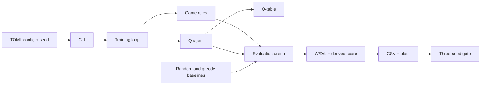

# Architecture

**Status:** target shape for the first milestone. Implementation starts at S1.

## Components

- **Game rules:** immutable board, legal move generation, state transitions,
  terminal and draw detection.
- **Agents:** random baseline, depth-1 greedy baseline, and tabular Q-agent.
- **Training:** self-play loop with periodic snapshots.
- **Evaluation:** arena for pairing agents over openings and colours, plus the
  three-seed gate and metrics.
- **Composition:** CLI, TOML config, seed handling, and artifact writing.

The rules do not depend on agents. Agents depend on the rules. Training depends
on both. Evaluation depends on the rules and agents. The CLI composes them.

## Data flow

1. A TOML config and seed define a run.
2. Training plays games and updates the Q-table.
3. The Q-table and metrics are saved.
4. Evaluation replays the trained agent against fixed baselines over a fixed
   opening suite, using both colours.
5. The gate aggregates three seeds and writes the milestone report.

## Decisions

- [ADR 0001 — 5x5 English draughts rules](adr/0001-5x5-rules.md)
- [ADR 0002 — Board, move, and state encoding](adr/0002-board-and-state-encoding.md)

## Current milestone boundaries

- 5x5 only; no full 8x8.
- Tabular Q-learning only; no neural networks or GPU training.
- Headless only; no interactive UI.
- Local only; no cloud or distributed training.
- No reuse of the previous checkers attempt.

See `docs/00-brief.md` for the full scope and `docs/plan.md` for the slice
sequence.
