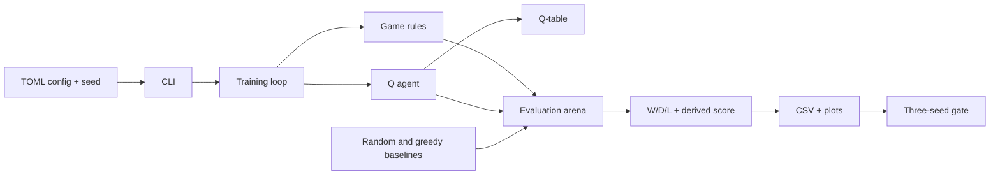

# Architecture

**Status:** S2 implements the immutable board, initial position, ASCII renderer,
canonical 40-bit state key, and legal move generation with pure move
application. Game state, counters, terminal detection, agents, and evaluation
are still to come.

## Components

- **Game rules:** immutable board (S1), legal move generation (S2), state
  transitions and terminal/draw detection (S3).
- **Agents:** random baseline, depth-1 greedy baseline, and tabular Q-agent.
- **Training:** self-play loop with periodic snapshots.
- **Evaluation:** arena for pairing agents over openings and colours, plus the
  three-seed gate and metrics.
- **Composition:** CLI, TOML config, seed handling, and artifact writing.

The rules do not depend on agents. Agents depend on the rules. Training depends
on both. Evaluation depends on the rules and agents. The CLI composes them.

## Board module (S1)

`src/rlcheckers/game/board.py` owns the immutable 25-cell position and its
40-bit canonical key. It exposes `Board.initial()`, `Board.from_state_key()`,
`Board.piece_at()`, `Board.state_key`, and `Board.render()`.

The board validates encoding only: exactly 25 cells, `None` on light squares, a
piece code on every dark square, and a valid side to move. It does not generate
moves or judge reachability; those checks belong to later slices.

## Moves module (S2)

`src/rlcheckers/game/moves.py` owns the immutable `Move` value object,
`generate_moves()`, and `apply_move()`. `Move` stores the origin, every landing
square, and the captured squares in order. Its `action_key` is the 33-bit ADR
0002 encoding of the path.

`generate_moves()` returns every legal move for `Board.side_to_move`, sorted by
`(path, captures)`. Captures are mandatory; a man captures forward only while a
king captures in any direction; a capture chain continues while a jump remains.
A man that reaches the opponent's back rank is promoted and the move ends, even
if the new king could capture again. There is no maximum-capture rule, so every
complete capture path is returned.

`apply_move()` accepts exactly the moves that `generate_moves()` returns, removes
the captured pieces, promotes a man on the opponent's back rank, switches the
side, and returns a new `Board` without mutating the input. It deliberately
validates by membership in the generated move list. Counters, game state,
terminal detection, and draw rules remain S3 work.

## Data flow

1. A TOML config and seed define a run.
2. Training plays games and updates the Q-table.
3. The Q-table and metrics are saved.
4. Evaluation replays the trained agent against fixed baselines over a fixed
   opening suite, using both colours.
5. The gate aggregates three seeds and writes the milestone report.

## Decisions

- [ADR 0001 — 5x5 English draughts rules](adr/0001-5x5-rules.md)
- [ADR 0002 — Board, move, and state encoding](adr/0002-board-and-state-encoding.md)

## Current milestone boundaries

- 5x5 only; no full 8x8.
- Tabular Q-learning only; no neural networks or GPU training.
- Headless only; no interactive UI.
- Local only; no cloud or distributed training.
- No reuse of the previous checkers attempt.

See `docs/00-brief.md` for the full scope and `docs/plan.md` for the slice
sequence.
