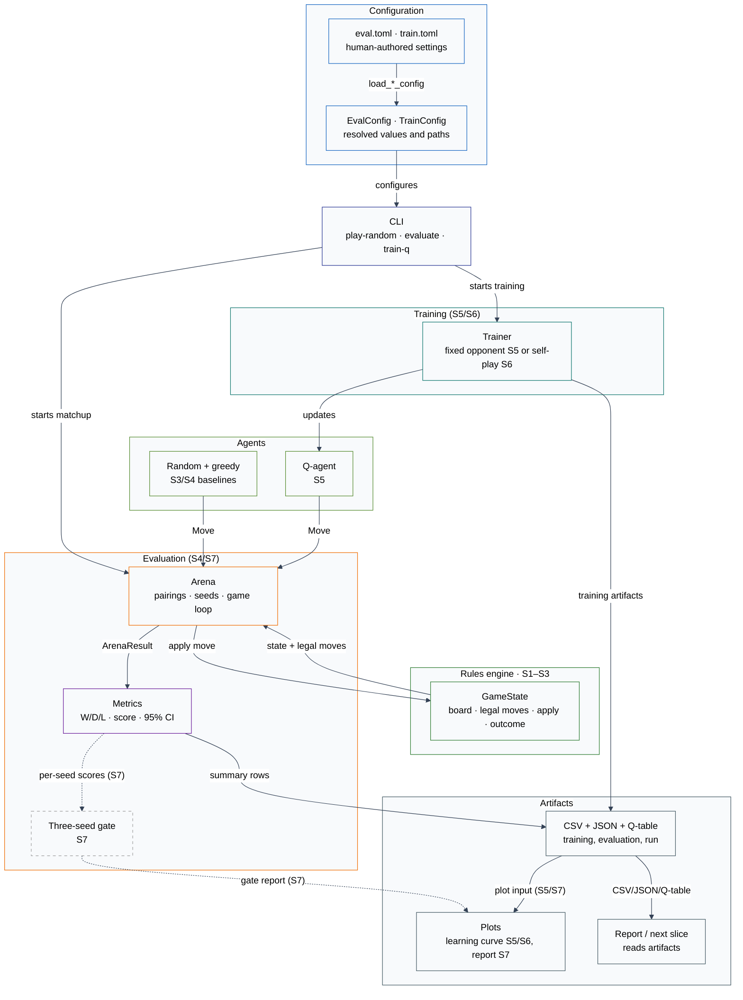

# Architecture

**Status:** S6 implements the immutable rules engine (S1-S3), seeded random
play, the depth-1 greedy baseline (S4), the seeded evaluation arena (S4),
tabular Q-learning against a fixed random opponent (S5), and self-play against
periodic frozen snapshots (S6): snapshot policy, self-play trainer, conditional
training config, self-play artifacts, titled learning curve, two diagnostics,
and `train-q` dispatch. S6 is complete, approved, and pushed. The three-seed
gate is planned (S7).

## Components

- **Game rules:** immutable board (S1), legal move generation (S2), state
  transitions and terminal/draw detection (S3).
- **Agents:** random baseline (S3), depth-1 greedy baseline (S4), and tabular
  Q-agent (S5).
- **Training:** fixed random-opponent trainer (S5) and self-play with periodic
  frozen snapshots (S6).
- **Evaluation:** arena for pairing agents over openings and colours, metrics,
  config, and artifacts (S4), plus the random and greedy self-play diagnostics
  (S6) and the three-seed gate (S7).
- **Composition:** CLI (`play-random`, `evaluate`, `train-q`), TOML configs,
  seed handling, mode dispatch, and artifact writing.

The rules do not depend on agents. Agents depend on the rules. Training depends
on both. Evaluation depends on the rules and agents. The CLI composes them. S4
writes CSV/JSON only; S5 adds the Q-table, training CSV, run metadata, and
learning curve; S6 adds the snapshot schedule and self-play artifacts; S7 owns
the gate report and its plots under ADR 0004.

**Figure A — Component map.** Solid arrows are implemented through S6; dashed
arrows point at S7. Category colour is carried by the stroke; every fill is
white or light grey. The arena talks to the rules engine and the agents; the
`train-q` command dispatches to the fixed-opponent or self-play trainer and
composes the matching diagnostics. Blue is configuration, indigo is composition,
green is rules/agents/training, orange is evaluation, purple is metrics, and grey
is artifacts/reporting.

## Board module (S1)

`src/rlcheckers/game/board.py` owns the immutable 25-cell position and its
40-bit canonical key. It exposes `Board.initial()`, `Board.from_state_key()`,
`Board.piece_at()`, `Board.state_key`, and `Board.render()`.

The board validates encoding only: exactly 25 cells, `None` on light squares, a
piece code on every dark square, and a valid side to move. It does not generate
moves or judge reachability; move generation lives in S2, and `GameState`
adds the game-level piece-count check.

## Moves module (S2)

`src/rlcheckers/game/moves.py` owns the immutable `Move` value object,
`generate_moves()`, and `apply_move()`. `Move` stores the origin, every landing
square, and the captured squares in order. Its `action_key` is the 33-bit ADR
0002 encoding of the path.

`generate_moves()` returns every legal move for `Board.side_to_move`, sorted by
`(path, captures)`. Captures are mandatory; a man captures forward only while a
king captures in any direction; a capture chain continues while a jump remains.
A man that reaches the opponent's back rank is promoted and the move ends, even
if the new king could capture again. There is no maximum-capture rule, so every
complete capture path is returned.

`apply_move()` accepts exactly the moves that `generate_moves()` returns, removes
the captured pieces, promotes a man on the opponent's back rank, switches the
side, and returns a new `Board` without mutating the input. It deliberately
validates by membership in the generated move list. Counters, game state,
terminal detection, and draw rules live in `state.py`.

`format_move()` renders a move path with `-` between squares for a quiet move
and `x` for a capture. It is display-only and has no inverse parser.

## State module (S3)

`src/rlcheckers/game/state.py` owns `GameState`, `GameRecord`, `Outcome`,
`DrawReason`, and the `REPETITION_LIMIT` and `NO_PROGRESS_PLY_LIMIT` constants.
`GameState` is an immutable board plus a tuple of position keys and a
no-progress ply counter.

- `position_keys` ends with the current board key and is seeded with that key
  when constructed from empty history. The constructor validates the board,
  the key range, the last-key match, the counter range, and that at least one
  piece remains.
- `apply()` rejects terminal states, delegates the board transition to
  `apply_move()`, resets the no-progress counter on a capture or promotion,
  increments it otherwise, and appends the next position key.
- `outcome` checks decisive results before draws: no Black pieces, no White
  pieces, and no legal moves for the side to move are wins; threefold repetition
  and then 80 plies without progress are draws.
- `draw_reason` is `None` unless the outcome is a draw, and prefers repetition
  over no-progress when both apply.
- `GameRecord` holds the move tuple and terminal state, deriving `outcome` and
  `plies`.

## Agents and random play (S3)

`src/rlcheckers/agents/random_agent.py` owns `RandomAgent` and
`play_random_game()`. `RandomAgent` wraps a private `random.Random`, rejects
non-integer seeds and terminal states, and otherwise chooses uniformly from
`GameState.legal_moves()`.

`play_random_game(seed)` uses one agent and one RNG stream for both colours,
applies moves until the state is terminal, and returns a `GameRecord`. The same
seed reproduces the whole game. A game that exceeds `MAX_GAME_PLIES` without
terminating raises `RuntimeError`.

## Greedy baseline and protocol (S4)

`src/rlcheckers/agents/greedy_agent.py` owns `GreedyAgent`, `material_balance`,
and the `MAN_VALUE`, `KING_VALUE`, and `TERMINAL_SCORE` constants. The baseline
searches exactly one ply: it applies every legal move, scores an immediate win
as `+1000`, a draw as `0`, and a loss as `-1000`, otherwise scores material from
the moving side's perspective, and breaks ties with the smallest
`(path, captures)`. It is deterministic, owns no RNG, and never mutates the
state. `material_balance` counts men as 1 and kings as 3.

`src/rlcheckers/agents/protocol.py` owns the `Agent` protocol
(`choose_move(state) -> Move`) and `AgentFactory` (a callable from a seed to an
agent). The registry in `agents/__init__.py` exposes
`AGENT_NAMES = ("greedy", "random")` and `make_agent()`, which raises
`ValueError` for an unknown name. The arena depends on `AgentFactory`, not on
the registry.

## Q-table and Q-agent (S5)

`src/rlcheckers/agents/q_agent.py` owns `q_key`, `QTable`, `QTableError`,
`TableCapacityError`, and `QAgent`. The key is
`(state.board.state_key << 33) | move.action_key`, a 73-bit value. The table is a
sparse `dict[int, float]` with a 2,000,000-entry cap; missing entries are `0.0`,
and a new key at the cap raises rather than evicting.

The S5 learning state is the 40-bit board key only; repetition and no-progress
counters are excluded under ADR 0005. `QTable` saves to and loads from JSON with
decimal-string keys, validates the schema and saved cap, and estimates memory
from the dictionary and its keys and values. `QAgent` is the thin greedy
adapter: it owns no RNG and returns `table.best_move(state)`, with ties broken by
the first legal move in `(path, captures)` order. A finished game is rejected.

## Training (S5)

`src/rlcheckers/training/train_q.py` owns the fixed-opponent trainer and its
helpers: `q_update`, `epsilon_at`, `choose_epsilon_greedy`, `reward_for`,
`derive_episode_seed`, `EpisodeMetric`, `TrainingResult`, `train_q`,
`write_training_artifacts`, and `write_learning_curve`.

Training alternates the five S4 openings with both learner colours, plays a
seeded random opponent, and updates only the learner's actions. `alpha = 0.1`,
`gamma = 0.9`, and epsilon decays linearly from `1.0` to `0.05` over 80% of the
episodes; zero decay is rejected. Rewards are terminal `+1/0/-1` from the
learner's perspective; the S4 derived score remains evaluation-only. The table
cap and a 2,000-ply guard fail loudly. Episode seeds use a separate `train`
domain while reusing `derive_side_seed`.

The S5 diagnostic trains 10,000 seeded episodes and plays 1,000 games against
random. The recorded result is **794 W / 50 D / 156 L**, score **0.819**, 95% CI
**0.796–0.842**, and 21,773 table entries. That is a diagnostic, not the S7 gate.

## Self-play training (S6)

`src/rlcheckers/training/self_play.py` owns `SnapshotPolicy`, `Snapshot`,
`SnapshotRecord`, `SelfPlayEpisodeMetric`, `SelfPlayTrainingResult`,
`train_self_play`, `write_self_play_artifacts`, and
`SELF_PLAY_TRAINING_FIELDS`.

The cadence N is a positive multiple of 10 and strictly less than the episode
count. The policy starts with an empty snapshot at episode 0 and refreshes a
deep copy of the learner table at N, 2N, ... boundaries. The latest snapshot
covers its creation episode through `min(created + N, episodes) - 1`. The
opponent is a greedy Q-agent over that frozen table; only the learner explores
and updates. Episode scheduling, openings, colours, epsilon decay, rewards, and
the 2,000-ply guard match S5. The learner RNG is derived from the episode seed
and learner colour, so the initial empty opponent is deterministic and a run is
reproducible. Missing, duplicate, unscheduled, out-of-range, or non-table
refreshes raise `SelfPlayError`; the trainer does not catch snapshot failures.

Metrics record the episode, opening, learner colour, outcome, plies, epsilon,
learner table size, and the active opponent's snapshot episode and table size.
The self-play writer checks the metric count, config interval, snapshot
schedule, and both 1,000-game diagnostics before creating the output directory.
It writes the same four artifact names as S5, but the training CSV has the
snapshot columns, `run.json` has `diagnostics` and `snapshots`, and the plot is
titled "Self-play training, seed N".

The S6 slow diagnostic (seed 7, 10,000 episodes, interval 1,000) recorded
7,181 table entries and 10 snapshots. Against random it scored **0.829500**
(818 W / 23 D / 159 L, 95% CI **0.806659–0.852341**); against greedy it scored
**1.000000** (1,000 W / 0 D / 0 L, 95% CI **1.000000–1.000000**). Both point
estimates are above 0.50, but S6 does not apply the S7 mean-plus-floor gate.

## Evaluation arena (S4)

`src/rlcheckers/evaluation/arena.py` owns `STANDARD_OPENINGS`, `opening_state`,
`GameOutcome`, `GameResult`, `ArenaResult`, `ArenaError`, `play_matchup`,
`outcome_for`, and the two seed helpers.

The standard suite is five move prefixes from the initial position: empty,
`6-10`, `8-14`, `6-10 18-14`, and `8-14 16-12`. `opening_state` applies the
prefix through `GameState.apply`, so the prefix contributes to position history
and the no-progress counter. The suite is fixed in code.

`play_matchup` validates the seed, game count, and openings before the first
game; rejects duplicate opening keys; schedules every opening with both agent
colours; derives one game seed and two side seeds with SHA-256; and records one
`GameResult` per game from the agent-under-test perspective. Every returned move
is checked against the legal moves; an illegal move raises `ArenaError`, and a
game over 2,000 plies raises `RuntimeError`.

## Metrics (S4)

`src/rlcheckers/evaluation/metrics.py` owns `summarize`, `summary_rows`,
`format_float`, `ScoreSummary`, and `SummaryRow`. The derived score is
`(wins + 0.5 * draws) / games`. The 95% interval uses the per-game sample
variance and the normal approximation, clamped to `[0, 1]`; it describes
game-level sampling noise, not unseen openings. Rows are ordered overall,
black, white, then each opening. `format_float` writes six decimals, and fewer
than two games in a group is rejected rather than given an invented interval.

## Config (S4, S5, S6)

`src/rlcheckers/config.py` owns `EvalConfig`, `TrainConfig`, `ConfigError`,
`load_eval_config`, and `load_train_config`. The evaluation TOML file has exactly
five top-level keys: `seed`, `games`, `agent`, `opponent`, and `output_dir`; the
loader validates types, the ten-game cycle, and the agent names.

A random-opponent training TOML file has exactly ten top-level keys: `seed`,
`episodes`, `alpha`, `gamma`, `epsilon_start`, `epsilon_end`,
`epsilon_decay_fraction`, `opponent`, `output_dir`, and `max_table_entries`.
Episodes are a positive multiple of 10; alpha is in `(0, 1]`, gamma in `[0, 1)`,
the epsilon endpoints are in `[0, 1]` with start at least end, the decay fraction
is in `(0, 1]` (zero is rejected), opponent is `"random"`, and the cap is
positive. A self-play config sets `opponent = "self"` and adds the required
`snapshot_interval` as the eleventh key; it must be a positive multiple of 10,
at least 10, and strictly less than `episodes`. A random config that includes
`snapshot_interval` is rejected. Both loaders resolve a relative `output_dir`
against the config file's parent and do not create it.

## Artifacts (S4, S5, S6)

`src/rlcheckers/evaluation/artifacts.py` owns `write_artifacts`,
`METRICS_FIELDS`, and `GAMES_FIELDS`. It validates the result against the config
before creating anything, then writes `metrics.csv` (overall, colour, and
opening summaries), `games.csv` (one audit row per game), and `run.json`
(command line, config, opening keys, package and Python versions). CSVs use
`\n` line endings, and rerunning the same result produces identical bytes. S4
writes no plots.

`src/rlcheckers/training/train_q.py` owns `write_training_artifacts`,
`TRAINING_FIELDS`, `write_learning_curve`, and `DIAGNOSTIC_GAMES`. The training
writer validates the result, diagnostic seed, names, game count, and openings
before creating anything, then writes `q_table.json`, `training.csv`, `run.json`,
and `learning_curve.png`. The CSV records episode, opening, learner colour,
outcome, plies, epsilon, and table size. JSON and CSV are byte-reproducible;
the PNG is reproducible in content from the metrics and config.

`src/rlcheckers/training/self_play.py` owns `write_self_play_artifacts` and
`SELF_PLAY_TRAINING_FIELDS`. It validates the metric count, interval, snapshot
schedule, and both diagnostics before creating the output directory. It writes
the same four artifact names: the training CSV adds the opponent snapshot
episode and table size; `run.json` adds `diagnostics` and `snapshots`; and the
learning curve reuses the S5 contract with the title prefix "Self-play
training". JSON and CSV are byte-reproducible, and the PNG is reproducible in
content from the metrics and config. The S5 learning-curve contract remains
under ADR 0004.

## CLI (S3, S4, S5, S6)

`src/rlcheckers/cli.py` exposes `main(argv)`, and `src/rlcheckers/__main__.py`
runs it for `python -m rlcheckers`. `play-random --seed INT` prints the seed,
numbered moves, final outcome, and ply count. `evaluate --config PATH` loads the
evaluation config, composes the agent factories, plays the matchup, writes the
three artifacts, and prints the ten-line summary.

`train-q --config PATH` dispatches on the config. With `opponent = "random"` it
runs the S5 trainer and one 1,000-game diagnostic, then prints the thirteen-line
summary. With `opponent = "self"` it runs the snapshot trainer, plays 1,000-game
diagnostics against both random and greedy over the same openings, writes the
self-play artifacts, and prints the twenty-one-line summary. Runtime problems
print `error: <message>` to stderr and return 1; `argparse` usage errors keep
exit code 2.

## Data flow

1. A TOML config and seed define a run.
2. In an S4 evaluation, the CLI composes the baselines and the arena plays the
   fixed suite with both colours; metrics and artifacts are written.
3. In S5, `train-q` trains the Q-table against a fixed random opponent, writes
   the Q-table/training metrics/plot, then evaluates the frozen Q-agent on the
   same arena for the diagnostic.
4. In S6, `train-q` trains against the latest frozen snapshot, writes the
   self-play artifacts, and evaluates the frozen Q-agent against random and
   greedy on the same opening suite.
5. S7 aggregates three training seeds and writes the milestone report.

## Decisions

- [ADR 0001 — 5x5 English draughts rules](adr/0001-5x5-rules.md)
- [ADR 0002 — Board, move, and state encoding](adr/0002-board-and-state-encoding.md)
- [ADR 0003 — Evaluation protocol and gate](adr/0003-evaluation-protocol.md)
- [ADR 0004 — Plot ownership](adr/0004-plot-ownership.md)
- [ADR 0005 — Tabular Q-learning representation and hyperparameters](adr/0005-tabular-q-learning.md)
- [ADR 0006 — Self-play snapshot policy](adr/0006-self-play-snapshot-policy.md)
- [ADR 0007 — Stochastic greedy gate baseline](adr/0007-stochastic-greedy-gate-baseline.md)

## Specifications

- [Spec 0003 — Game application and random play](specs/0003-game-application-and-random-play.md)
- [Spec 0004 — Baselines and evaluation arena](specs/0004-evaluation-arena.md)
- [Spec 0005 — Tabular Q-learning against a fixed random opponent](specs/0005-tabular-q-learning.md)
- [Spec 0006 — Self-play snapshots](specs/0006-self-play-snapshots.md)

## Current milestone boundaries

- 5x5 only; no full 8x8.
- Tabular Q-learning only; no neural networks or GPU training.
- Headless only; no interactive UI.
- Local only; no cloud or distributed training.
- No reuse of the previous checkers attempt.

See `docs/00-brief.md` for the full scope and `docs/plan.md` for the slice
sequence.
