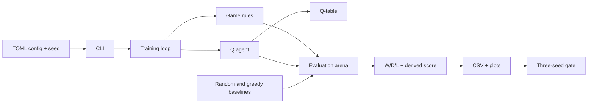

# Architecture

**Status:** S3 implements the immutable board, legal move generation, game state
with repetition and no-progress counters, terminal detection, seeded random
play, and the `play-random` CLI command. Evaluation and learning are next.

## Components

- **Game rules:** immutable board (S1), legal move generation (S2), state
  transitions and terminal/draw detection (S3).
- **Agents:** random baseline (S3), depth-1 greedy baseline (S4), and tabular
  Q-agent (S5).
- **Training:** self-play loop with periodic snapshots (S6).
- **Evaluation:** arena for pairing agents over openings and colours, plus the
  three-seed gate and metrics (S4 and S7).
- **Composition:** CLI (S3), TOML config, seed handling, and artifact writing.

The rules do not depend on agents. Agents depend on the rules. Training depends
on both. Evaluation depends on the rules and agents. The CLI composes them.

## Board module (S1)

`src/rlcheckers/game/board.py` owns the immutable 25-cell position and its
40-bit canonical key. It exposes `Board.initial()`, `Board.from_state_key()`,
`Board.piece_at()`, `Board.state_key`, and `Board.render()`.

The board validates encoding only: exactly 25 cells, `None` on light squares, a
piece code on every dark square, and a valid side to move. It does not generate
moves or judge reachability; move generation lives in S2, and `GameState`
adds the game-level piece-count check.

## Moves module (S2)

`src/rlcheckers/game/moves.py` owns the immutable `Move` value object,
`generate_moves()`, and `apply_move()`. `Move` stores the origin, every landing
square, and the captured squares in order. Its `action_key` is the 33-bit ADR
0002 encoding of the path.

`generate_moves()` returns every legal move for `Board.side_to_move`, sorted by
`(path, captures)`. Captures are mandatory; a man captures forward only while a
king captures in any direction; a capture chain continues while a jump remains.
A man that reaches the opponent's back rank is promoted and the move ends, even
if the new king could capture again. There is no maximum-capture rule, so every
complete capture path is returned.

`apply_move()` accepts exactly the moves that `generate_moves()` returns, removes
the captured pieces, promotes a man on the opponent's back rank, switches the
side, and returns a new `Board` without mutating the input. It deliberately
validates by membership in the generated move list. Counters, game state,
terminal detection, and draw rules live in `state.py`.

`format_move()` renders a move path with `-` between squares for a quiet move
and `x` for a capture. It is display-only and has no inverse parser.

## State module (S3)

`src/rlcheckers/game/state.py` owns `GameState`, `GameRecord`, `Outcome`,
`DrawReason`, and the `REPETITION_LIMIT` and `NO_PROGRESS_PLY_LIMIT` constants.
`GameState` is an immutable board plus a tuple of position keys and a
no-progress ply counter.

- `position_keys` ends with the current board key and is seeded with that key
  when constructed from empty history. The constructor validates the board,
  the key range, the last-key match, the counter range, and that at least one
  piece remains.
- `apply()` rejects terminal states, delegates the board transition to
  `apply_move()`, resets the no-progress counter on a capture or promotion,
  increments it otherwise, and appends the next position key.
- `outcome` checks decisive results before draws: no Black pieces, no White
  pieces, and no legal moves for the side to move are wins; threefold repetition
  and then 80 plies without progress are draws.
- `draw_reason` is `None` unless the outcome is a draw, and prefers repetition
  over no-progress when both apply.
- `GameRecord` holds the move tuple and terminal state, deriving `outcome` and
  `plies`.

## Agents and random play (S3)

`src/rlcheckers/agents/random_agent.py` owns `RandomAgent` and
`play_random_game()`. `RandomAgent` wraps a private `random.Random`, rejects
non-integer seeds and terminal states, and otherwise chooses uniformly from
`GameState.legal_moves()`.

`play_random_game(seed)` uses one agent and one RNG stream for both colours,
applies moves until the state is terminal, and returns a `GameRecord`. The same
seed reproduces the whole game. A game that exceeds `MAX_GAME_PLIES` without
terminating raises `RuntimeError`.

## CLI (S3)

`src/rlcheckers/cli.py` exposes `main(argv)`, and `src/rlcheckers/__main__.py`
runs it for `python -m rlcheckers`. The only command is
`play-random --seed INT`. It prints the seed, numbered moves, final outcome, and
ply count, with no board render or draw-reason line. `argparse` handles missing
or non-integer seeds as usage errors with exit code 2.

## Data flow

1. A TOML config and seed define a run.
2. Training plays games and updates the Q-table.
3. The Q-table and metrics are saved.
4. Evaluation replays the trained agent against fixed baselines over a fixed
   opening suite, using both colours.
5. The gate aggregates three seeds and writes the milestone report.

## Decisions

- [ADR 0001 — 5x5 English draughts rules](adr/0001-5x5-rules.md)
- [ADR 0002 — Board, move, and state encoding](adr/0002-board-and-state-encoding.md)
- [ADR 0003 — Evaluation protocol and gate](adr/0003-evaluation-protocol.md)

## Current milestone boundaries

- 5x5 only; no full 8x8.
- Tabular Q-learning only; no neural networks or GPU training.
- Headless only; no interactive UI.
- Local only; no cloud or distributed training.
- No reuse of the previous checkers attempt.

See `docs/00-brief.md` for the full scope and `docs/plan.md` for the slice
sequence.
