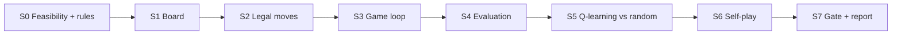

# Plan — RLCheckers, first milestone

**Date:** 2026-10-27
**Status:** S0–S3 complete; S4 next
**Source:** `docs/00-brief.md`

## How this plan works

- A slice is one testable outcome, with its tests, code, docs, and one or more
  green Conventional Commits.
- Every slice starts with `/spec`, then `/tdd` for one behaviour at a time. The
  failing test is shown before implementation.
- Every slice follows the definition of done in `AGENTS.md`: test first, full
  suite green, `ruff` clean, docs updated, and no push before approval.
- Commit each successful TDD cycle. A slice may span several self-contained,
  green commits; never commit a red or partially green tree.
- If a slice does not fit one session, split it at a testable boundary and
  update this plan. Never carry a half-finished slice across turns.
- Push only at the end of a slice, after explicit approval.
- Non-obvious decisions get an ADR before implementation. An ADR records
  policy and trade-offs: choices that change what a result means or whether two
  runs are comparable. A spec records the observable contract: interfaces,
  formats, examples, and acceptance tests. A concrete detail belongs in the
  spec unless it would change the evaluation contract, in which case it moves
  up into the ADR.

## Why this order

The order is driven by the two reasons the previous attempt failed: learning
did not improve, and there was no reliable evaluation.

1. **Rules first (S0–S3).** If move generation or terminal detection is wrong,
   every learning result is noise. Perft and known positions come before any
   agent.
2. **Evaluation before training (S4).** A trustworthy scoreboard is the
   antidote to "no reliable evaluation". It must exist before a Q-table does.
3. **Isolate the update (S5).** Train against a fixed random opponent first.
   This separates "the Q-update is wrong" from "self-play is unstable", which
   is the fastest way to diagnose "learning did not improve".
4. **Add self-play (S6).** Only after the update works against a fixed
   opponent.
5. **Run the approved gate (S7).** Three seeds, both opponents, both colours,
   fixed openings, and a report.

S5 is a diagnostic stepping stone. The milestone gate is the self-play agent in
S6/S7; S5 does not replace the brief's self-play decision.

## Slice overview

| ID | Slice | Outcome | Size | Spec | ADR gate |
|---|---|---|---|---|---|
| S0 | Feasibility and encoding | Rules, state encoding, and table budget agreed | XS | — | 0001, 0002 |
| S1 | Board and initial position | A correct 5x5 board can be created and rendered | S | 0001 | 0001, 0002 |
| S2 | Legal move generation | Every legal move, including captures and promotions | L | 0002 | 0002 |
| S3 | Game application and random play | A seeded random game reaches a result | M | 0003 | — |
| S4 | Baselines and evaluation arena | W/D/L and derived score against baselines | M–L | 0004 | 0003 |
| S5 | Tabular Q-learning | The Q-update improves against random | M–L | 0005 | 0004 |
| S6 | Self-play snapshots | Self-play improves without a fixed opponent | M | 0006 | 0005 |
| S7 | Three-seed gate and report | The approved gate is run and reported | M | 0007 | — |

Rough total: 25–35 focused hours, likely 4–6 weeks at 8–12 hours per week.

## S0 — Feasibility and encoding gate

**Outcome:** A written decision that 5x5 tabular Q-learning is viable within the
memory and time budget, plus the exact rules and state encoding.

**Acceptance criteria:**

- ADR 0001 records the 5x5 starting position, orientation, first player, move
  rules, promotion, win conditions, and draw rule.
- ADR 0002 records the board representation, move encoding, canonical state key,
  and a Q-table memory cap.
- A state-space estimate is recorded, with the projected table size and the
  reasoning behind it.
- If the estimate exceeds the agreed cap, stop and revisit board size or
  afterstates before writing code.

**Files touched:** `docs/adr/0001-5x5-rules.md`,
`docs/adr/0002-board-and-state-encoding.md`, `docs/architecture.md`.

**Tests added:** None. This is a review-and-decision gate, not a code slice.

**Rough size:** XS, 1–2 hours.

**Gate:** ADR 0001 and ADR 0002 accepted. No production code.

## S1 — Board and initial position

**Outcome:** An in-memory 5x5 board with pieces, side to move, a stable canonical
key, a text renderer, and the correct initial position.

**Acceptance criteria:**

- A new board has 5 Black men and 5 White men on the correct dark squares, with
  Black to move.
- Only dark squares are playable; coordinates and orientations are consistent
  with ADR 0001.
- The canonical key is stable for identical positions and changes when side to
  move or a piece changes.
- A text render shows the board and side to move clearly.
- Invalid coordinates, pieces, or sides fail with clear errors.

**Files touched:** `pyproject.toml`, `src/rlcheckers/__init__.py`,
`src/rlcheckers/game/__init__.py`, `src/rlcheckers/game/board.py`,
`tests/game/test_board.py`, `docs/architecture.md`.

**Tests added:** Initial counts and layout, dark-square rules, side to move,
canonical-key stability, render snapshot, invalid input.

**Rough size:** S, 2–3 hours.

**Gate:** ADR 0001 and ADR 0002; spec `0001-board-and-initial-position.md`.

**Notes:** This slice installs numpy, pytest, ruff, and matplotlib into `.venv`
and configures the `src/` layout, pytest, and ruff. No agent or training code.

## S2 — Legal move generation

**Outcome:** For any 5x5 position, the engine returns every legal move, including
mandatory captures, multiple captures, promotions, and king moves.

**Acceptance criteria:**

- Men move one square diagonally forward; kings move one square diagonally in
  any direction.
- Captures are mandatory; men capture forward only; kings capture in any
  direction.
- Multiple captures continue until no capture remains; promotion ends the move.
- If more than one capture sequence exists, each legal sequence is returned.
- Perft counts for at least three known positions at depths 1–3 match the values
  recorded in the tests.
- Applying any returned move never leaves two pieces on one square, removes
  exactly the captured pieces, and alternates the side to move.

**Files touched:** `src/rlcheckers/game/moves.py`,
`src/rlcheckers/game/pieces.py` if needed, `tests/game/test_moves.py`,
`tests/game/test_perft.py`, `docs/architecture.md`.

**Tests added:** Perft, mandatory capture, multiple capture branches, promotion,
king direction, edge positions, property tests for piece conservation and
turn alternation.

**Rough size:** L, 4–6 hours. Split into quiet moves and captures if it exceeds
one session.

**Gate:** ADR 0002; spec `0002-legal-move-generation.md`.

**Risk:** High. A rules bug invalidates every later result.

## S3 — Game application, terminal states, and random play

**Status:** complete and pushed (2026-10-30).

**Outcome:** A game can be played from the initial position to a win or draw
using random legal moves, and a seeded game is reproducible.

**Acceptance criteria:**

- Applying a move updates the board, captures, promotion, side to move, and the
  repetition and no-progress counters.
- A side loses when it has no pieces or no legal moves.
- A game is drawn after threefold repetition or 80 plies without a capture or
  promotion.
- A seeded random-vs-random game terminates, and replaying the seed produces the
  same move sequence and result.
- `python -m rlcheckers play-random --seed N` prints the moves and the result.

**Files touched:** `src/rlcheckers/game/state.py`,
`src/rlcheckers/agents/random_agent.py`, `src/rlcheckers/cli.py`,
`src/rlcheckers/__main__.py`, `tests/game/test_state.py`,
`tests/agents/test_random_agent.py`, `tests/test_cli.py`.

**Tests added:** Move application, capture removal, promotion, terminal win,
repetition draw, no-progress draw, seeded reproducibility, CLI smoke test.

**Rough size:** M, 3–4 hours.

**Gate:** Spec `0003-game-application-and-random-play.md`.

## S4 — Baselines and evaluation arena

**Outcome:** A headless evaluation command plays two agents over a fixed opening
suite, both colours, for N games, and reports W/D/L and the derived score.

**Acceptance criteria:**

- The random baseline chooses uniformly among legal moves.
- The depth-1 greedy baseline uses a documented material evaluation and a
  deterministic tie-break; the exact definition is in the spec.
- The arena supports any two agents, both colours per opening, fixed seeds, and
  configurable game counts.
- Metrics include wins, draws, losses, derived score, and per-seed results.
- `python -m rlcheckers evaluate --config ...` writes a CSV with the documented
  schema.
- A 10-game smoke evaluation completes; a 1,000-game evaluation is available.

**Files touched:** `src/rlcheckers/agents/greedy_agent.py`,
`src/rlcheckers/evaluation/arena.py`,
`src/rlcheckers/evaluation/metrics.py`, `src/rlcheckers/config.py`,
`tests/agents/test_greedy_agent.py`, `tests/evaluation/test_arena.py`,
`tests/evaluation/test_metrics.py`, `docs/architecture.md`.

**Tests added:** Greedy choice on known positions, colour swap, opening-suite
application, metric arithmetic, seed reproducibility, CSV schema, small-N
integration.

**Rough size:** M–L, 4–6 hours. Split the arena from the baselines if needed.

**Gate:** ADR 0003; spec `0004-evaluation-arena.md`.

**Risk:** High for trust. This slice is the answer to "no reliable evaluation".

## S5 — Tabular Q-learning against a fixed random opponent

**Outcome:** A Q-learning agent trains against a fixed random opponent, saves its
Q-table and metrics, and measurably improves against random.

**Acceptance criteria:**

- The Q-table is keyed by canonical state and action; epsilon-greedy selection
  and the Q-learning update use configurable alpha, gamma, and epsilon.
- A tiny deterministic example verifies the update arithmetic.
- Save and load round-trip preserves the Q-table and metadata.
- A short seeded training run writes a Q-table, config, CSV, and plot.
- The trained agent improves against random on the evaluation suite. This is a
  diagnostic result, not the final gate.
- Q-table size and memory are logged; training stops with a clear error if the
  configured cap is exceeded.

**Files touched:** `src/rlcheckers/agents/q_agent.py`,
`src/rlcheckers/training/train_q.py`, `src/rlcheckers/config.py`,
`tests/agents/test_q_agent.py`, `tests/training/test_train_q.py`,
`docs/architecture.md`.

**Tests added:** Q-update arithmetic, epsilon schedule, state-key stability,
save/load, memory cap, short training smoke test, improvement check.

**Rough size:** M–L, 4–6 hours. Split the agent from the training loop if needed.

**Gate:** ADR 0004; spec `0005-tabular-q-learning.md`.

**Risk:** High. If the update is wrong, fix it here before adding self-play.

**Note:** This is a diagnostic slice. The final training regime is self-play in
S6.

## S6 — Self-play with periodic snapshots

**Outcome:** The Q-agent trains through self-play against periodic snapshots and
improves against random and depth-1 greedy without a fixed training opponent.

**Acceptance criteria:**

- A snapshot policy is created every N episodes and used as the opponent.
- The training loop records the opponent snapshot and evaluation metrics.
- A seeded self-play run writes a Q-table, config, CSV, and learning-curve plot.
- The agent improves against random and greedy on the evaluation suite. It may
  still be below the final gate.
- A snapshot or opponent-selection failure produces a clear error, not a silent
  fallback.

**Files touched:** `src/rlcheckers/training/self_play.py`,
`src/rlcheckers/agents/q_agent.py`, `src/rlcheckers/config.py`,
`tests/training/test_self_play.py`, `docs/architecture.md`.

**Tests added:** Snapshot cadence, opponent selection, seeded reproducibility,
no-collapse smoke test, artifact writing.

**Rough size:** M, 3–4 hours.

**Gate:** ADR 0005; spec `0006-self-play-snapshots.md`.

**Risk:** High. Self-play is non-stationary; keep the fixed baselines as the
scoreboard.

## S7 — Three-seed gate and report

**Outcome:** A reproducible three-seed evaluation against random and depth-1
greedy, with W/D/L, derived score, plots, and a written first-milestone report.

**Acceptance criteria:**

- Three independent training seeds are evaluated against both baselines.
- Each matchup uses 1,000 games, both colours, and the fixed opening suite.
- The report shows per-seed and aggregate W/D/L and derived score, with the
  gate thresholds and a clear pass/fail.
- Artifacts are written under `docs/results/` and the CSV/plots are reproducible
  from the saved configs and seeds.
- Runtime is within the target; if not, the report says where time went.
- A small-N integration test covers the gate logic without running the full
  experiment.

**Files touched:** `src/rlcheckers/evaluation/gate.py`,
`src/rlcheckers/cli.py`, `tests/evaluation/test_gate.py`,
`docs/results/first-milestone.md`, `docs/architecture.md`.

**Tests added:** Metric aggregation, gate pass/fail logic, report generation,
small-N integration.

**Rough size:** M, 3–4 hours plus compute.

**Gate:** Spec `0007-three-seed-gate.md`.

## ADRs required

| ADR | Decision | Needed before |
|---|---|---|
| 0001 | 5x5 rules, starting position, orientation, first player, draw rule | S0/S1 |
| 0002 | Board, move, and canonical-state encoding; Q-table memory cap | S0/S1 |
| 0003 | Evaluation protocol: score definition, colour pairing, fixed-opening policy, gate statistics, determinism, agent interface | S4 |
| 0004 | Q-learning state/action representation and initial hyperparameters | S5 |
| 0005 | Self-play snapshot cadence and opponent selection | S6 |

ADR 0003 settles evaluation policy: the score definition, colour pairing,
fixed-opening policy, gate statistics, determinism guarantees, and the agent
interface the arena depends on. Spec 0004 settles the concrete contract: the
opening positions, baseline definitions, arena pairing mechanics, metric
schema, CSV columns, config schema, and CLI syntax. A concrete choice moves up
into ADR 0003 only if it would change the evaluation contract.

## Deliberately deferred

- Afterstate value learning. It is a post-milestone experiment, not part of the
  first gate.
- Dense Q-tables, tile coding, and any function approximation.
- Full 8x8 checkers, neural networks, GPU training, AlphaZero, and MCTS.
- Interactive UI or a playable CLI beyond the headless commands.
- Cloud or distributed training, hyperparameter search, and large leagues.
- Opening books, endgame tablebases, and perfect play.
- Packaging, publishing, and distribution.
- Advanced algorithms such as SARSA(λ), PPO, or actor-critic methods.
- Performance work beyond the "minutes, not hours" target.
- Reusing any previous checkers material.

## Risks and mitigations

| Risk | Mitigation |
|---|---|
| 5x5 Q-table is larger than expected | S0 estimate and memory cap; integer keys; sparse storage; afterstates as fallback |
| Rules bug invalidates results | Perft, known positions, property tests, and manual game reviews before training |
| Learning still does not improve | Fixed-opponent diagnostic in S5 before self-play; inspect Q-values; keep the evaluation harness fixed |
| Self-play collapse or forgetting | Periodic snapshots; evaluate against fixed baselines; stop and inspect if the curve falls |
| Evaluation noise or overfitting | 3 seeds, 1,000 games, both colours, fixed openings, per-seed reporting |
| Games never terminate | Explicit draw rule and dedicated tests for repetition and no-progress |
| Reproducibility drift | Seed everything; save config, versions, and the resolved command line |
| Scope creep | Explicit non-goals; one slice per turn; split a slice rather than expand it |

## What each spec must settle

- **Spec 0001:** coordinates, orientation, initial layout, render format, key
  format.
- **Spec 0002:** move encoding, capture-path representation, promotion timing,
  perft positions and expected counts.
- **Spec 0003:** state transition contract, repetition and no-progress counters,
  draw and win contracts, CLI output.
- **Spec 0004:** opening-suite contents, baseline definitions, arena pairing,
  metric schema including the confidence interval, CSV columns, config schema,
  CLI syntax, seed handling.
- **Spec 0005:** state key, action key, update equation, epsilon schedule,
  hyperparameter defaults, save format, memory cap.
- **Spec 0006:** snapshot cadence, opponent selection, training/evaluation
  interleaving, artifact layout.
- **Spec 0007:** gate aggregation and report format, runtime budget, and failure
  handling; it reuses the spec 0004 interval rather than defining a second one.

## Next step

1. Run `/spec` for `0004-evaluation-arena.md` (S4).
2. Run `/tdd` for the first behaviour in S4.
3. Keep training code out until the evaluation harness in S4 is green.
