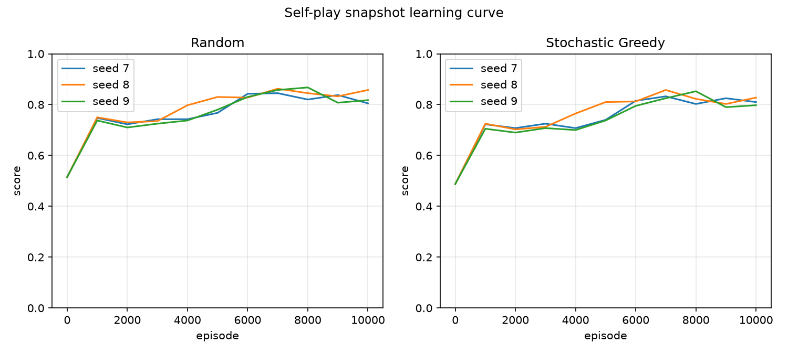

# S7 three-seed gate diagnostics

- **Slice:** S7 ΓÇö Three-seed gate and report
- **Date:** 2026-11-06
- **Status:** pass; approved and pushed 2026-11-06
- **Spec:** `docs/specs/0007-three-seed-gate.md`

## Intended goal

Train three independent self-play seeds, evaluate each final agent against random and seeded stochastic greedy, and report the ADR 0003 gate with per-snapshot and depth-2 diagnostics.

## Configuration

```toml
seeds = [7, 8, 9]
eval_seed = 7
episodes = 10000
alpha = 0.1
gamma = 0.9
epsilon_start = 1.0
epsilon_end = 0.05
epsilon_decay_fraction = 0.8
output_dir = "C:\dev\RLCheckers\docs\results"
max_table_entries = 2000000
snapshot_interval = 1000
games = 1000
snapshot_games = 200
unique_games = 10
```

Command: `rlcheckers gate --config gate.toml`

## Gate decision

Passed: yes

## Per-seed results

| Seed | Table size | Random W/D/L | Random score | Random CI | Stochastic greedy W/D/L | Stochastic greedy score | Stochastic greedy CI | Deterministic greedy W/D/L | Depth-2 W/D/L |
|---:|---:|---:|---:|---:|---:|---:|---:|---:|---:|
| 7 | 7181 | 818/23/159 | 0.829500 | 0.806659..0.852341 | 808/22/170 | 0.819000 | 0.795572..0.842428 | 10/0/0 | 4/0/6 |
| 8 | 7409 | 832/25/143 | 0.844500 | 0.822570..0.866430 | 817/28/155 | 0.831000 | 0.808348..0.853652 | 10/0/0 | 4/0/6 |
| 9 | 7388 | 800/36/164 | 0.818000 | 0.794808..0.841192 | 783/35/182 | 0.800500 | 0.776408..0.824592 | 10/0/0 | 4/0/6 |

## Aggregate

| Metric | Value | Threshold |
|---|---:|---:|
| Random mean | 0.830667 | 0.600000 |
| Random min | 0.818000 | 0.500000 |
| Stochastic greedy mean | 0.816833 | 0.550000 |
| Stochastic greedy min | 0.800500 | 0.500000 |

## Per-colour

| Seed | Opponent | Black W/D/L | Black score | White W/D/L | White score |
|---:|---|---:|---:|---:|---:|
| 7 | random | 415/6/79 | 0.836000 | 403/17/80 | 0.823000 |
| 7 | stochastic_greedy | 411/5/84 | 0.827000 | 397/17/86 | 0.811000 |
| 7 | deterministic_greedy | 5/0/0 | 1.000000 | 5/0/0 | 1.000000 |
| 7 | depth2 | 3/0/2 | 0.600000 | 1/0/4 | 0.200000 |
| 8 | random | 425/6/69 | 0.856000 | 407/19/74 | 0.833000 |
| 8 | stochastic_greedy | 418/5/77 | 0.841000 | 399/23/78 | 0.821000 |
| 8 | deterministic_greedy | 5/0/0 | 1.000000 | 5/0/0 | 1.000000 |
| 8 | depth2 | 3/0/2 | 0.600000 | 1/0/4 | 0.200000 |
| 9 | random | 414/5/81 | 0.833000 | 386/31/83 | 0.803000 |
| 9 | stochastic_greedy | 404/6/90 | 0.814000 | 379/29/92 | 0.787000 |
| 9 | deterministic_greedy | 5/0/0 | 1.000000 | 5/0/0 | 1.000000 |
| 9 | depth2 | 3/0/2 | 0.600000 | 1/0/4 | 0.200000 |

## Snapshot curve

| Seed | Episode | Table size | Random score | Stochastic greedy score |
|---:|---:|---:|---:|---:|
| 7 | 0 | 0 | 0.515000 | 0.487500 |
| 7 | 1000 | 1704 | 0.747500 | 0.722500 |
| 7 | 2000 | 3036 | 0.722500 | 0.707500 |
| 7 | 3000 | 4130 | 0.742500 | 0.725000 |
| 7 | 4000 | 4932 | 0.742500 | 0.707500 |
| 7 | 5000 | 5853 | 0.767500 | 0.740000 |
| 7 | 6000 | 6510 | 0.842500 | 0.815000 |
| 7 | 7000 | 6882 | 0.845000 | 0.832500 |
| 7 | 8000 | 7023 | 0.820000 | 0.802500 |
| 7 | 9000 | 7106 | 0.837500 | 0.825000 |
| 7 | 10000 | 7181 | 0.805000 | 0.810000 |
| 8 | 0 | 0 | 0.515000 | 0.487500 |
| 8 | 1000 | 1732 | 0.750000 | 0.725000 |
| 8 | 2000 | 3105 | 0.730000 | 0.702500 |
| 8 | 3000 | 4238 | 0.735000 | 0.712500 |
| 8 | 4000 | 5167 | 0.797500 | 0.765000 |
| 8 | 5000 | 5854 | 0.830000 | 0.810000 |
| 8 | 6000 | 6454 | 0.827500 | 0.812500 |
| 8 | 7000 | 6746 | 0.862500 | 0.857500 |
| 8 | 8000 | 6972 | 0.845000 | 0.822500 |
| 8 | 9000 | 7177 | 0.832500 | 0.802500 |
| 8 | 10000 | 7409 | 0.857500 | 0.827500 |
| 9 | 0 | 0 | 0.515000 | 0.487500 |
| 9 | 1000 | 1778 | 0.737500 | 0.705000 |
| 9 | 2000 | 3159 | 0.710000 | 0.690000 |
| 9 | 3000 | 4262 | 0.725000 | 0.707500 |
| 9 | 4000 | 5186 | 0.737500 | 0.700000 |
| 9 | 5000 | 6088 | 0.780000 | 0.737500 |
| 9 | 6000 | 6711 | 0.830000 | 0.795000 |
| 9 | 7000 | 6917 | 0.857500 | 0.825000 |
| 9 | 8000 | 7187 | 0.867500 | 0.852500 |
| 9 | 9000 | 7322 | 0.807500 | 0.790000 |
| 9 | 10000 | 7388 | 0.817500 | 0.797500 |



## Unique-game accounting

| Opponent | Games | Unique games | CI applicable |
|---|---:|---:|---|
| random | 1000 | 1000 | yes |
| stochastic_greedy | 1000 | 1000 | yes |
| deterministic_greedy | 10 | 10 | no |
| depth2 | 10 | 10 | no |

## Depth-2 diagnostic

| Seed | W/D/L | Score | Unique games |
|---:|---:|---:|---:|
| 7 | 4/0/6 | 0.400000 | 10 |
| 8 | 4/0/6 | 0.400000 | 10 |
| 9 | 4/0/6 | 0.400000 | 10 |

## Caveats

- Random and stochastic greedy are weak baselines; the gate is a diagnostic, not a general-strength claim.
- Deterministic greedy is 10 unique games per seed, not 1,000 independent games.
- Depth-2 is a reported diagnostic, not part of the pass/fail gate.
- The per-snapshot curve uses `snapshot_games` per snapshot per opponent.
- The ADR 0003 thresholds are fixed for this milestone.

## Artifacts

- `q_table_seed_7.json`
- `q_table_seed_8.json`
- `q_table_seed_9.json`
- `gate.json`
- `gate.csv`
- `snapshot_curve.csv`
- `snapshot_curve.png`
- `s7-three-seed-gate-diagnostics.md`

## Verification commands

| Command | Result |
|---|---|
| `.\.venv\Scripts\python.exe -m pytest -q` | 382 passed, 2 deselected |
| `.\.venv\Scripts\python.exe -m ruff check .` | clean |
| `.\.venv\Scripts\python.exe -m rlcheckers gate --config gate.toml` | pass; random mean 0.830667, stochastic greedy mean 0.816833 |

The gate-generated portion above is reproducible from `gate.toml`; this
verification section is added by the final TDD step.
