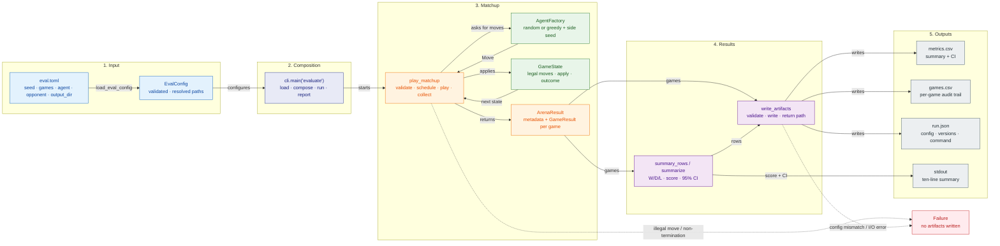
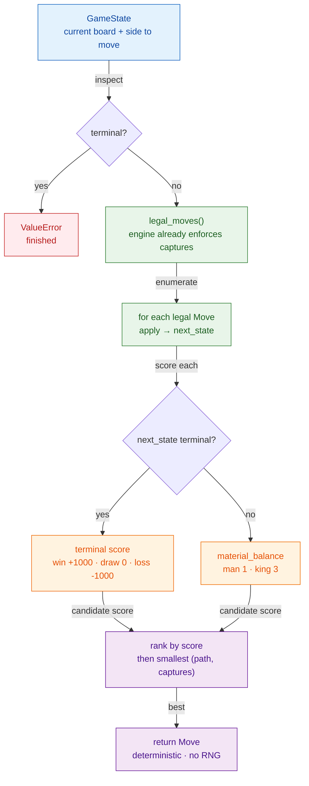
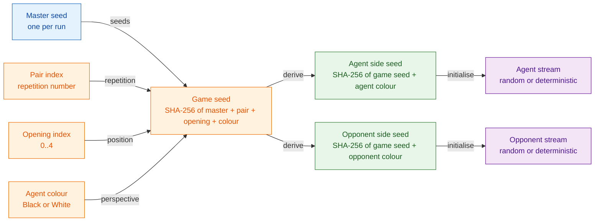
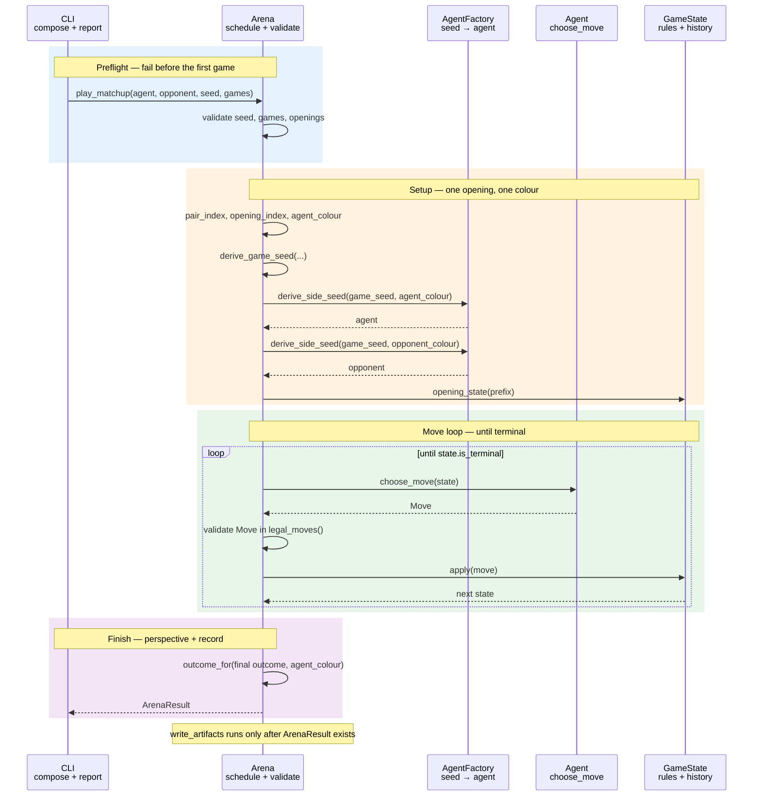
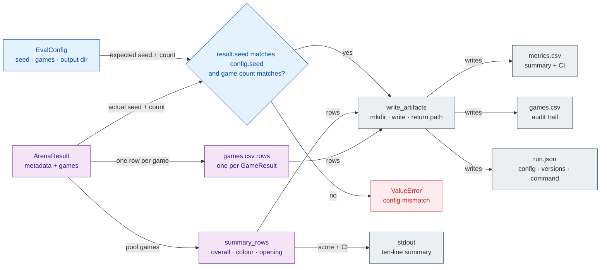

# Spec 0004 — Baselines and evaluation arena

- **Status:** proposed
- **Date:** 2026-11-01
- **Slice:** S4 — Baselines and evaluation arena
- **Related:** `docs/00-brief.md`, `docs/plan.md`, ADR 0001, ADR 0002,
  ADR 0003, `docs/architecture.md`,
  `docs/specs/0003-game-application-and-random-play.md`

## Outcome

A caller can run a seeded, colour-balanced evaluation of any two agents over a
fixed five-position opening suite, and receive reproducible W/D/L metrics, a
derived score with a 95% confidence interval, per-colour and per-opening
breakdowns, and CSV/JSON artifacts, including through
`python -m rlcheckers evaluate --config PATH`.

## Public interface

### System view

Figure 1 is the runtime path from a TOML file to the three artifacts. It is
explanatory rather than a second contract; the sections below define each box.



**Figure 1 — S4 runtime pipeline.** The CLI is the only place that composes
all five contracts. The arena returns an `ArenaResult`; only then does
`write_artifacts` create files, so a failed game or an invalid config cannot
leave partial metrics. Blue is input, indigo is composition, green is
rules/agents, orange is the matchup, purple is results, grey is output, and red
is the loud-failure path. Related decisions: 2 (artifact count), 5 (modules),
and 11 (registry scope).

### Modules and imports

New production modules:

- `src/rlcheckers/agents/protocol.py` — `Agent` and `AgentFactory`.
- `src/rlcheckers/agents/greedy_agent.py` — `GreedyAgent`, `material_balance`,
  and the value constants.
- `src/rlcheckers/evaluation/__init__.py` — re-exports for the evaluation
  package.
- `src/rlcheckers/evaluation/arena.py` — `STANDARD_OPENINGS`,
  `opening_state`, `outcome_for`, `GameOutcome`, `GameResult`, `ArenaResult`,
  `ArenaError`, `play_matchup`, `derive_game_seed`, and `derive_side_seed`.
- `src/rlcheckers/evaluation/metrics.py` — `ScoreSummary`, `SummaryRow`,
  `summarize`, `summary_rows`, and `format_float`.
- `src/rlcheckers/evaluation/artifacts.py` — `write_artifacts`,
  `METRICS_FIELDS`, and `GAMES_FIELDS`.
- `src/rlcheckers/config.py` — `EvalConfig`, `ConfigError`, and
  `load_eval_config`.

Existing modules gain public names:

- `src/rlcheckers/agents/__init__.py` re-exports `Agent`, `AgentFactory`,
  `GreedyAgent`, `material_balance`, `AGENT_NAMES`, and `make_agent` in
  addition to the current names.
- `src/rlcheckers/cli.py` gains the `evaluate` subcommand.

Canonical imports:

```python
from rlcheckers.agents import (
    AGENT_NAMES,
    Agent,
    AgentFactory,
    GreedyAgent,
    RandomAgent,
    make_agent,
    material_balance,
)
from rlcheckers.config import ConfigError, EvalConfig, load_eval_config
from rlcheckers.evaluation import (
    STANDARD_OPENINGS,
    ArenaError,
    ArenaResult,
    GameOutcome,
    GameResult,
    ScoreSummary,
    SummaryRow,
    derive_game_seed,
    derive_side_seed,
    opening_state,
    outcome_for,
    play_matchup,
    summarize,
    summary_rows,
    write_artifacts,
)
```

S4 uses only the standard library and the existing `rlcheckers` modules. It
does not import numpy or matplotlib. The arena is headless and writes files;
it never renders a board.

### Opening suite

`STANDARD_OPENINGS` is a tuple of five move prefixes from the initial position.
Each prefix is a tuple of `Move` objects. The exact suite is:

```python
STANDARD_OPENINGS = (
    (),
    (Move((6, 10)),),
    (Move((8, 14)),),
    (Move((6, 10)), Move((18, 14))),
    (Move((8, 14)), Move((16, 12))),
)
```

| Index | Prefix from initial | Side to move | State key | No-progress |
|---|---|---|---|---|
| 0 | none | Black | `235602448969` | 0 |
| 1 | `6-10` | White | `785358295113` | 1 |
| 2 | `8-14` | White | `785360355913` | 1 |
| 3 | `6-10`, `18-14` | Black | `235206119497` | 2 |
| 4 | `8-14`, `16-12` | Black | `235554996809` | 2 |

The move strings in the table are `format_move` output for readability. The
canonical representation is the `Move` tuples above.

`opening_state(moves)` returns the `GameState` after applying the prefix to
`GameState.from_board(Board.initial())` through `GameState.apply`. The prefix
therefore contributes to `position_keys` and to `no_progress_plies`; the game
does not start from a bare board. Every prefix is legal, non-terminal, and
produces a distinct state key. The suite is fixed in code: changing it creates
a new evaluation contract.

Because there are five openings and every opening is played with both colours,
one full cycle is ten games. The arena requires the game count to be a multiple
of ten, which keeps colours and openings balanced and gives every summary
group at least two games.

### Agent protocol and registry

`src/rlcheckers/agents/protocol.py` defines:

```python
class Agent(Protocol):
    def choose_move(self, state: GameState) -> Move: ...

AgentFactory = Callable[[int], Agent]
```

An agent receives the current `GameState`, which carries the side to move. An
agent must return a legal move, must not mutate the state, and may own a seeded
RNG. `RandomAgent` already satisfies the protocol; `GreedyAgent` adds a
deterministic implementation.

`agents/__init__.py` defines:

```python
AGENT_NAMES = ("greedy", "random")

def make_agent(name: str, seed: int) -> Agent: ...
```

`make_agent` maps `"random"` to `RandomAgent(seed=seed)` and `"greedy"` to
`GreedyAgent()`. An unknown name raises `ValueError` containing
`unknown agent`. The seed is passed to every factory but only agents with
randomness use it.

`AgentFactory` is the arena's dependency: the arena never imports the registry
and never branches on agent names.

### Greedy baseline

`src/rlcheckers/agents/greedy_agent.py` defines:

```python
MAN_VALUE = 1
KING_VALUE = 3
TERMINAL_SCORE = 1000

def material_balance(board: Board, side: Side) -> int: ...

class GreedyAgent:
    def choose_move(self, state: GameState) -> Move: ...
```

`material_balance` counts the pieces on `board` from `side`'s perspective:
men are worth 1, kings are worth 3, and the result is the side's total minus
the opponent's total. Empty squares and light squares contribute nothing. The
function does not look at side to move.

`GreedyAgent.choose_move` is a depth-1 material search:

1. If `state.is_terminal`, raise `ValueError` containing `finished`.
2. For every move in `state.legal_moves()`, compute
   `next_state = state.apply(move)`.
3. If `next_state.is_terminal`, score the move by outcome for the moving side:
   `TERMINAL_SCORE` for a win, `0` for a draw, `-TERMINAL_SCORE` for a loss.
4. Otherwise score the move with
   `material_balance(next_state.board, state.board.side_to_move)`.
5. Choose the highest score. Break ties with the smallest
   `(move.path, move.captures)` in ordinary tuple order.
6. Return the chosen move.



**Figure 2 — Greedy choice.** The baseline searches exactly one ply. The
terminal override makes it take an immediate win, but it never sees the
opponent's reply; that is the trade-off for a cheap, deterministic baseline.
Blue is the input state, green is the legal-move path, orange is scoring,
purple is the tie-break and return, and red is the error. Related decisions: 7
(terminal bonus) and 13 (cost).

The terminal override prevents the baseline from ignoring an immediate win or
draw just because material is unchanged. It is still depth-1: the agent never
considers the opponent's reply, so it can walk into a capture.

Captures are already mandatory in the move generator, so the agent compares
only the legal moves the engine returns. It does not generate moves itself and
does not mutate the state. It owns no RNG and is deterministic.

### Arena

`src/rlcheckers/evaluation/arena.py` defines the evaluation data types and the
match loop.

```python
class GameOutcome(Enum):
    WIN = "win"
    DRAW = "draw"
    LOSS = "loss"

    @property
    def score(self) -> float: ...

@dataclass(frozen=True)
class GameResult:
    game_index: int
    pair_index: int
    opening_index: int
    agent_colour: Side
    outcome: GameOutcome
    plies: int
    game_seed: int
    final_state_key: int

@dataclass(frozen=True)
class ArenaResult:
    agent_name: str
    opponent_name: str
    seed: int
    openings: tuple[tuple[Move, ...], ...]
    games: tuple[GameResult, ...]
```

`GameOutcome.score` is `1.0` for `WIN`, `0.5` for `DRAW`, and `0.0` for `LOSS`.
`GameResult.outcome` is always from the agent-under-test perspective, never from
Black's. `plies` counts moves after the opening prefix, not the prefix itself.
`final_state_key` is the canonical board key at the end of the game.
`ArenaResult.openings` is the immutable suite actually used, so artifacts and
tests do not have to assume the standard suite.

`play_matchup` is the public entry point:

```python
def play_matchup(
    agent_factory: AgentFactory,
    opponent_factory: AgentFactory,
    *,
    seed: int,
    games: int,
    agent_name: str = "agent",
    opponent_name: str = "opponent",
    openings: Sequence[Sequence[Move]] = STANDARD_OPENINGS,
) -> ArenaResult: ...
```

Validation, before the first game:

- `seed` must be an `int` and not a `bool`; otherwise `TypeError` naming
  `seed`.
- `games` must be a positive `int`, not a `bool`, and a multiple of
  `2 * len(openings)`; otherwise `ValueError` naming `games`.
- `openings` must be non-empty. Each opening must be a sequence of legal moves
  from the initial position and must not be terminal. Duplicate opening state
  keys are rejected because they would double-weight one position.
- The opening state keys are recomputed from the move prefixes; callers cannot
  pass a board directly.

#### Schedule

For `p` in `0 .. games // 2 - 1`, and for offset `0` then `1`:

- `game_index = 2 * p + offset`
- `pair_index = p`
- `opening_index = p % len(openings)`
- `agent_colour = Side.BLACK` when `offset == 0`, otherwise `Side.WHITE`

For the standard five-opening suite, ten games produce:

| Game | Pair | Opening | Agent colour |
|---|---|---|---|
| 0 | 0 | 0 | Black |
| 1 | 0 | 0 | White |
| 2 | 1 | 1 | Black |
| 3 | 1 | 1 | White |
| 4 | 2 | 2 | Black |
| 5 | 2 | 2 | White |
| 6 | 3 | 3 | Black |
| 7 | 3 | 3 | White |
| 8 | 4 | 4 | Black |
| 9 | 4 | 4 | White |

Games 10–19 repeat the same opening pattern. Every opening gets
`games / len(openings)` games and every colour gets `games / 2` games.

#### Seeding

Each game has one base seed derived from the run seed and the game identity:

```python
def derive_game_seed(
    master_seed: int, pair_index: int, opening_index: int, agent_colour: Side
) -> int:
    payload = f"{master_seed}|{pair_index}|{opening_index}|{agent_colour.name}"
    return int.from_bytes(hashlib.sha256(payload.encode()).digest()[:8], "big")

def derive_side_seed(game_seed: int, side: Side) -> int:
    payload = f"{game_seed}|{side.name}"
    return int.from_bytes(hashlib.sha256(payload.encode()).digest()[:8], "big")
```

The arena calls each factory with the side-specific seed:
`agent_factory(derive_side_seed(game_seed, agent_colour))` and
`opponent_factory(derive_side_seed(game_seed, opponent_colour))`, where
`opponent_colour` is the other `Side`. Both sides therefore get independent
streams, and the pair index makes reordering or parallelising games harmless.

The derivation uses SHA-256 rather than `hash()` because Python's string hash
is salted per process. The recorded `game_seed` is the base seed, not either
side seed.



**Figure 3 — Seed derivation.** Every stream is a pure function of the master
seed and the game's identity, so execution order cannot change a game.
Blue is the master seed, orange is game identity, green is side seeds, and
purple is the resulting streams. `games.csv` stores only the base `game_seed`;
the side seeds are reproducible from it. Related decisions: 4 (one master seed)
and 10 (side seeds).

#### Game loop

For each scheduled game:

1. Build the opening state with `opening_state(openings[opening_index])`.
2. Create the two agents with the side seeds above and assign them to Black and
   White according to `agent_colour`.
3. While `state.is_terminal` is false:
   - pick the agent for `state.board.side_to_move`;
   - call `choose_move(state)`;
   - reject a move that is not in `state.legal_moves()` with `ArenaError`
     containing `illegal` and the game index;
   - apply the move with `state.apply`;
   - increment `plies`;
   - raise `RuntimeError` containing `did not terminate` after
     `MAX_GAME_PLIES` (2000) plies.
4. Map the final `Outcome` to the agent perspective with `outcome_for`.
5. Record the `GameResult`.



**Figure 4 — One game.** Blue is preflight, orange is setup, green is the move
loop, and purple is result mapping. The arena validates every move; an illegal
move or a 2,000-ply non-termination raises before any artifact is written.
Related decisions: 7 (greedy policy), 10 (side seeds), and 13 (greedy cost).

`outcome_for(outcome: Outcome, agent_colour: Side) -> GameOutcome` is public:

```python
def outcome_for(outcome: Outcome, agent_colour: Side) -> GameOutcome: ...
```

- `DRAW` maps to `DRAW` for either colour.
- `BLACK_WIN` maps to `WIN` for Black and `LOSS` for White.
- `WHITE_WIN` maps to `WIN` for White and `LOSS` for Black.
- `ONGOING` raises `ValueError` containing `ongoing`.

The arena never asks an agent to move in a terminal state. It validates every
returned move, even though `GameState.apply` would also reject an illegal move,
so the error names the offending game. A `RuntimeError` from the game-length
guard is not swallowed.

#### Errors

| Condition | Error |
|---|---|
| `seed` is not an int or is a bool | `TypeError` naming `seed` |
| `games` is not a positive multiple of the suite cycle | `ValueError` naming `games` |
| an opening prefix is illegal | `ValueError` naming the opening index |
| an opening is terminal | `ValueError` naming the opening index |
| two openings resolve to the same key | `ValueError` naming `opening` |
| an agent returns an illegal move | `ArenaError` containing `illegal` and the game index |
| a game exceeds `MAX_GAME_PLIES` | `RuntimeError` containing `did not terminate` |
| `outcome_for` is called with `ONGOING` | `ValueError` containing `ongoing` |

`ArenaError` subclasses `RuntimeError`. Tests assert substrings, not full
wording.

### Metrics

`src/rlcheckers/evaluation/metrics.py` defines:

```python
@dataclass(frozen=True)
class ScoreSummary:
    games: int
    wins: int
    draws: int
    losses: int
    score: float
    ci_low: float
    ci_high: float

@dataclass(frozen=True)
class SummaryRow:
    group: str
    key: str
    summary: ScoreSummary

def summarize(outcomes: Sequence[GameOutcome]) -> ScoreSummary: ...
def summary_rows(result: ArenaResult) -> tuple[SummaryRow, ...]: ...
def format_float(value: float) -> str: ...
```

`summarize` computes:

- `games = len(outcomes)`, `wins`, `draws`, and `losses` by counting the
  `GameOutcome` members.
- `score = (wins + 0.5 * draws) / games`.
- The sample variance of the per-game scores
  `(sum((x - mean) ** 2) / (games - 1))`, the standard error
  `sqrt(variance / games)`, and a two-sided 95% interval
  `mean ± NormalDist().inv_cdf(0.975) * stderr`.
- `ci_low = max(0.0, lower)` and `ci_high = min(1.0, upper)`.
- No rounding in the dataclass; rounding happens only in CSV and display
  formatting.

`summarize` requires at least two outcomes because the sample variance is
undefined for one. Empty or single-game input raises `ValueError` containing
`at least two games`.

`summary_rows(result)` returns rows in this exact order:

1. `SummaryRow("overall", "", summarize(all outcomes))`
2. `SummaryRow("colour", "black", ...)`
3. `SummaryRow("colour", "white", ...)`
4. `SummaryRow("opening", "0", ...)` through `"4"` in ascending index order.

Per-colour and per-opening groups are computed from `result.games`. With the
standard suite and a valid game count, every group has at least two games.
`summary_rows` does not add a per-opening-by-colour row. It is specified for
the standard five-opening suite; a custom suite with fewer than two games in a
group is outside this contract, and `summarize` raises rather than inventing an
interval.

`format_float` returns `f"{value:.6f}"`, so `0.8` becomes `"0.800000"`. It is
used for `score`, `ci_low`, and `ci_high` in CSV and on stdout.

Example: seven wins, two draws, and one loss give
`score = (7 + 1) / 10 = 0.8`. The per-game values are seven `1.0`, two `0.5`,
and one `0.0`; the sample variance is `1.10 / 9 = 0.12222`, the standard error
is `0.11055`, and the interval is approximately `[0.583333, 1.000000]` after
clamping the upper bound.

### Config

`src/rlcheckers/config.py` defines:

```python
@dataclass(frozen=True)
class EvalConfig:
    seed: int
    games: int
    agent: str
    opponent: str
    output_dir: Path

class ConfigError(ValueError): ...

def load_eval_config(path: str | Path) -> EvalConfig: ...
```

An example config:

```toml
seed = 7
games = 10
agent = "random"
opponent = "greedy"
output_dir = "results/smoke"
```

`load_eval_config` reads the file as UTF-8 with `tomllib`, validates the
top-level table, and returns an immutable `EvalConfig`. A relative
`output_dir` resolves against the config file's parent directory; an absolute
path is kept. The function does not create the directory.

Validation rules:

| Key | Rule | Error |
|---|---|---|
| top level | must be a table with no unknown keys | `ConfigError` naming the unexpected key |
| `seed` | required `int`, not `bool` | `ConfigError` naming the key and expected type |
| `games` | required `int`, not `bool`, positive, divisible by `2 * len(STANDARD_OPENINGS)` (10) | `ConfigError` naming the key and the divisor |
| `agent` | required `str` in `AGENT_NAMES` | `ConfigError` naming the key and the allowed names |
| `opponent` | required `str` in `AGENT_NAMES` | `ConfigError` naming the key and the allowed names |
| `output_dir` | required non-empty `str` | `ConfigError` naming the key |

A missing key, a missing file, a TOML parse error, or a non-table document
raises `ConfigError` containing enough context to identify the problem. Missing
file messages contain `config file`; TOML parse errors contain `config`. The
error type is a `ValueError` subclass so callers can catch it without importing
`tomllib` exceptions.

The resolved `output_dir` is stored as a `Path`. `EvalConfig` compares by
value, so two loads of the same config are equal.

`agent` and `opponent` may name the same agent. The agent under test is always
the one scored, whichever colour it has.

### Artifacts

`src/rlcheckers/evaluation/artifacts.py` defines:

```python
METRICS_FIELDS = (...)
GAMES_FIELDS = (...)

def write_artifacts(
    result: ArenaResult,
    config: EvalConfig,
    *,
    command_line: Sequence[str],
) -> Path: ...
```

`write_artifacts` creates `config.output_dir` with parents, overwrites
`metrics.csv`, `games.csv`, and `run.json` if they already exist, and leaves
unrelated files alone. It returns the output directory. CSVs use UTF-8 and
`lineterminator="\n"` so the bytes are stable on Windows and POSIX. It also
checks that `result.seed == config.seed` and
`len(result.games) == config.games`; a mismatch raises `ValueError` containing
`config`, because otherwise the metadata and the rows would disagree.

`artifacts.py` imports `EvalConfig` only under `typing.TYPE_CHECKING` with
postponed annotations and reads `config.seed`, `config.games`, `config.agent`,
`config.opponent`, and `config.output_dir` at runtime. `config.py` imports
`STANDARD_OPENINGS` from `evaluation.arena`, so a runtime `config` import here
would create a cycle.



**Figure 5 — From `ArenaResult` to artifacts.** The writer validates the result
against the config before creating files, so metadata and rows cannot silently
disagree. Purple is result/summary data, blue is config and validation, red is
failure, and grey is output. The `seed` column in `metrics.csv` and the
per-game `game_seed` in `games.csv` make the outputs self-describing when S7
concatenates runs. Related decisions: 2 (artifact count) and 6 (plots are
absent).

#### `metrics.csv`

Header, in this exact order:

```text
seed,agent,opponent,group,key,games,wins,draws,losses,score,ci_low,ci_high
```

One row per `summary_rows(result)` row, in that order. The `seed` column is
the run's master seed, so the summary is self-describing when S7 concatenates
runs. `score`, `ci_low`, and `ci_high` use `format_float`. Example rows:

```text
7,random,greedy,overall,,10,7,2,1,0.800000,0.583333,1.000000
7,random,greedy,colour,black,5,4,0,1,0.800000,0.400000,1.000000
7,random,greedy,colour,white,5,3,2,0,0.800000,0.400000,1.000000
7,random,greedy,opening,0,2,1,1,0,0.500000,0.000000,1.000000
```

The example rows are illustrative; the actual values come from the run.

#### `games.csv`

Header, in this exact order:

```text
seed,agent,opponent,game_index,pair_index,opening_index,agent_colour,outcome,plies,game_seed,final_state_key
```

One row per game in `result.games`, in game-index order.
`agent_colour` is `black` or `white`, `outcome` is `win`, `draw`, or `loss`,
and all integer fields are written in decimal. `game_seed` is the base game
seed from `derive_game_seed`; the side seeds are derived from it and are not
stored separately.

#### `run.json`

A JSON object with exactly these keys:

```json
{
  "command_line": ["rlcheckers", "evaluate", "--config", "eval.toml"],
  "config": {
    "agent": "random",
    "games": 10,
    "opponent": "greedy",
    "output_dir": "C:\\...\\results\\smoke",
    "seed": 7
  },
  "openings": [
    {"index": 0, "state_key": 235602448969},
    {"index": 1, "state_key": 785358295113},
    {"index": 2, "state_key": 785360355913},
    {"index": 3, "state_key": 235206119497},
    {"index": 4, "state_key": 235554996809}
  ],
  "package_version": "0.1.0",
  "python_version": "3.14.0"
}
```

`openings` has one entry per opening in `result.openings`, in suite order, with
the state key computed from `opening_state`. `command_line` is the argument list
used for the run, prefixed with `"rlcheckers"`. `package_version` is
`rlcheckers.__version__`; `python_version` is `platform.python_version()`.
`run.json` is written with `indent=2`, `sort_keys=True`, and a trailing
newline. It contains no timestamp, so two runs in the same environment produce
identical bytes; `python_version` can differ across environments, while
`metrics.csv` and `games.csv` remain byte-identical for the same run.

### CLI

`src/rlcheckers/cli.py` keeps the existing `play-random` command and adds:

```text
python -m rlcheckers evaluate --config PATH
```

`--config` is required. Missing or unparseable arguments are `argparse` errors
with exit code 2 and usage on stderr. Runtime problems (config validation,
illegal agent move, non-termination, filesystem error) print
`error: <message>` to stderr and return `1`.

On success the command prints exactly:

```text
agent: <agent>
opponent: <opponent>
seed: <seed>
games: <games>
wins: <wins>
draws: <draws>
losses: <losses>
score: <score>
ci95: <low>..<high>
artifacts: <output_dir>
```

The score and interval use `format_float`. `artifacts` is
`str(config.output_dir)`. There are no blank lines and nothing is written to
stderr on success. The command writes `metrics.csv`, `games.csv`, and
`run.json` as described above. It does not print a board render, per-colour
details, or a per-opening table; those live in the CSV.

`main(argv)` records `["rlcheckers", *argv]` as `command_line` when `argv` is
passed, and `["rlcheckers", *sys.argv[1:]]` when it is not, so the module entry
point and direct calls record the same resolved command. `play-random` keeps
its current output and exit codes unchanged.

### Performance

The greedy baseline calls `state.apply` for every candidate move and the game
loop calls it again for the chosen move. S4 accepts that duplication for
clarity; a 1,000-game run should still finish in minutes on 5x5. Do not add
caching or transposition tables in this slice. Profile first if a 1,000-game
run is materially slower than that.

## Acceptance criteria

The snippets are illustrative. Later snippets may reuse earlier variables and
helpers. Tests import `pytest` explicitly. A local `board_with` helper is
allowed in tests but is not production API:

```python
def board_with(
    pieces: dict[int, Piece], side: Side = Side.BLACK
) -> Board:
    cells: list[Piece | None] = [None] * SQUARE_COUNT
    for square in PLAYABLE_SQUARES:
        cells[square] = pieces.get(square, Piece.EMPTY)
    return Board(tuple(cells), side)
```

### A1 — Standard opening suite

The five prefixes are legal, non-terminal, distinct, and produce the recorded
keys and counters:

```python
expected = (
    (Side.BLACK, 235602448969, 0),
    (Side.WHITE, 785358295113, 1),
    (Side.WHITE, 785360355913, 1),
    (Side.BLACK, 235206119497, 2),
    (Side.BLACK, 235554996809, 2),
)

for index, moves in enumerate(STANDARD_OPENINGS):
    state = opening_state(moves)
    side, key, no_progress = expected[index]
    assert state.board.side_to_move is side
    assert state.board.state_key == key
    assert state.no_progress_plies == no_progress
    assert state.is_terminal is False
    assert state.position_keys[-1] == key

assert len({opening_state(m).board.state_key for m in STANDARD_OPENINGS}) == 5
assert opening_state(STANDARD_OPENINGS[3]).position_keys == (
    Board.initial().state_key,
    opening_state((Move((6, 10)),)).board.state_key,
    235206119497,
)
```

The last assertion checks that the prefix history is carried, not just the
final board.

### A2 — Material balance

Men count 1, kings count 3, and the result is from the requested side:

```python
board = board_with(
    {0: Piece.BLACK_KING, 6: Piece.BLACK_MAN, 20: Piece.WHITE_MAN}
)
assert material_balance(board, Side.BLACK) == 3
assert material_balance(board, Side.WHITE) == -3

empty = board_with({0: Piece.BLACK_MAN, 20: Piece.WHITE_KING})
assert material_balance(empty, Side.BLACK) == -2
assert material_balance(empty, Side.WHITE) == 2
```

### A3 — Greedy choice

A higher-value capture beats a lower-value one:

```python
game = GameState.from_board(
    board_with(
        {
            12: Piece.BLACK_KING,
            6: Piece.WHITE_KING,
            18: Piece.WHITE_MAN,
        }
    )
)
assert GreedyAgent().choose_move(game) == Move((12, 0), (6,))
```

When both captures remove a man, the lower path wins the tie:

```python
game = GameState.from_board(
    board_with(
        {
            12: Piece.BLACK_KING,
            6: Piece.WHITE_MAN,
            18: Piece.WHITE_MAN,
        }
    )
)
assert GreedyAgent().choose_move(game) == Move((12, 0), (6,))
```

Promotion is valued through the material balance, and the tie-break is
deterministic:

```python
game = GameState.from_board(
    board_with({16: Piece.BLACK_MAN, 2: Piece.WHITE_KING})
)
assert GreedyAgent().choose_move(game) == Move((16, 20))
```

Quiet moves with equal material use the same tie-break:

```python
game = GameState.from_board(
    board_with({12: Piece.BLACK_KING, 0: Piece.WHITE_KING})
)
assert GreedyAgent().choose_move(game) == Move((12, 6))
```

The initial position has four legal moves, all materially equal; greedy takes
the lexicographically first path and does not see the opponent's reply:

```python
game = GameState.from_board(Board.initial())
assert GreedyAgent().choose_move(game) == Move((6, 10))
```

A capture that ends the game is chosen by the terminal override:

```python
game = GameState.from_board(
    board_with({20: Piece.BLACK_KING, 16: Piece.WHITE_MAN})
)
move = GreedyAgent().choose_move(game)
assert move == Move((20, 12), (16,))
assert game.apply(move).outcome is Outcome.BLACK_WIN
```

A finished game is rejected:

```python
finished = GameState.from_board(board_with({20: Piece.BLACK_KING}))
with pytest.raises(ValueError, match="finished"):
    GreedyAgent().choose_move(finished)
```

Greedy is deterministic and always returns a legal move:

```python
game = GameState.from_board(Board.initial())
agent = GreedyAgent()
first = agent.choose_move(game)
assert first in game.legal_moves()
assert agent.choose_move(game) == first
```

### A4 — Arena schedule

With two first-legal agents, a ten-game matchup follows the exact schedule:

```python
class FirstLegalAgent:
    def choose_move(self, state: GameState) -> Move:
        return state.legal_moves()[0]


def first_legal(seed: int) -> Agent:
    return FirstLegalAgent()


result = play_matchup(first_legal, first_legal, seed=7, games=10)

assert result.agent_name == "agent"
assert result.opponent_name == "opponent"
assert len(result.games) == 10
assert [g.game_index for g in result.games] == list(range(10))
assert [g.pair_index for g in result.games] == [0, 0, 1, 1, 2, 2, 3, 3, 4, 4]
assert [g.opening_index for g in result.games] == [0, 0, 1, 1, 2, 2, 3, 3, 4, 4]
assert [g.agent_colour for g in result.games] == [
    Side.BLACK,
    Side.WHITE,
] * 5
```

Every opening and colour is balanced:

```python
from collections import Counter

assert Counter(g.opening_index for g in result.games) == {
    0: 2,
    1: 2,
    2: 2,
    3: 2,
    4: 2,
}
assert Counter(g.agent_colour for g in result.games) == {
    Side.BLACK: 5,
    Side.WHITE: 5,
}
```

The two roles actually swap colours; the result record alone is not enough:

```python
agent_sides: list[Side] = []
opponent_sides: list[Side] = []


class TrackingAgent:
    def __init__(self, log: list[Side]) -> None:
        self.log = log

    def choose_move(self, state: GameState) -> Move:
        self.log.append(state.board.side_to_move)
        return state.legal_moves()[0]


play_matchup(
    lambda seed: TrackingAgent(agent_sides),
    lambda seed: TrackingAgent(opponent_sides),
    seed=7,
    games=10,
)
assert set(agent_sides) == {Side.BLACK, Side.WHITE}
assert set(opponent_sides) == {Side.BLACK, Side.WHITE}
```

A twenty-game matchup doubles each count, and every game is terminal with a
non-negative ply count:

```python
longer = play_matchup(first_legal, first_legal, seed=7, games=20)
assert Counter(g.opening_index for g in longer.games) == {
    index: 4 for index in range(5)
}
assert all(g.plies > 0 for g in longer.games)
assert all(g.outcome in tuple(GameOutcome) for g in longer.games)
```

### A5 — Determinism, perspective, and arena errors

The same seed and game count reproduce the same result:

```python
first = play_matchup(
    lambda seed: make_agent("random", seed),
    lambda seed: make_agent("greedy", seed),
    seed=7,
    games=10,
)
second = play_matchup(
    lambda seed: make_agent("random", seed),
    lambda seed: make_agent("greedy", seed),
    seed=7,
    games=10,
)
assert first == second
```

`outcome_for` maps every terminal outcome from each colour's perspective:

```python
assert outcome_for(Outcome.BLACK_WIN, Side.BLACK) is GameOutcome.WIN
assert outcome_for(Outcome.BLACK_WIN, Side.WHITE) is GameOutcome.LOSS
assert outcome_for(Outcome.WHITE_WIN, Side.WHITE) is GameOutcome.WIN
assert outcome_for(Outcome.WHITE_WIN, Side.BLACK) is GameOutcome.LOSS
assert outcome_for(Outcome.DRAW, Side.BLACK) is GameOutcome.DRAW
assert outcome_for(Outcome.DRAW, Side.WHITE) is GameOutcome.DRAW

with pytest.raises(ValueError, match="ongoing"):
    outcome_for(Outcome.ONGOING, Side.BLACK)
```

An illegal move from an agent fails loudly:

```python
class IllegalAgent:
    def choose_move(self, state: GameState) -> Move:
        return Move((0, 6))


with pytest.raises(ArenaError, match="illegal"):
    play_matchup(
        lambda seed: IllegalAgent(),
        lambda seed: IllegalAgent(),
        seed=7,
        games=10,
    )
```

Bad arguments and duplicate openings are rejected before play:

```python
with pytest.raises(TypeError, match="seed"):
    play_matchup(first_legal, first_legal, seed="7", games=10)

for games in (0, 9, 11, -10, True):
    with pytest.raises((TypeError, ValueError), match="games"):
        play_matchup(first_legal, first_legal, seed=7, games=games)

with pytest.raises(ValueError, match="opening"):
    play_matchup(
        first_legal,
        first_legal,
        seed=7,
        games=4,
        openings=((), ()),
    )
```

The seed helpers are stable and side seeds differ:

```python
game_seed = derive_game_seed(7, 0, 0, Side.BLACK)
assert game_seed == derive_game_seed(7, 0, 0, Side.BLACK)
assert game_seed != derive_game_seed(7, 1, 0, Side.BLACK)
assert derive_side_seed(game_seed, Side.BLACK) != derive_side_seed(
    game_seed, Side.WHITE
)
```

### A6 — Metrics and confidence intervals

Counts, score, and interval arithmetic:

```python
summary = summarize(
    [GameOutcome.WIN, GameOutcome.WIN, GameOutcome.DRAW, GameOutcome.LOSS]
)
assert summary.games == 4
assert summary.wins == 2
assert summary.draws == 1
assert summary.losses == 1
assert summary.score == pytest.approx(0.625)
assert summary.ci_low == pytest.approx(0.155855, abs=1e-3)
assert summary.ci_high == 1.0

two = summarize([GameOutcome.WIN, GameOutcome.LOSS])
assert two.score == pytest.approx(0.5)
assert (two.ci_low, two.ci_high) == pytest.approx((0.0, 1.0))
```

Empty and single-game summaries are rejected because the interval is
undefined:

```python
with pytest.raises(ValueError, match="at least two"):
    summarize([])
with pytest.raises(ValueError, match="at least two"):
    summarize([GameOutcome.WIN])
```

Summary rows are ordered overall, colours, then openings:

```python
rows = summary_rows(result)
assert [(row.group, row.key) for row in rows] == [
    ("overall", ""),
    ("colour", "black"),
    ("colour", "white"),
    ("opening", "0"),
    ("opening", "1"),
    ("opening", "2"),
    ("opening", "3"),
    ("opening", "4"),
]
assert all(row.summary.games >= 2 for row in rows)
assert format_float(0.8) == "0.800000"
```

### A7 — Config loading

A valid config loads, resolves a relative output directory, and preserves an
absolute one:

```python
path = tmp_path / "eval.toml"
path.write_text(
    'seed = 7\n'
    'games = 10\n'
    'agent = "random"\n'
    'opponent = "greedy"\n'
    'output_dir = "out"\n',
    encoding="utf-8",
)
config = load_eval_config(path)
assert config == EvalConfig(
    seed=7,
    games=10,
    agent="random",
    opponent="greedy",
    output_dir=(tmp_path / "out").resolve(),
)

absolute = tmp_path / "elsewhere"
absolute_path = tmp_path / "absolute.toml"
absolute_path.write_text(
    f'seed = 7\ngames = 1000\nagent = "greedy"\n'
    f'opponent = "random"\noutput_dir = "{absolute.as_posix()}"\n',
    encoding="utf-8",
)
assert load_eval_config(absolute_path).output_dir == absolute.resolve()
```

Bad configs fail with `ConfigError` naming the problem:

```python
cases = [
    (
        "missing",
        'seed = 7\ngames = 10\nagent = "random"\n'
        'opponent = "greedy"\n',
        "output_dir",
    ),
    (
        "unknown",
        'seed = 7\ngames = 10\nagent = "random"\n'
        'opponent = "greedy"\noutput_dir = "out"\nextra = 1\n',
        "extra",
    ),
    (
        "seed",
        'seed = "7"\ngames = 10\nagent = "random"\n'
        'opponent = "greedy"\noutput_dir = "out"\n',
        "seed",
    ),
    (
        "games",
        'seed = 7\ngames = 9\nagent = "random"\n'
        'opponent = "greedy"\noutput_dir = "out"\n',
        "games",
    ),
    (
        "agent",
        'seed = 7\ngames = 10\nagent = "q"\n'
        'opponent = "greedy"\noutput_dir = "out"\n',
        "agent",
    ),
    (
        "output_dir",
        'seed = 7\ngames = 10\nagent = "random"\n'
        'opponent = "greedy"\noutput_dir = ""\n',
        "output_dir",
    ),
]

for stem, text, expected in cases:
    candidate = tmp_path / f"{stem}.toml"
    candidate.write_text(text, encoding="utf-8")
    with pytest.raises(ConfigError, match=expected):
        load_eval_config(candidate)
```

Missing files and invalid TOML also raise `ConfigError`:

```python
with pytest.raises(ConfigError, match="config"):
    load_eval_config(tmp_path / "missing.toml")

broken = tmp_path / "broken.toml"
broken.write_text("seed = [\n", encoding="utf-8")
with pytest.raises(ConfigError, match="config"):
    load_eval_config(broken)
```

A 1,000-game config is accepted; the test does not run it.

### A8 — Artifacts

A ten-game result writes three files with the documented schemas:

```python
artifact_config = EvalConfig(
    seed=7,
    games=10,
    agent="agent",
    opponent="opponent",
    output_dir=tmp_path / "out",
)
artifact_command_line = [
    "rlcheckers",
    "evaluate",
    "--config",
    "eval.toml",
]
out = write_artifacts(
    result,
    artifact_config,
    command_line=artifact_command_line,
)
assert out == tmp_path / "out"

with (out / "metrics.csv").open(newline="", encoding="utf-8") as handle:
    metrics = list(csv.DictReader(handle))
assert list(metrics[0]) == list(METRICS_FIELDS)
assert len(metrics) == 8

with (out / "games.csv").open(newline="", encoding="utf-8") as handle:
    games = list(csv.DictReader(handle))
assert list(games[0]) == list(GAMES_FIELDS)
assert len(games) == 10
assert [int(row["game_index"]) for row in games] == list(range(10))

run = json.loads((out / "run.json").read_text(encoding="utf-8"))
assert set(run) == {
    "command_line",
    "config",
    "openings",
    "package_version",
    "python_version",
}
assert len(run["openings"]) == 5
```

Writing twice to the same directory is byte-for-byte reproducible and leaves
unrelated files alone:

```python
(out / "keep.txt").write_text("keep", encoding="utf-8")
first = {name: (out / name).read_bytes() for name in (
    "metrics.csv", "games.csv", "run.json"
)}
write_artifacts(result, artifact_config, command_line=artifact_command_line)
second = {name: (out / name).read_bytes() for name in first}
assert first == second
assert (out / "keep.txt").read_text(encoding="utf-8") == "keep"
```

### A9 — CLI

`evaluate` writes the artifacts and prints the ten-line summary:

```python
assert main(["evaluate", "--config", str(path)]) == 0
captured = capsys.readouterr()
lines = captured.out.splitlines()

assert lines[0] == "agent: random"
assert lines[1] == "opponent: greedy"
assert lines[2] == "seed: 7"
assert lines[3] == "games: 10"
assert lines[4].startswith("wins: ")
assert lines[5].startswith("draws: ")
assert lines[6].startswith("losses: ")
assert lines[7].startswith("score: ")
assert lines[8].startswith("ci95: ")
assert lines[9] == f"artifacts: {config.output_dir}"
assert captured.err == ""

wins = int(lines[4].split(": ")[1])
draws = int(lines[5].split(": ")[1])
losses = int(lines[6].split(": ")[1])
assert wins + draws + losses == 10
assert (path.parent / "out" / "metrics.csv").exists()
```

Running the same config twice produces identical metrics and game logs:

```python
main(["evaluate", "--config", str(path)])
first = {
    name: (path.parent / "out" / name).read_bytes()
    for name in ("metrics.csv", "games.csv")
}
main(["evaluate", "--config", str(path)])
second = {
    name: (path.parent / "out" / name).read_bytes()
    for name in ("metrics.csv", "games.csv")
}
assert first == second
```

Missing and invalid configs are handled:

```python
with pytest.raises(SystemExit) as excinfo:
    main(["evaluate"])
assert excinfo.value.code == 2
assert "--config" in capsys.readouterr().err

bad = tmp_path / "bad.toml"
bad.write_text("seed = 1\n", encoding="utf-8")
assert main(["evaluate", "--config", str(bad)]) == 1
captured = capsys.readouterr()
assert captured.err.startswith("error:")
assert captured.out == ""
```

The module entry point works in a subprocess:

```python
completed = subprocess.run(
    [sys.executable, "-m", "rlcheckers", "evaluate", "--config", str(path)],
    capture_output=True,
    text=True,
    check=False,
)
assert completed.returncode == 0
assert completed.stdout.startswith("agent: random\n")
assert completed.stderr == ""
```

`play-random` keeps its existing behaviour and tests.

### A10 — Documentation

`docs/architecture.md` records the S4 arena, opening suite, greedy baseline,
metrics, config, artifacts, and `evaluate` command, and keeps the S5–S7
boundaries accurate. `README.md` updates its status and shows:

```powershell
.\.venv\Scripts\python.exe -m rlcheckers evaluate --config eval.toml
```

Module docstrings in `greedy_agent.py`, `protocol.py`, `arena.py`,
`metrics.py`, `artifacts.py`, and `config.py` state the contracts above in a
short paragraph. `docs/plan.md` marks S4 complete when the slice is finished.

## Tests to add

| Criterion | Test(s) |
|---|---|
| A1 | `test_standard_openings_are_legal`, `test_standard_openings_are_distinct`, `test_standard_opening_state_keys`, `test_standard_openings_are_not_terminal`, `test_opening_state_preserves_prefix_history` |
| A2 | `test_material_balance_counts_men_and_kings`, `test_material_balance_from_both_sides` |
| A3 | `test_greedy_prefers_higher_value_capture`, `test_greedy_tie_breaks_by_path`, `test_greedy_prefers_promotion`, `test_greedy_uses_quiet_tie_break`, `test_greedy_takes_terminal_win`, `test_greedy_rejects_finished_game`, `test_greedy_returns_legal_move`, `test_greedy_is_deterministic` |
| A4 | `test_matchup_plays_requested_games`, `test_matchup_pairs_openings`, `test_matchup_alternates_colours`, `test_matchup_swaps_agent_colours`, `test_matchup_distributes_openings_evenly`, `test_matchup_assigns_sequential_indices` |
| A5 | `test_matchup_same_seed_is_reproducible`, `test_outcome_for_perspective`, `test_matchup_rejects_illegal_move`, `test_matchup_rejects_bad_games`, `test_matchup_rejects_bad_seed`, `test_matchup_rejects_duplicate_openings`, `test_seed_helpers_are_stable`, `test_side_seeds_differ` |
| A6 | `test_summarize_counts_and_score`, `test_summarize_confidence_interval`, `test_summarize_clamps_interval`, `test_summarize_rejects_short_input`, `test_summary_rows_order`, `test_summary_rows_groups`, `test_format_float` |
| A7 | `test_load_config_reads_fields`, `test_load_config_resolves_relative_output_dir`, `test_load_config_keeps_absolute_output_dir`, `test_load_config_rejects_missing_key`, `test_load_config_rejects_unknown_key`, `test_load_config_rejects_bad_seed`, `test_load_config_rejects_bad_games`, `test_load_config_rejects_unknown_agent`, `test_load_config_rejects_bad_output_dir`, `test_load_config_rejects_invalid_toml`, `test_load_config_rejects_missing_file`, `test_load_config_accepts_1000_games` |
| A8 | `test_write_artifacts_creates_files`, `test_metrics_csv_schema`, `test_games_csv_schema`, `test_run_json_schema`, `test_artifacts_are_byte_reproducible`, `test_write_artifacts_preserves_unrelated_files`, `test_write_artifacts_rejects_mismatched_config` |
| A9 | `test_cli_evaluate_writes_artifacts`, `test_cli_evaluate_stdout`, `test_cli_evaluate_is_reproducible`, `test_cli_evaluate_requires_config`, `test_cli_evaluate_reports_config_error`, `test_module_entry_point_runs_evaluate` |
| A10 | Documentation review, not a unit test |

Test files:

- `tests/agents/test_greedy_agent.py` — A2 and A3.
- `tests/evaluation/test_arena.py` — A1, A4, and A5.
- `tests/evaluation/test_metrics.py` — A6.
- `tests/test_config.py` — A7.
- `tests/evaluation/test_artifacts.py` — A8.
- `tests/test_cli.py` — A9, added next to the `play-random` tests.

Tests use plain `pytest` assertions, `pytest.raises` with `match` for errors,
`tmp_path` for files, `capsys` for output, and local fake agents for arena
mechanics. No fake agent becomes production API.

## TDD order

S4 is an M–L slice. Follow this order and stop at a testable boundary if the
session runs out; do not carry a half-finished slice across turns.

1. **Bootstrap before the first red test:** create `agents/protocol.py`,
   `agents/greedy_agent.py`, `evaluation/__init__.py`, `evaluation/arena.py`,
   `evaluation/metrics.py`, `evaluation/artifacts.py`, and `config.py` with
   the public signatures raising `NotImplementedError`; wire the package
   re-exports and the `evaluate` subparser. Verify the imports work. The first
   failure must be missing behaviour, not a missing module.
2. Add A2 and A3: material balance, capture choice, tie-break, promotion,
   terminal win, finished-game rejection, and determinism.
3. Add A1: the standard opening suite, its keys, counters, and history.
4. Add A4 and A5: schedule, colour pairing, reproducibility, perspective,
   illegal moves, argument validation, and duplicate openings.
5. Add A6: metrics arithmetic, confidence interval, clamping, and summary row
   order.
6. Add A7: config loading and validation, including relative paths and the
   1,000-game acceptance.
7. Add A8: CSV and JSON artifacts, schema, overwrite, and byte reproducibility.
8. Add A9: CLI success, stdout, reproducibility, errors, and the module entry
   point.
9. Update `docs/architecture.md`, `README.md`, `docs/plan.md`, and module
   docstrings; run the full suite and `ruff check .`; commit. Use separate
   green commits at the greedy, arena, metrics, config, artifacts, and CLI
   boundaries if the slice is split.
10. Do not push unless asked.

## Out of scope

- The S5 Q-table, Q-learning, epsilon-greedy selection, training loop,
  save/load, memory cap, and `q_key`.
- Self-play, snapshots, the three-seed gate, and the milestone report (S6 and
  S7).
- Plot output. S4 writes CSV and JSON only; plots arrive with training.
- Configurable opening suites, opening books, and endgame tablebases.
- Additional agents beyond random and greedy, and any plugin system. The
  arena protocol is ready for S5, but registration waits.
- CLI overrides for seed, games, openings, or agents. The config file is the
  only input.
- Parallel or multiprocess evaluation, caching, transposition tables,
  resumable runs, and artifact cleanup.
- Per-opening-by-colour rows, Elo, heatmaps, significance tests, bootstrap
  intervals, and Wilson intervals.
- Human play, move parsing, board rendering in the evaluation output, and
  interactive UI.
- Full 8x8 checkers and non-5x5 rules.
- Packaging, publishing, and distribution changes.
- Performance work beyond straightforward Python. Profile a 1,000-game run
  before optimizing.

## Contradictions, gaps, and decisions

These need explicit approval because the brief, plan, or an ADR does not fully
settle them:

1. **"Mirrored for colour".** The brief's assumption 4 says positions are
   "mirrored for colour"; ADR 0003 says every opening is played twice, once
   per agent colour. This spec uses the same opening position and swaps which
   agent controls Black and White. It does not build a vertically mirrored
   board. If literal board mirroring is wanted, the suite and keys change.
2. **Artifact count.** The plan asks the command to write "a CSV"; this spec
   writes `metrics.csv` (summary), `games.csv` (audit trail), and `run.json`
   (metadata). One summary CSV satisfies the plan, but the extra files are a
   deliberate choice. If only one file is wanted, `games.csv` can be dropped.
3. **Game-count constraint.** The plan says game counts are configurable; this
   spec requires a multiple of ten, the cycle for five openings and two
   colours. Ten and 1,000 pass. Arbitrary counts would need a documented
   remainder rule and would leave some groups with one game.
4. **S4 has one master seed, not three training seeds.** ADR 0003's gate
   aggregates three training seeds across two opponents and reports per-seed
   estimates plus a seed-to-seed range. S4 evaluates one agent per run; the
   metrics CSV records that run's seed, but the three-seed aggregation, range,
   and gate report are S7.
5. **Added modules.** The plan lists `greedy_agent.py`, `arena.py`,
   `metrics.py`, and `config.py`. This spec adds `protocol.py`,
   `artifacts.py`, `evaluation/__init__.py`, and `tests/test_config.py` to keep
   the protocol shared and the CLI thin. If the file list is binding, fold
   these into the listed modules.
6. **No plots, despite ADR 0003 §11.** The brief lists plots, and ADR 0003 says
   the plot contents are fixed in spec 0004; the plan's S4 acceptance criteria
   only require CSV, and S5/S7 own the plots. This spec writes no plots and does
   not fix their contents. If ADR 0003's sentence is binding for S4, this needs
   either a plot contract here (implemented in S5/S7) or a superseding ADR that
   moves plot contents to those slices.
7. **Greedy terminal bonus.** The plan says "material evaluation"; this spec
   adds `TERMINAL_SCORE` so the baseline does not ignore an immediate win or
   draw. Pure material-only scoring is the alternative, at the cost of weaker
   choices.
8. **Confidence-interval method.** ADR 0003 requires a 95% interval but does
   not fix the method. This spec uses the normal approximation on per-game
   scores with sample variance, clamped to `[0, 1]`. It treats games as
   independent draws, which ADR 0003 already flags as a diagnostic assumption.
   A bootstrap or Wilson interval would change the numbers and need its own
   contract.
9. **Two-ply openings.** Openings 3 and 4 start after two plies, so games begin
   with `no_progress_plies` 2 and a three-key history. This is legal and
   reachable, but it shortens the no-progress horizon and changes repetition
   history. All-one-ply openings are the simpler alternative.
10. **Side seeds are derived, not stored.** `games.csv` records the base
    `game_seed` only. Reproducing a side stream requires the derivation
    contract in this spec and the code. Adding `black_seed` and `white_seed`
    columns would make the log self-contained at the cost of two columns.
11. **Registry scope.** The plan says the arena supports "any two agents"; the
    arena API accepts any `AgentFactory`, but the config/CLI registry exposes
    only `random` and `greedy`. The Q-agent joins in S5.
12. **Fixed suite in code.** The suite is a code constant, not a config field.
    This keeps runs comparable. A configurable suite would create a new
    evaluation contract per config and is out of scope.
13. **Greedy cost.** The baseline calls `state.apply` for each candidate move,
    duplicating move generation. S4 accepts that for clarity; a 1,000-game run
    should still be minutes, and optimization waits for a profile.

## Approval

Proposed for approval on 2026-11-01. The next step is `/tdd` for the first
behaviour in S4.
