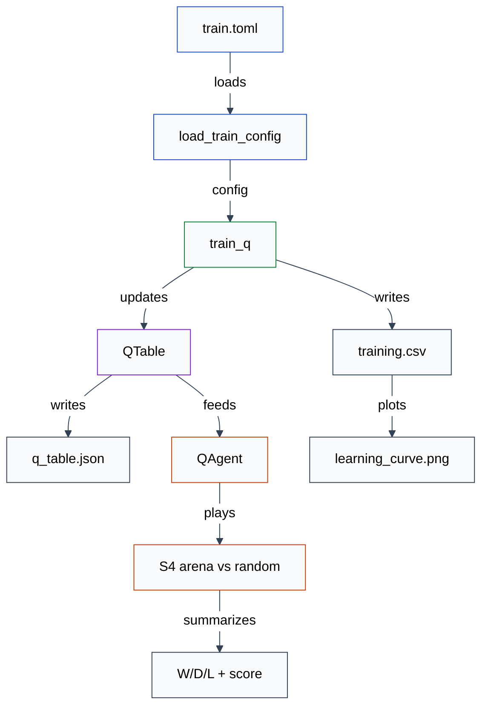

# Spec 0005 — Tabular Q-learning against a fixed random opponent

- **Status:** approved
- **Date:** 2026-11-04
- **Slice:** S5 — Tabular Q-learning against a fixed random opponent
- **Related:** `docs/00-brief.md`, `docs/plan.md`, ADR 0002, ADR 0003, ADR 0004,
  ADR 0005, `docs/design/0005-tabular-q-learning.md`,
  `docs/specs/0004-evaluation-arena.md`

## Outcome

A caller can run a seeded tabular Q-learning training command that learns from
games against a fixed random opponent, saves and reloads an inspectable Q-table
with metrics and a learning curve, and receives a diagnostic W/D/L and
derived-score summary from the S4 arena.

## Public interface

### System view

Figure 1 is the runtime path from a training TOML file to the saved Q-table and
diagnostic summary. It is explanatory rather than a second contract; the
sections below define each box.



**Figure 1 — S5 runtime pipeline.** The CLI is the only place that composes the
contracts. The trainer owns exploration and updates; the Q-agent only reads the
table and plays greedily. The S4 arena remains the evaluator. Category colour is
carried by the stroke only; every box uses a light-grey fill. Labels use the S4
Markdown black-text spans, so the Markdown renderer does not inherit grey label
text. This is a Markdown-only technique. A console version of the same diagram
must use plain labels, no HTML, and no fills.

### Modules and imports

New production modules:

- `src/rlcheckers/agents/q_agent.py` — `q_key`, `QTable`, `QAgent`,
  `QTableError`, and `TableCapacityError`.
- `src/rlcheckers/training/__init__.py` — re-exports for the training package.
- `src/rlcheckers/training/train_q.py` — `DIAGNOSTIC_GAMES`,
  `EpisodeMetric`, `TrainingResult`, `derive_episode_seed`, `epsilon_at`,
  `choose_epsilon_greedy`, `q_update`, `reward_for`, `train_q`,
  `write_learning_curve`, `write_training_artifacts`, and `TRAINING_FIELDS`.

Existing modules gain public names:

- `src/rlcheckers/config.py` gains `TrainConfig` and `load_train_config`; the S4
  `EvalConfig` and `load_eval_config` remain unchanged.
- `src/rlcheckers/agents/__init__.py` re-exports `QAgent`, `QTable`, `q_key`,
  and the Q-table errors in addition to the current names. `AGENT_NAMES` stays
  `("greedy", "random")`; `make_agent` does not gain a Q entry in S5.
- `src/rlcheckers/cli.py` gains the `train-q` subcommand; `play-random` and
  `evaluate` keep their current behaviour.
- `pyproject.toml` adds `matplotlib` to the project dependencies. S5 does not
  add numpy; the Q-table stays a sparse Python dictionary.

Canonical imports:

```python
from rlcheckers.agents import (
    QAgent,
    QTable,
    RandomAgent,
    TableCapacityError,
    q_key,
)
from rlcheckers.config import ConfigError, TrainConfig, load_train_config
from rlcheckers.evaluation import (
    GameOutcome,
    STANDARD_OPENINGS,
    opening_state,
    outcome_for,
    play_matchup,
    summarize,
    format_float,
)
from rlcheckers.training import (
    DIAGNOSTIC_GAMES,
    TRAINING_FIELDS,
    EpisodeMetric,
    TrainingResult,
    choose_epsilon_greedy,
    derive_episode_seed,
    epsilon_at,
    q_update,
    reward_for,
    train_q,
    write_learning_curve,
    write_training_artifacts,
)
```

The Q-table module imports the rules types; the training module imports the
Q-table and the S4 evaluation helpers. The S4 arena never imports the training
module. The Q-agent is not registered in `make_agent` in S5; the training command
constructs it directly. A later slice may add registry support.

### Q-table key and representation

The learning state is the 40-bit canonical board key, which already includes the
side to move. S5 deliberately excludes repetition and no-progress counters; that
is the ADR 0005 decision and is revisited only if draws dominate in S6.

The Q-table key is ADR 0002's combined key:

```python
def q_key(state: GameState, move: Move) -> int:
    return (state.board.state_key << 33) | move.action_key
```

`state.board.state_key` is 40 bits and `move.action_key` is 33 bits, so `q_key`
fits in 73 bits. The maximum key is `2**73 - 1`. The key is not an `int64`; JSON
persistence therefore uses decimal strings.

`QTable` is a sparse `dict[int, float]` wrapper with these public members:

```python
class QTableError(ValueError): ...
class TableCapacityError(QTableError): ...

class QTable:
    def __init__(
        self,
        entries: Mapping[int, float] | None = None,
        *,
        max_entries: int = 2_000_000,
    ) -> None: ...
    @property
    def entries(self) -> Mapping[int, float]: ...
    @property
    def max_entries(self) -> int: ...
    def get(self, key: int) -> float: ...
    def set(self, key: int, value: float) -> None: ...
    def best_value(self, state: GameState) -> float: ...
    def best_move(self, state: GameState) -> Move: ...
    def size(self) -> int: ...
    def estimated_memory_bytes(self) -> int: ...
    def __eq__(self, other: object) -> bool: ...
    def save(self, path: str | Path, metadata: Mapping[str, Any]) -> Path: ...
    @classmethod
    def load(cls, path: str | Path) -> tuple[QTable, dict[str, Any]]: ...
```

`get` returns `0.0` for a missing key. `set` stores a finite float. A new key when
the table already holds `max_entries` entries raises `TableCapacityError`; there
is no silent eviction. Updating an existing key is always allowed. `best_value`
and `best_move` search `state.legal_moves()`; unseen moves have value `0.0`.
Greedy ties choose the first move in the legal-move order, which is sorted by
`(path, captures)`. A terminal state raises `QTableError` containing `finished`.
`QTable` compares by value: equal when `max_entries` and `entries` are equal.

`estimated_memory_bytes` uses `sys.getsizeof` on the dictionary and its keys and
values. It is an approximate diagnostic, not an allocator measurement. The table
size and this estimate are logged; the cap is on entries, not bytes.

### QAgent adapter

`QAgent` is the playing adapter. It owns no RNG and does not train.

```python
class QAgent:
    def __init__(self, table: QTable) -> None: ...
    @property
    def table(self) -> QTable: ...
    def choose_move(self, state: GameState) -> Move: ...
```

`choose_move` raises `ValueError` containing `finished` when `state.is_terminal`.
Otherwise it returns `table.best_move(state)`. The adapter satisfies the S4
`Agent` protocol, returns a legal move, does not mutate the state, and is
deterministic. It is the same object used by the diagnostic arena.

### Training loop

The trainer owns exploration and updates. The update arithmetic is a pure
function:

```python
def q_update(
    current: float,
    reward: float,
    next_best: float,
    alpha: float,
    gamma: float,
) -> float:
    return current + alpha * (reward + gamma * next_best - current)
```

For a terminal learner action or a terminal opponent reply, pass `next_best=0.0`;
the target is the terminal reward. For a non-terminal next learner turn, pass
`next_best = table.best_value(next_state)`.

The epsilon schedule is also a pure function. Episode indices are 0-based and
the epsilon is computed before the episode:

```python
def epsilon_at(
    episode: int,
    episodes: int,
    start: float,
    end: float,
    decay_fraction: float,
) -> float: ...
```

`decay_fraction` must be in `(0, 1]`; zero is rejected. Compute
`decay_episodes = max(1, int(episodes * decay_fraction))`. If
`episode >= decay_episodes`, return `end`. Otherwise return
`start + (end - start) * episode / decay_episodes`. With the ADR 0005 defaults,
episode 0 is `1.0`, episode `0.8 * episodes` is `0.05`, and later episodes stay
at `0.05`.

Exploration is a helper owned by the trainer:

```python
def choose_epsilon_greedy(
    table: QTable,
    state: GameState,
    epsilon: float,
    rng: random.Random,
) -> Move: ...
```

With probability `epsilon`, choose uniformly from `state.legal_moves()` using
`rng`; otherwise return `table.best_move(state)`. A terminal state raises
`ValueError` containing `finished`.

The reward mapping is from the learner's perspective:

```python
def reward_for(outcome: GameOutcome) -> float: ...
```

`GameOutcome.WIN` is `1.0`, `GameOutcome.DRAW` is `0.0`, and
`GameOutcome.LOSS` is `-1.0`. This is a training signal. It is not the S4 derived
score; `GameOutcome.score` and the derived score remain evaluation statistics.

Training episodes use the S4 five-opening suite and both learner colours. For
episode index `episode`, with `openings` defaulting to `STANDARD_OPENINGS`:

- `opening_index = (episode // 2) % len(openings)`.
- `learner_colour = Side.BLACK` when `episode % 2 == 0`, else `Side.WHITE`.
- `opening = openings[opening_index]` and `state = opening_state(opening)`.
- `episode_seed = derive_episode_seed(master_seed, episode)`.
- The learner and opponent seeds are `derive_side_seed(episode_seed, colour)`.
- The learner's exploration RNG is `random.Random(learner_seed)`.
- The opponent factory defaults to `lambda seed: RandomAgent(seed)`.

`derive_episode_seed` uses a separate training domain so training episodes do
not reuse the S4 diagnostic game seeds:

```python
def derive_episode_seed(master_seed: int, episode: int) -> int:
    payload = f"{master_seed}|train|{episode}"
    return int.from_bytes(hashlib.sha256(payload.encode()).digest()[:8], "big")
```

The S4 `derive_side_seed` is reused. The production CLI always uses the standard
openings and the random factory. Tests may pass a custom openings tuple or a
deterministic opponent factory to force edge cases; neither becomes production
API.

The training loop for one episode is:

1. Build the opening state. If the side to move is not the learner's colour, the
   opponent moves first. Apply the opponent's move and count one ply. If the game
   ends before the learner moves, record the outcome and perform no Q-update.
2. While the state is not terminal:
   - Choose the learner's move with `choose_epsilon_greedy`.
   - Compute `key = q_key(state, learner_move)` and `current = table.get(key)`.
   - Apply the learner's move and count one ply.
   - If the learner's move ends the game, set the target to the terminal reward,
     update the table, record the outcome, and end the episode.
   - Otherwise the opponent replies with a random legal move; count one ply.
   - If the opponent's reply ends the game, set the target to the terminal
     reward, update the table, record the outcome, and end the episode.
   - Otherwise set the target to `gamma * table.best_value(next_state)`, update
     the table, and continue from `next_state`.
3. If the ply count exceeds `MAX_GAME_PLIES`, raise `RuntimeError` naming the
   limit. The engine's draw rule should end games first.

`train_q` returns the trained table and one metric per episode:

```python
@dataclass(frozen=True)
class EpisodeMetric:
    episode: int
    opening_index: int
    learner_colour: Side
    outcome: GameOutcome
    plies: int
    epsilon: float
    table_size: int

@dataclass(frozen=True)
class TrainingResult:
    table: QTable
    metrics: tuple[EpisodeMetric, ...]
    openings: tuple[tuple[Move, ...], ...]

def train_q(
    config: TrainConfig,
    *,
    openings: Sequence[Sequence[Move]] = STANDARD_OPENINGS,
    opponent_factory: AgentFactory | None = None,
) -> TrainingResult: ...
```

`EpisodeMetric.outcome` is from the learner's perspective. `plies` counts moves
after the opening prefix. `table_size` is the entry count after the episode.
`TrainingResult.metrics` has exactly `config.episodes` entries in episode order.
`TrainingResult.openings` records the suite actually used. The production
`opponent_factory` is `RandomAgent`; tests may inject another factory.

### Training config

`src/rlcheckers/config.py` adds a separate TOML schema. The `TrainConfig` fields
are:

```python
@dataclass(frozen=True)
class TrainConfig:
    seed: int
    episodes: int
    alpha: float
    gamma: float
    epsilon_start: float
    epsilon_end: float
    epsilon_decay_fraction: float
    opponent: str
    output_dir: Path
    max_table_entries: int
```

All ten keys are required; there are no hidden defaults. Validation rules:

- `seed`: int, not bool.
- `episodes`: positive int, not bool, and a multiple of 10. The multiple of 10
  keeps the five openings and both colours balanced. Ten is the minimum.
- `alpha`: int or float, not bool, `0 < alpha <= 1`.
- `gamma`: int or float, not bool, `0 <= gamma < 1`.
- `epsilon_start`, `epsilon_end`: int or float, not bool, in `[0, 1]`, with
  `epsilon_start >= epsilon_end`.
- `epsilon_decay_fraction`: int or float, not bool, in `(0, 1]`. Zero is
  rejected; use `epsilon_start == epsilon_end` for a constant schedule.
- `opponent`: the string `"random"` only in S5.
- `output_dir`: non-empty string; a relative path resolves against the config
  file's directory, and the result is absolute.
- `max_table_entries`: positive int, not bool. The example uses 2,000,000.

Unknown keys, missing keys, invalid TOML, and missing files raise `ConfigError`.
The S4 `load_eval_config` and `EvalConfig` remain unchanged. The resolved config
is saved with the training run. Example `train.toml`:

```toml
seed = 7
episodes = 10000
alpha = 0.1
gamma = 0.9
epsilon_start = 1.0
epsilon_end = 0.05
epsilon_decay_fraction = 0.8
opponent = "random"
output_dir = "out"
max_table_entries = 2000000
```

### Artifacts

`write_training_artifacts(result, diagnostic, config, command_line)` creates the
output directory and writes four files. It returns the output directory. It
validates that `len(result.metrics) == config.episodes`, that
`diagnostic.seed == config.seed`, that the diagnostic names are `q` and `random`,
that the diagnostic has `DIAGNOSTIC_GAMES = 1000` games, and that the training and
diagnostic openings match. A mismatch raises `ValueError`; no partial files are
written.

#### `q_table.json`

A single JSON document with exactly these top-level keys:

```json
{
  "format": "rlcheckers.qtable",
  "version": 1,
  "metadata": {
    "config": {
      "alpha": 0.1,
      "epsilon_decay_fraction": 0.8,
      "epsilon_end": 0.05,
      "epsilon_start": 1.0,
      "episodes": 10000,
      "gamma": 0.9,
      "max_table_entries": 2000000,
      "opponent": "random",
      "output_dir": "C:\\...\\out",
      "seed": 7
    },
    "package_version": "0.1.0",
    "python_version": "3.14.0",
    "seed": 7,
    "table_size": 123
  },
  "table": {
    "1234567890123": 0.234
  }
}
```

`table` maps decimal-string `q_key` values to floats. The loader converts the
keys to `int`, checks the key range and finite values, checks
`metadata.table_size == len(table)`, and uses
`metadata.config.max_table_entries` as the loaded table's cap. Unknown top-level
keys, a wrong `format`, a wrong `version`, a non-integer key, a key outside
`0..2**73-1`, a non-finite value, or a size mismatch raise `QTableError`.
`save` writes with `indent=2`, `sort_keys=True`, and a trailing newline; the same
table and metadata produce identical bytes. The S4 `run.json` remains unchanged.

#### `training.csv`

Header, in this exact order:

```text
episode,opening_index,learner_colour,outcome,plies,epsilon,table_size
```

One row per `EpisodeMetric`, in episode order. `learner_colour` is `black` or
`white`; `outcome` is `win`, `draw`, or `loss` from the learner's perspective;
`epsilon` uses `format_float`; `table_size` is the entry count after the episode.
The file is byte-reproducible for the same result and config.

#### `run.json`

A JSON object with exactly these keys:

```json
{
  "command_line": ["rlcheckers", "train-q", "--config", "train.toml"],
  "config": {
    "alpha": 0.1,
    "epsilon_decay_fraction": 0.8,
    "epsilon_end": 0.05,
    "epsilon_start": 1.0,
    "episodes": 10000,
    "gamma": 0.9,
    "max_table_entries": 2000000,
    "opponent": "random",
    "output_dir": "C:\\...\\out",
    "seed": 7
  },
  "diagnostic": {
    "agent": "q",
    "ci_high": 0.71,
    "ci_low": 0.66,
    "draws": 12,
    "games": 1000,
    "losses": 340,
    "opponent": "random",
    "score": 0.686,
    "wins": 648
  },
  "openings": [
    {"index": 0, "state_key": 235602448969},
    {"index": 1, "state_key": 785358295113},
    {"index": 2, "state_key": 785360355913},
    {"index": 3, "state_key": 235206119497},
    {"index": 4, "state_key": 235554996809}
  ],
  "package_version": "0.1.0",
  "python_version": "3.14.0",
  "table_bytes": 4567,
  "table_size": 123
}
```

The diagnostic values are illustrative. `openings` uses the suite actually used,
with the state key from `opening_state`. `table_bytes` is
`result.table.estimated_memory_bytes()`. The file uses `indent=2`,
`sort_keys=True`, and a trailing newline; the CSV and JSON files are
byte-reproducible for the same run. The PNG is not required to be byte-identical
across environments; it is reproducible in content from the CSV and config.

#### `learning_curve.png`

The plot uses the Agg backend and has episode on the x-axis and rate in `[0, 1]`
on the y-axis. It shows three rolling lines from the learner's perspective: win
rate, draw rate, and loss rate. The rolling window is `min(100, episode + 1)`, so
the plot has a point for every episode, including short smoke runs. The title
includes the seed. The legend names the three lines. The plot is generated from
`training.csv` and the saved config; no hidden training state is used. The
function `write_learning_curve(metrics, path, *, seed)` returns the path and
raises `ValueError` for empty metrics.

### CLI

`src/rlcheckers/cli.py` keeps `play-random` and `evaluate` and adds:

```text
python -m rlcheckers train-q --config PATH
```

`--config` is required. Missing or unparseable arguments are `argparse` errors
with exit code 2 and usage on stderr. Runtime problems (config validation,
capacity overflow, illegal move, non-termination, filesystem error) print
`error: <message>` to stderr and return `1`.

On success the command prints exactly:

```text
episodes: <episodes>
seed: <seed>
table_size: <size>
table_bytes: <bytes>
agent: q
opponent: random
games: 1000
wins: <wins>
draws: <draws>
losses: <losses>
score: <score>
ci95: <low>..<high>
artifacts: <output_dir>
```

The score and interval use `format_float`. `artifacts` is
`str(config.output_dir)`. The diagnostic runs through `play_matchup` with a
`QAgent` factory and a `RandomAgent` factory, seed `config.seed`, 1,000 games,
and the S4 five-opening suite. The Q-agent is greedy; the diagnostic is not the
S7 gate. The S4 `evaluate` command and registry remain unchanged. The
`train-q` command records `["rlcheckers", *argv]` as `command_line`, where `argv`
is the full argument list including `train-q`; this mirrors `evaluate`.

### Performance

The example 10,000-episode run at roughly 17.5 plies per game is about 175,000
moves; it should finish in minutes on 5x5. The 1,000-game diagnostic is much
shorter. The Q-table is a Python dict and the plot is one figure. Do not add
caching, transposition tables, parallel training, or resumable checkpoints in
this slice. Profile first if a 10,000-episode run is materially slower than that.

## Acceptance criteria

The snippets are illustrative; later snippets may reuse earlier variables and
helpers. Tests import `pytest` explicitly, and use `dataclasses.replace` where
shown. A local `board_with` helper is allowed in tests but is not production API:

```python
def board_with(
    pieces: dict[int, Piece], side: Side = Side.BLACK
) -> Board:
    cells: list[Piece | None] = [None] * SQUARE_COUNT
    for square in PLAYABLE_SQUARES:
        cells[square] = pieces.get(square, Piece.EMPTY)
    return Board(tuple(cells), side)
```

### A1 — Q-table key and storage

The key combines the canonical board key and the action key:

```python
state = GameState.from_board(Board.initial())
move = Move((6, 10))
assert q_key(state, move) == (state.board.state_key << 33) | move.action_key
```

Missing values default to zero; updates are allowed; the cap only rejects new
keys:

```python
table = QTable(max_entries=2)
key_one = q_key(state, Move((6, 10)))
key_two = q_key(state, Move((8, 14)))
key_three = q_key(state, Move((6, 12)))

assert table.get(key_one) == 0.0
table.set(key_one, 0.5)
table.set(key_one, 0.6)
table.set(key_two, -0.2)
assert table.get(key_one) == 0.6
assert table.size() == 2
with pytest.raises(TableCapacityError, match="cap"):
    table.set(key_three, 0.0)
assert table.estimated_memory_bytes() > 0
```

A non-positive cap and a non-finite value are rejected:

```python
with pytest.raises(ValueError, match="max_entries"):
    QTable(max_entries=0)
with pytest.raises(ValueError, match="finite"):
    QTable().set(1, float("nan"))
```

### A2 — Q-update arithmetic

The non-terminal example matches the design note:

```python
assert q_update(0.20, 0.0, 0.60, 0.1, 0.9) == pytest.approx(0.234)
```

A terminal win uses the reward directly:

```python
assert q_update(0.20, 1.0, 0.0, 0.1, 0.9) == pytest.approx(0.28)
assert q_update(0.20, -1.0, 0.0, 0.1, 0.9) == pytest.approx(0.08)
assert q_update(0.20, 0.0, 0.0, 0.1, 0.9) == pytest.approx(0.18)
```

Invalid learning parameters are rejected:

```python
with pytest.raises(ValueError, match="alpha"):
    q_update(0.2, 0.0, 0.6, 0.0, 0.9)
with pytest.raises(ValueError, match="gamma"):
    q_update(0.2, 0.0, 0.6, 0.1, 1.0)
```

### A3 — Epsilon schedule

The schedule starts at the start value and reaches the end value at the decay
boundary:

```python
assert epsilon_at(0, 10, 1.0, 0.05, 0.8) == 1.0
assert epsilon_at(4, 10, 1.0, 0.05, 0.8) == pytest.approx(0.525)
assert epsilon_at(8, 10, 1.0, 0.05, 0.8) == 0.05
assert epsilon_at(9, 10, 1.0, 0.05, 0.8) == 0.05
```

A zero decay fraction is rejected:

```python
with pytest.raises(ValueError, match="decay_fraction"):
    epsilon_at(0, 10, 1.0, 0.05, 0.0)
```

Out-of-range episodes and inverted endpoints are rejected:

```python
with pytest.raises(ValueError, match="episode"):
    epsilon_at(-1, 10, 1.0, 0.05, 0.8)
with pytest.raises(ValueError, match="episode"):
    epsilon_at(10, 10, 1.0, 0.05, 0.8)
with pytest.raises(ValueError, match="start"):
    epsilon_at(0, 10, 0.01, 0.05, 0.8)
```

### A4 — QAgent greedy adapter

The adapter returns the highest-Q legal move:

```python
state = GameState.from_board(Board.initial())
table = QTable()
best = Move((6, 10))
table.set(q_key(state, best), 1.0)
agent = QAgent(table)
assert agent.choose_move(state) == best
assert agent.choose_move(state) in state.legal_moves()
assert agent.choose_move(state) == agent.choose_move(state)
```

Ties choose the first legal move, which is the smallest `(path, captures)`:

```python
tied = QTable()
assert QAgent(tied).choose_move(state) == Move((6, 10))
```

A finished game is rejected:

```python
finished = GameState.from_board(
    board_with({20: Piece.BLACK_KING})
)
with pytest.raises(ValueError, match="finished"):
    QAgent(QTable()).choose_move(finished)
```

### A5 — Save and load

A round trip preserves the table and metadata:

```python
metadata = {
    "config": {
        "alpha": 0.1,
        "epsilon_decay_fraction": 0.8,
        "epsilon_end": 0.05,
        "epsilon_start": 1.0,
        "episodes": 20,
        "gamma": 0.9,
        "max_table_entries": 1000,
        "opponent": "random",
        "output_dir": "out",
        "seed": 7,
    },
    "package_version": "0.1.0",
    "python_version": "3.14.0",
    "seed": 7,
    "table_size": 2,
}
table = QTable(max_entries=1000)
table.set(1, 0.25)
table.set(2, -0.5)
path = tmp_path / "q_table.json"
assert table.save(path, metadata) == path

loaded, loaded_metadata = QTable.load(path)
assert loaded == table
assert loaded_metadata == metadata
assert loaded.get(1) == 0.25
assert loaded.get(2) == -0.5
```

The JSON schema uses decimal string keys and the documented top-level keys:

```python
document = json.loads(path.read_text(encoding="utf-8"))
assert set(document) == {"format", "metadata", "table", "version"}
assert document["format"] == "rlcheckers.qtable"
assert document["version"] == 1
assert set(document["table"]) == {"1", "2"}
assert set(document["metadata"]) == {
    "config",
    "package_version",
    "python_version",
    "seed",
    "table_size",
}
```

Saving the same table and metadata twice is byte-reproducible:

```python
first = path.read_bytes()
table.save(path, metadata)
assert path.read_bytes() == first
```

A wrong format, a wrong version, a bad key, or a size mismatch is rejected:

```python
bad = tmp_path / "bad.json"
bad.write_text(
    '{"format":"wrong","version":1,"metadata":{},"table":{}}',
    encoding="utf-8",
)
with pytest.raises(QTableError, match="format"):
    QTable.load(bad)
```

### A6 — Training loop

A short seeded run follows the opening and colour schedule and records one metric
per episode:

```python
config = TrainConfig(
    seed=7,
    episodes=20,
    alpha=0.1,
    gamma=0.9,
    epsilon_start=1.0,
    epsilon_end=0.05,
    epsilon_decay_fraction=0.8,
    opponent="random",
    output_dir=tmp_path / "out",
    max_table_entries=1000,
)
result = train_q(config)
assert len(result.metrics) == 20
assert [metric.episode for metric in result.metrics] == list(range(20))
assert [metric.opening_index for metric in result.metrics] == [
    0, 0, 1, 1, 2, 2, 3, 3, 4, 4,
] * 2
assert [metric.learner_colour for metric in result.metrics] == [
    Side.BLACK,
    Side.WHITE,
] * 10
assert result.table.size() > 0
assert result.table.size() <= config.max_table_entries
assert all(metric.outcome in tuple(GameOutcome) for metric in result.metrics)
```

The same config and seed reproduce the same table and metrics:

```python
first = train_q(config)
second = train_q(config)
assert first == second
```

A full table stops training with a clear error:

```python
small = replace(config, max_table_entries=1)
with pytest.raises(TableCapacityError, match="cap"):
    train_q(small)
```

### A7 — Training config

A valid config loads, resolves a relative output directory, and preserves an
absolute one:

```python
path = tmp_path / "train.toml"
path.write_text(
    'seed = 7\n'
    'episodes = 20\n'
    'alpha = 0.1\n'
    'gamma = 0.9\n'
    'epsilon_start = 1.0\n'
    'epsilon_end = 0.05\n'
    'epsilon_decay_fraction = 0.8\n'
    'opponent = "random"\n'
    'output_dir = "out"\n'
    'max_table_entries = 1000\n',
    encoding="utf-8",
)
config = load_train_config(path)
assert config == TrainConfig(
    seed=7,
    episodes=20,
    alpha=0.1,
    gamma=0.9,
    epsilon_start=1.0,
    epsilon_end=0.05,
    epsilon_decay_fraction=0.8,
    opponent="random",
    output_dir=(tmp_path / "out").resolve(),
    max_table_entries=1000,
)
```

A twenty-episode config is accepted, as is a ten-episode config. A zero decay
fraction is rejected:

```python
assert load_train_config(path).episodes == 20
ten = tmp_path / "ten.toml"
ten.write_text(
    path.read_text(encoding="utf-8").replace("episodes = 20", "episodes = 10"),
    encoding="utf-8",
)
assert load_train_config(ten).episodes == 10
zero_decay = tmp_path / "zero.toml"
zero_decay.write_text(
    path.read_text(encoding="utf-8").replace(
        "epsilon_decay_fraction = 0.8",
        "epsilon_decay_fraction = 0.0",
    ),
    encoding="utf-8",
)
with pytest.raises(ConfigError, match="epsilon_decay_fraction"):
    load_train_config(zero_decay)
```

Bad configs fail with `ConfigError` naming the problem:

```python
cases = [
    (
        "missing",
        'seed = 7\nepisodes = 20\nalpha = 0.1\ngamma = 0.9\n'
        'epsilon_start = 1.0\nepsilon_end = 0.05\n'
        'epsilon_decay_fraction = 0.8\nopponent = "random"\n'
        'output_dir = "out"\n',
        "max_table_entries",
    ),
    (
        "unknown",
        'seed = 7\nepisodes = 20\nalpha = 0.1\ngamma = 0.9\n'
        'epsilon_start = 1.0\nepsilon_end = 0.05\n'
        'epsilon_decay_fraction = 0.8\nopponent = "random"\n'
        'output_dir = "out"\nmax_table_entries = 1000\nextra = 1\n',
        "extra",
    ),
    (
        "seed",
        'seed = "7"\nepisodes = 20\nalpha = 0.1\ngamma = 0.9\n'
        'epsilon_start = 1.0\nepsilon_end = 0.05\n'
        'epsilon_decay_fraction = 0.8\nopponent = "random"\n'
        'output_dir = "out"\nmax_table_entries = 1000\n',
        "seed",
    ),
    (
        "episodes",
        'seed = 7\nepisodes = 15\nalpha = 0.1\ngamma = 0.9\n'
        'epsilon_start = 1.0\nepsilon_end = 0.05\n'
        'epsilon_decay_fraction = 0.8\nopponent = "random"\n'
        'output_dir = "out"\nmax_table_entries = 1000\n',
        "episodes",
    ),
    (
        "alpha",
        'seed = 7\nepisodes = 20\nalpha = 0.0\ngamma = 0.9\n'
        'epsilon_start = 1.0\nepsilon_end = 0.05\n'
        'epsilon_decay_fraction = 0.8\nopponent = "random"\n'
        'output_dir = "out"\nmax_table_entries = 1000\n',
        "alpha",
    ),
    (
        "gamma",
        'seed = 7\nepisodes = 20\nalpha = 0.1\ngamma = 1.0\n'
        'epsilon_start = 1.0\nepsilon_end = 0.05\n'
        'epsilon_decay_fraction = 0.8\nopponent = "random"\n'
        'output_dir = "out"\nmax_table_entries = 1000\n',
        "gamma",
    ),
    (
        "epsilon",
        'seed = 7\nepisodes = 20\nalpha = 0.1\ngamma = 0.9\n'
        'epsilon_start = 0.05\nepsilon_end = 1.0\n'
        'epsilon_decay_fraction = 0.8\nopponent = "random"\n'
        'output_dir = "out"\nmax_table_entries = 1000\n',
        "epsilon",
    ),
    (
        "fraction",
        'seed = 7\nepisodes = 20\nalpha = 0.1\ngamma = 0.9\n'
        'epsilon_start = 1.0\nepsilon_end = 0.05\n'
        'epsilon_decay_fraction = 1.1\nopponent = "random"\n'
        'output_dir = "out"\nmax_table_entries = 1000\n',
        "epsilon_decay_fraction",
    ),
    (
        "opponent",
        'seed = 7\nepisodes = 20\nalpha = 0.1\ngamma = 0.9\n'
        'epsilon_start = 1.0\nepsilon_end = 0.05\n'
        'epsilon_decay_fraction = 0.8\nopponent = "greedy"\n'
        'output_dir = "out"\nmax_table_entries = 1000\n',
        "opponent",
    ),
    (
        "output_dir",
        'seed = 7\nepisodes = 20\nalpha = 0.1\ngamma = 0.9\n'
        'epsilon_start = 1.0\nepsilon_end = 0.05\n'
        'epsilon_decay_fraction = 0.8\nopponent = "random"\n'
        'output_dir = ""\nmax_table_entries = 1000\n',
        "output_dir",
    ),
    (
        "cap",
        'seed = 7\nepisodes = 20\nalpha = 0.1\ngamma = 0.9\n'
        'epsilon_start = 1.0\nepsilon_end = 0.05\n'
        'epsilon_decay_fraction = 0.8\nopponent = "random"\n'
        'output_dir = "out"\nmax_table_entries = 0\n',
        "max_table_entries",
    ),
]

for stem, text, expected in cases:
    candidate = tmp_path / f"{stem}.toml"
    candidate.write_text(text, encoding="utf-8")
    with pytest.raises(ConfigError, match=expected):
        load_train_config(candidate)
```

Missing files and invalid TOML also raise `ConfigError`:

```python
with pytest.raises(ConfigError, match="config"):
    load_train_config(tmp_path / "missing.toml")

broken = tmp_path / "broken.toml"
broken.write_text("seed = [\n", encoding="utf-8")
with pytest.raises(ConfigError, match="config"):
    load_train_config(broken)
```

### A8 — Artifacts and CLI

A short result and diagnostic write four files with the documented schemas:

```python
config = TrainConfig(
    seed=7,
    episodes=20,
    alpha=0.1,
    gamma=0.9,
    epsilon_start=1.0,
    epsilon_end=0.05,
    epsilon_decay_fraction=0.8,
    opponent="random",
    output_dir=(tmp_path / "out").resolve(),
    max_table_entries=1000,
)
result = train_q(config)
agent = QAgent(result.table)
diagnostic = play_matchup(
    lambda seed: agent,
    RandomAgent,
    seed=config.seed,
    games=DIAGNOSTIC_GAMES,
    agent_name="q",
    opponent_name="random",
)
out = write_training_artifacts(
    result,
    diagnostic,
    config,
    command_line=["rlcheckers", "train-q", "--config", "train.toml"],
)
assert out == config.output_dir
assert (out / "q_table.json").exists()
assert (out / "training.csv").exists()
assert (out / "run.json").exists()
assert (out / "learning_curve.png").exists()

with (out / "training.csv").open(newline="", encoding="utf-8") as handle:
    rows = list(csv.DictReader(handle))
assert list(rows[0]) == list(TRAINING_FIELDS)
assert len(rows) == 20

run = json.loads((out / "run.json").read_text(encoding="utf-8"))
assert set(run) == {
    "command_line",
    "config",
    "diagnostic",
    "openings",
    "package_version",
    "python_version",
    "table_bytes",
    "table_size",
}
assert run["diagnostic"]["games"] == 1000
assert len(run["openings"]) == 5
```

Writing twice to the same directory is byte-reproducible for the CSV and JSON
files and leaves unrelated files alone:

```python
(out / "keep.txt").write_text("keep", encoding="utf-8")
first = {
    name: (out / name).read_bytes()
    for name in ("q_table.json", "training.csv", "run.json")
}
write_training_artifacts(
    result,
    diagnostic,
    config,
    command_line=["rlcheckers", "train-q", "--config", "train.toml"],
)
second = {name: (out / name).read_bytes() for name in first}
assert first == second
assert (out / "keep.txt").read_text(encoding="utf-8") == "keep"
```

Mismatched inputs are rejected before writing:

```python
with pytest.raises(ValueError, match="episodes"):
    write_training_artifacts(
        result,
        diagnostic,
        replace(config, episodes=10),
        command_line=["rlcheckers", "train-q"],
    )
```

The CLI writes the artifacts and prints the thirteen-line summary:

```python
assert main(["train-q", "--config", str(path)]) == 0
captured = capsys.readouterr()
lines = captured.out.splitlines()

assert lines[0].startswith("episodes: ")
assert lines[1].startswith("seed: ")
assert lines[2].startswith("table_size: ")
assert lines[3].startswith("table_bytes: ")
assert lines[4] == "agent: q"
assert lines[5] == "opponent: random"
assert lines[6] == "games: 1000"
assert lines[7].startswith("wins: ")
assert lines[8].startswith("draws: ")
assert lines[9].startswith("losses: ")
assert lines[10].startswith("score: ")
assert lines[11].startswith("ci95: ")
assert lines[12] == f"artifacts: {config.output_dir}"
assert captured.err == ""
```

Missing and invalid configs are handled:

```python
with pytest.raises(SystemExit) as excinfo:
    main(["train-q"])
assert excinfo.value.code == 2
assert "--config" in capsys.readouterr().err

bad = tmp_path / "bad.toml"
bad.write_text("seed = 1\n", encoding="utf-8")
assert main(["train-q", "--config", str(bad)]) == 1
captured = capsys.readouterr()
assert captured.err.startswith("error:")
assert captured.out == ""
```

The module entry point works in a subprocess:

```python
completed = subprocess.run(
    [sys.executable, "-m", "rlcheckers", "train-q", "--config", str(path)],
    capture_output=True,
    text=True,
    check=False,
)
assert completed.returncode == 0
assert completed.stdout.startswith("episodes: ")
assert completed.stderr == ""
```

### A9 — Improvement diagnostic

A fixed-seed 10,000-episode run improves on the S4 five-opening suite against
random. The test is marked `slow` because it trains and plays 1,000 games:

```python
config = TrainConfig(
    seed=7,
    episodes=10000,
    alpha=0.1,
    gamma=0.9,
    epsilon_start=1.0,
    epsilon_end=0.05,
    epsilon_decay_fraction=0.8,
    opponent="random",
    output_dir=tmp_path / "out",
    max_table_entries=2000000,
)
result = train_q(config)
agent = QAgent(result.table)
diagnostic = play_matchup(
    lambda seed: agent,
    RandomAgent,
    seed=config.seed,
    games=DIAGNOSTIC_GAMES,
    agent_name="q",
    opponent_name="random",
)
summary = summarize([game.outcome for game in diagnostic.games])
assert summary.games == 1000
assert summary.wins + summary.draws + summary.losses == 1000
assert 0.0 <= summary.ci_low <= summary.score <= summary.ci_high <= 1.0
assert summary.score > 0.5
```

The point estimate is the diagnostic threshold. The 95% interval is reported and
may cross 0.5; the S7 gate's stricter mean-and-floor rules are not applied in S5.
If the score is not above 0.5, the test fails with the W/D/L and score in the
message; the next action is to inspect state coverage and rewards, not to hide
the result.

### A10 — Documentation

`docs/architecture.md` records the Q-table, Q-agent, trainer, training config,
artifacts, plot, and `train-q` command, and keeps the S5–S7 boundaries accurate.
`README.md` updates its status and shows:

```powershell
.\.venv\Scripts\python.exe -m rlcheckers train-q --config train.toml
```

Module docstrings in `q_agent.py`, `train_q.py`, and `config.py` state the
contracts above in a short paragraph. `docs/plan.md` marks S5 complete when the
slice is finished. `docs/state.md` records the handoff. ADR 0005 moves from
proposed to accepted when the spec review approves. Markdown diagrams use the S4
black-text spans and white/light-grey fills; console diagrams use plain labels,
no HTML, and no fills. See `AGENTS.md` "Two outputs, two rules". The S4 figure is
corrected if it is touched.

## Tests to add

| Criterion | Test(s) |
|---|---|
| A1 | `test_q_key_combines_state_and_action`, `test_q_table_defaults_to_zero`, `test_q_table_set_and_get`, `test_q_table_capacity_guard`, `test_q_table_rejects_bad_cap`, `test_q_table_rejects_non_finite`, `test_q_table_memory_estimate` |
| A2 | `test_q_update_non_terminal`, `test_q_update_terminal_win`, `test_q_update_terminal_loss_and_draw`, `test_q_update_rejects_bad_alpha`, `test_q_update_rejects_bad_gamma` |
| A3 | `test_epsilon_schedule_starts_at_start`, `test_epsilon_schedule_reaches_end`, `test_epsilon_schedule_stays_at_end`, `test_epsilon_schedule_rejects_zero_fraction`, `test_epsilon_schedule_rejects_bad_episode`, `test_epsilon_schedule_rejects_inverted_endpoints` |
| A4 | `test_q_agent_picks_highest_value`, `test_q_agent_tie_breaks_by_path`, `test_q_agent_returns_legal_move`, `test_q_agent_is_deterministic`, `test_q_agent_rejects_finished_game` |
| A5 | `test_q_table_save_load_round_trip`, `test_q_table_json_schema`, `test_q_table_save_is_byte_reproducible`, `test_q_table_load_rejects_bad_format`, `test_q_table_load_uses_saved_cap` |
| A6 | `test_train_q_episode_schedule`, `test_train_q_uses_both_colours`, `test_train_q_rewards_and_updates`, `test_train_q_is_reproducible`, `test_train_q_capacity_guard`, `test_train_q_smoke` |
| A7 | `test_load_train_config_reads_fields`, `test_load_train_config_resolves_relative_output_dir`, `test_load_train_config_keeps_absolute_output_dir`, `test_load_train_config_accepts_10_episodes`, `test_load_train_config_rejects_missing_key`, `test_load_train_config_rejects_unknown_key`, `test_load_train_config_rejects_bad_seed`, `test_load_train_config_rejects_bad_episodes`, `test_load_train_config_rejects_bad_alpha`, `test_load_train_config_rejects_bad_gamma`, `test_load_train_config_rejects_bad_epsilon`, `test_load_train_config_rejects_bad_fraction`, `test_load_train_config_rejects_zero_decay_fraction`, `test_load_train_config_rejects_bad_opponent`, `test_load_train_config_rejects_bad_output_dir`, `test_load_train_config_rejects_bad_cap`, `test_load_train_config_rejects_invalid_toml`, `test_load_train_config_rejects_missing_file` |
| A8 | `test_write_training_artifacts_creates_files`, `test_training_csv_schema`, `test_run_json_schema`, `test_training_artifacts_are_byte_reproducible`, `test_write_training_artifacts_preserves_unrelated_files`, `test_write_training_artifacts_rejects_mismatched_config`, `test_learning_curve_is_written`, `test_cli_train_q_writes_artifacts`, `test_cli_train_q_stdout`, `test_cli_train_q_is_reproducible`, `test_cli_train_q_requires_config`, `test_cli_train_q_reports_config_error`, `test_module_entry_point_runs_train_q` |
| A9 | `test_train_q_improves_against_random` (slow) |
| A10 | Documentation review, not a unit test |

Test files:

- `tests/agents/test_q_agent.py` — A1, A4, and A5.
- `tests/training/test_train_q.py` — A2, A3, A6, A8, and A9.
- `tests/test_config.py` — A7, added next to the `EvalConfig` tests.
- `tests/test_cli.py` — A8 CLI tests, added next to the `evaluate` tests.

Tests use plain `pytest` assertions, `pytest.raises` with `match` for errors,
`tmp_path` for files, `capsys` for output, and local fake agents for edge cases.
The slow improvement test uses the `slow` marker. No fake agent becomes
production API.

## TDD order

S5 is an M–L slice. Follow this order and stop at a testable boundary if the
session runs out; do not carry a half-finished slice across turns.

1. **Bootstrap before the first red test:** create `agents/q_agent.py`,
   `training/__init__.py`, `training/train_q.py`, add `TrainConfig` and
   `load_train_config` to `config.py`, and wire the `train-q` subparser. Give the
   public signatures `NotImplementedError` bodies and verify the imports work.
   The first failure must be missing behaviour, not a missing module.
2. Add A1 and A2: `q_key`, `QTable` storage/defaults/cap/memory, and `q_update`
   arithmetic. Commit the agent/table boundary when green.
3. Add A3 and A4: epsilon schedule and the greedy `QAgent` adapter. Commit the
   policy boundary when green.
4. Add A5: JSON save/load, schema, byte reproducibility, and the saved cap.
5. Add A6: the training loop, episode schedule, both colours, seeds, rewards,
   updates, reproducibility, and the capacity guard. Split the agent from the
   trainer if the session runs short; commit each green boundary.
6. Add A7: training config loading and validation.
7. Add A8: artifacts, plot, and CLI. Commit the composition boundary when green.
8. Add A9: the slow improvement diagnostic. Run it explicitly and record the
   observed W/D/L and score. If it does not improve, inspect state coverage and
   rewards; do not change the game rules or hide the result.
9. Add A10: update `docs/architecture.md`, `README.md`, `docs/plan.md`,
   `docs/state.md`, ADR 0005, and module docstrings. Run the full suite and
   `ruff check .`; commit. Do not push unless asked.

## Out of scope

- Self-play, periodic snapshots, the three-seed gate, and the milestone report
  (S6 and S7).
- Q-agent evaluation against greedy, and the S7 mean-plus-floor gate. S5's
  diagnostic is against random only.
- Neural networks, DQN, AlphaZero, MCTS, afterstates, and function approximation.
- Reward shaping, material shaping, and draw-avoidance rewards.
- Repetition and no-progress counters in the learning state. S5 uses the board
  key only; S6 may revisit.
- Changing the game rules or draw rule. The draw baseline shows the game is
  decisive enough for S5.
- Changes to the S4 evaluation contract, its opening suite, its CSV/JSON
  artifacts, or the `evaluate` CLI. The S4 registry stays `random` and `greedy`.
- Registering the Q-agent in `make_agent` or making `evaluate` load a Q-table.
- Multiple training seeds, parallel training, resumable runs, mid-run
  checkpointing, and distributed training.
- Hyperparameter search, sweeps, tuning scripts, and learning-rate schedules
  beyond the fixed epsilon schedule.
- Configurable opening suites; S5 uses the S4 five-opening suite.
- Q-table eviction, LRU, pruning, or truncation. The cap raises an error.
- Pickle, NPZ, SQLite, or compressed persistence. S5 uses JSON only.
- Human play, move parsing, board rendering in training output, and an
  interactive UI.
- Full 8x8 checkers and non-5x5 rules.
- Packaging, publishing, and distribution changes.
- Performance work beyond straightforward Python. Profile a 10,000-episode run
  before optimizing.
- Plot customization beyond the one learning curve; no dashboards or reports.

## Contradictions, gaps, and decisions

These were resolved in the spec review on 2026-11-04; ADR 0005 is accepted.

1. **Board-only learning state — decided in ADR 0005; this spec adopts it.**
   The brief says the repetition and no-progress counters are environment state;
   ADR 0002 defers their inclusion to ADR 0005. S5 excludes them. The table is
   smaller, but the learning state is not fully Markov for the draw rule. The
   0.7% draw baseline supports accepting that debt for a diagnostic slice.
   Revisit in S6.
2. **Episodes must be a multiple of 10 — approved spec refinement.** ADR 0005
   requires positive episodes; the approved spec refines this to a multiple of 10
   so the five openings and both colours are balanced, matching the S4 game-count
   rule. Ten is the minimum; 10,000 is the example.
3. **Separate training config — decided in ADR 0005; this spec adopts it.**
   `TrainConfig` is separate from `EvalConfig`. The S4 evaluation config and CLI
   remain unchanged. All ten training keys are required; there are no hidden
   defaults.
4. **`train-q` is a new CLI subcommand — spec refinement.** ADR 0005 says the S4
   `evaluate` CLI and registry remain unchanged. This spec adds `train-q` rather
   than changing `evaluate`. The S4 `play-random` and `evaluate` commands keep
   their current behaviour.
5. **JSON Q-table schema — decided in ADR 0005; this spec fixes it.** The table
   uses decimal-string `q_key` values because the key is 73 bits. Pickle and NPZ
   are rejected. The top-level and metadata keys are fixed here. The JSON is
   inspectable but larger than a binary format; a later ADR can change
   persistence if size matters.
6. **Plot contract — owned by S5 under ADR 0004.** The plot shows three rolling
   rates from the learner's perspective: win, draw, and loss. The window is
   `min(100, episode + 1)`. The PNG is reproducible in content from the CSV and
   config, but byte equality across environments is not required.
7. **Improvement threshold — spec decision.** The brief's S7 gate against random
   is mean derived score at least 0.60. S5 is diagnostic and uses a point-estimate
   threshold above 0.50. The 95% interval is reported and may cross 0.50. This is
   deliberately weaker than the final gate; a failure means inspect coverage and
   rewards, not change the game.
8. **Q-agent registry — deferred.** The S4 `AGENT_NAMES` and `make_agent` remain
   `random` and `greedy`. The S5 training command constructs `QAgent` directly.
   Registering the Q-agent for `evaluate` is a later slice; S5 does not change the
   S4 registry.
9. **Training episode seed domain — spec refinement.** ADR 0005 says reuse the
   S4 derivation where possible. S5 uses a separate `train` domain for episode
   seeds so training episodes do not reuse the S4 diagnostic game seeds. The S4
   `derive_side_seed` is reused.
10. **Zero epsilon decay fraction — rejected.** ADR 0005 allows a fraction in
    `[0, 1]`; S5 requires `(0, 1]`. Zero would either start at the floor and
    silently remove exploration or create a zero-length decay phase. Use
    `epsilon_start == epsilon_end` for a constant schedule instead. ADR 0005 §6
    is amended to match.
11. **Alpha and gamma ranges — approved spec decision.** ADR 0005 §6 fixes these
    ranges: `0 < alpha <= 1` and `0 <= gamma < 1`. `alpha = 0` would stop
    learning; `gamma = 1` would remove discounting.
12. **Training reward versus derived score — spec clarification.** ADR 0003 says
    the derived score is an evaluation and gate statistic, never a training
    reward. S5 trains on terminal `+1/0/-1` from the learner's perspective.
    `GameOutcome.score` remains `1.0/0.5/0.0` for evaluation. The diagnostic uses
    the derived score; the trainer does not.
13. **Diagnostic game count — fixed at 1,000.** ADR 0005 says 1,000 games. S5 uses
    `DIAGNOSTIC_GAMES = 1000`, a multiple of ten, and reports W/D/L, score, and
    the 95% interval. The S7 gate remains separate.
14. **Optional test seams in `train_q` — spec refinement.** Production uses the
    standard openings and the random opponent factory. `train_q` accepts optional
    `openings` and `opponent_factory` arguments so tests can force edge cases
    without changing production behaviour. The CLI always uses the defaults.
15. **Mermaid labels — output-specific rules.** Markdown documents use the S4
    black-text spans and white/light-grey fills only; console diagrams use plain
    labels, no HTML, and no fills. The rules are recorded in `AGENTS.md` under
    "Two outputs, two rules". The S5 architecture figure is corrected if it is
    touched. The canonical light theme stays.

## Approval

Approved on 2026-11-04 in `/spec-review S5`. The design note records the
author's choice of option 1: the agent plays and the trainer trains. ADR 0005 is
accepted. All 15 decisions in "Contradictions, gaps, and decisions" are approved
as written; the final blocking decisions are restated here:

- Training episodes are a positive multiple of 10; ten is the minimum.
- Alpha is `0 < alpha <= 1`; gamma is `0 <= gamma < 1`.
- `epsilon_decay_fraction = 0.0` is rejected; use `epsilon_start == epsilon_end`
  for a constant schedule.

Assumptions: the S4 five-opening suite and both colours, one master seed,
board-only learning state, 1,000 diagnostic games, and the Q-agent not registered
in the S4 `make_agent`. Deferred items remain in "Out of scope" and ADR 0005's
"Deferred to spec 0005".

Next: /tdd A1.
